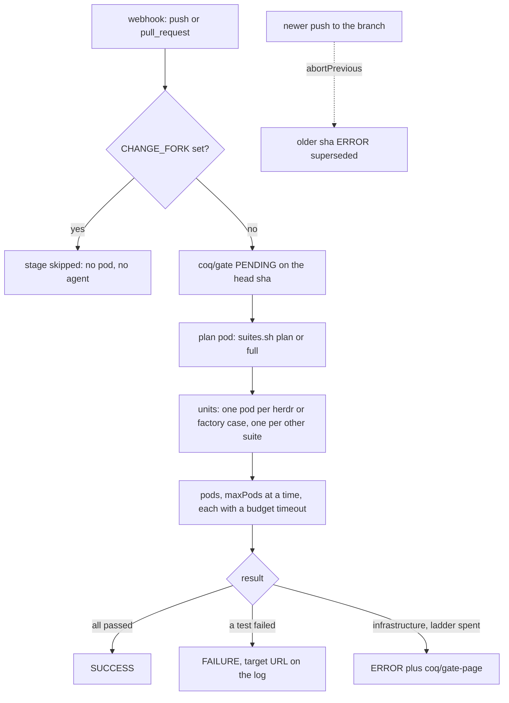

# CI gate: coqGate() and the coq/gate status

## Contents

- What this is
- Installed plugins
- Registering the library
- The multibranch job and its trust setting
- The webhook
- What coqGate() does
- Statuses
- The ladder
- Suites with no pod image
- The host-agent fallback rule
- Proving the human criteria
- Tests
- Where things are

## What this is

`coqGate()` is the shared-library step the `Jenkinsfile` calls.
It plans the suites a pull request needs from its diff, runs them as pod containers in the cluster, and posts a status named `coq/gate` on the head sha.
Everything is event driven: a GitHub webhook triggers the Jenkins job, and nothing polls or waits.
Design: `plans/2026/10/20261013194800-ci-gate-design.md` in the state root, ticket 2 and its 20:00Z, 20:04Z and 20:07Z amendments.
Ticket: `WO-20261013-ab25`.
The test image the pods run is `ci/image/README.md` (ticket 1).
The planner is `factory/bin/suites.sh`, and a case runs the way `bin/test-cases.sh` runs it, one container per case.

## Installed plugins

Read through the Jenkins tools on 2026-10-14 (`list_installed_plugins`), the ones this gate depends on:

| Plugin                      | Version                | Why                                                                                   |
| --------------------------- | ---------------------- | ------------------------------------------------------------------------------------- |
| `github-branch-source`      | 1967.vdea_d580c1a_b_a_ | multibranch pull request discovery, trust setting, `githubNotify` (the commit status) |
| `github`                    | 1.46.0                 | the `/github-webhook/` endpoint and `githubPush()`                                    |
| `workflow-multibranch`      | 821.vc3b_4ea_780798    | the multibranch job type                                                              |
| `pipeline-groovy-lib`       | 787.ve2fef0efdca_6     | global libraries                                                                      |
| `pipeline-github-lib`       | 65.v203688e7727e       | not used: the library is registered, not loaded by URL                                |
| `kubernetes`                | 4423.vb_59f230b_ce53   | `podTemplate` and `container`                                                         |
| `pipeline-model-definition` | 2.2277.v00573e73ddf1   | `disableConcurrentBuilds(abortPrevious: true)`                                        |
| `checks-api`                | 402.vca_263b_f200e3    | installed; not used, a commit status is enough (the ticket allows either)             |
| `configuration-as-code`     | 2053.vb_0da_47381a_25  | how the library is registered below                                                   |

There is no separate commit status publisher plugin.
`githubNotify` comes from `github-branch-source`, so that is the publisher.
Pinned versions of the plugins and of the library live in Jenkins and in `ci/config/images.json`, never as a literal in `coqGate.groovy`.
The job today (`coq-jev-herdr-plugin`) is a single-branch pipeline job with `DisableConcurrentBuilds` and a `PipelineTriggers` property.
It has to become a multibranch job to see pull requests, see below.

## Registering the library

`coqGate()` is loaded as the global library `coq-ci`, from `ci/jenkins-lib` in this repository, at a fixed ref.
A global library is trusted code, so the ref must not be a pull request branch: a library loaded from the branch under test lets any branch run Groovy on the controller.
Registered at `main`, a change to `coqGate.groovy` takes effect after it merges.

```yaml
unclassified:
  globalLibraries:
    libraries:
      - name: coq-ci
        defaultVersion: main
        implicit: false
        allowVersionOverride: false
        retriever:
          modernSCM:
            libraryPath: ci/jenkins-lib
            scm:
              github:
                repoOwner: jkkelley
                repository: coq-jev-herdr-plugin
                credentialsId: <the GitHub credential the multibranch job uses>
```

`allowVersionOverride: false` is the line that keeps `@Library('coq-ci@some-branch')` from working.
The `Jenkinsfile` begins with `@Library('coq-ci') _`.
Register the library before the `Jenkinsfile` of this ticket is built, or the build fails at compile time with "No library named coq-ci found".

## The multibranch job and its trust setting

1. Create a Multibranch Pipeline job named `coq-jev-herdr-plugin` (or a second one beside the single-branch job until the first green run), branch source GitHub, repository `jkkelley/coq-jev-herdr-plugin`, script path `Jenkinsfile`.
2. Behaviours: Discover branches (all), Discover pull requests from origin (the pull request head, not the merge), and no "Discover pull requests from forks".
3. If forks are ever discovered, the trust is "From users with Admin or Write permission".
   A fork pull request from anyone else is then not built at all, and the `Jenkinsfile` skips it anyway because `CHANGE_FORK` is set.
4. Build strategies and triggers: webhook only.
   No "Periodically if not otherwise run", no polling interval.
5. In the GitHub repository settings, "Require approval for all outside collaborators" stays on.

The runner has no page key and no AWS profile: the pod spec mounts no service account token, takes no environment from a secret or config map, and runs as user 1000.

## The webhook

GitHub posts events to Jenkins; Jenkins never asks GitHub.

| Field        | Value                                                        |
| ------------ | ------------------------------------------------------------ |
| Payload URL  | `https://<the Jenkins URL GitHub can reach>/github-webhook/` |
| Content type | `application/json`                                           |
| Events       | `push`, `pull_request`, and `status`                         |
| Secret       | set, and the same secret in the Jenkins GitHub server config |

State on 2026-10-14: `gh api repos/jkkelley/coq-jev-herdr-plugin/hooks` returns no webhook.
The Jenkins URL in the job description is `jenkins.homelab.local`.
Whether GitHub can reach that name is not verified here, and a webhook cannot be created until it can.
With `pollSCM` gone, no webhook means no build, so the webhook is a prerequisite of the first human criterion, not an afterthought.

## What coqGate() does



The head sha comes from the build's SCM revision.
For a pull request, `suites.sh plan` runs between the target branch and that sha.
For a push to main it runs `suites.sh full`.
The plan pod fetches the commit by sha from the public repository and holds no credential.
`herdr` and `factory` fan out to one pod per case, the same isolation `bin/test-cases.sh` gave on the host, because a case audits `/proc` and kills processes.
Every other planned command is one pod.
The timeout of a pod is its suite's entry in `budgetMinutes` (a first guess until `WO-20261013-74b6` measures them), and the pod's own deadline is longer, so the timeout always fires first.
At most `maxPods` (4, the herdr cap of `config/tests.json`) run at once.

## Statuses

| Context         | State                                           | Meaning                                        | Who acts                    |
| --------------- | ----------------------------------------------- | ---------------------------------------------- | --------------------------- |
| `coq/gate`      | PENDING                                         | planning, or running N pods                    | nobody                      |
| `coq/gate`      | SUCCESS                                         | every planned pod passed                       | merger                      |
| `coq/gate`      | FAILURE                                         | a test failed; the target URL is the build log | orchestrator seats a worker |
| `coq/gate`      | ERROR, "superseded by a newer build"            | a newer push aborted this build                | nobody                      |
| `coq/gate`      | ERROR, "infrastructure failed after the ladder" | rung 5                                         | orchestrator, with the page |
| `coq/gate-page` | ERROR                                           | the page of rung 5, same sha, same log link    | orchestrator                |

The page is a second commit status because the cluster cannot reach the line: the line receives GitHub status events by webhook (design amendment 20:20Z, ticket 6), so a status is the one channel that needs no new ingress and no new secret.
Ticket 6 owns the listener; it has to key on the `coq/gate-page` context.

## The ladder

Only infrastructure climbs it: a pod that does not schedule, an image that cannot be pulled, a checkout that fails, an agent that dies.
A failing test is a result and is never retried, and a test that outlives its budget is a failing test.

| Rung   | What happens                                                                                  |
| ------ | --------------------------------------------------------------------------------------------- |
| 1 to 3 | retry on a fresh pod after 10, 30 and 90 seconds                                              |
| 4      | one clean re-run on a fresh pod after a five minute cool-down                                 |
| 5      | `coq/gate` ERROR with the log link, and `coq/gate-page` ERROR; the build fails; nothing loops |

The numbers are the defaults of `settings()` in `coqGate.groovy` and can be set from the `Jenkinsfile`.

## Suites with no pod image

`scheduler` needs a Go toolchain and `bearings` needs playwright; neither is in `ghcr.io/jkkelley/coq-test` (see `ci/image/README.md`).
`hostOnly` in the `Jenkinsfile` names them.
They are planned, never run by this gate, and every status description lists them as "not run".
This fails open on purpose: failing closed would leave a full run on main red for good.
Closing it takes an image for each, or the host-agent fallback below; either is a ticket of its own.

## The host-agent fallback rule

A Jenkins inbound agent on this host, label `coq`, is a fallback only, for a suite proven not to run in a pod.
There is none today.
A suite goes there only with evidence that it cannot run in a pod (the test fails there and passes on the host, with the log), never to save time.
`ci/image/README.md` records the one known pod-only failure, `herdr/tests/cases/11-guard-ack-nudge` on arm64 nodes, which has its own ticket.

## Proving the human criteria

- Webhook trigger (AC-H1): push a branch, watch `gh api repos/jkkelley/coq-jev-herdr-plugin/commits/<sha>/statuses` show `coq/gate` pending and then final, with the job's trigger log naming the webhook and no polling entry.
- Superseded (AC-H2): push twice quickly; the first sha ends ERROR "superseded by a newer build".
- Fork (AC-H3): a pull request from a fork produces no build and no pod (`kubectl -n jenkins get pods -l app.kubernetes.io/part-of=coq-ci` stays empty).
- Ladder (AC-H4): on a branch, change the `image` in the `Jenkinsfile` to a tag that does not exist.
  The build shows the retries at 10, 30 and 90 seconds, the clean re-run after five minutes, then `coq/gate` ERROR and `coq/gate-page` ERROR.
  Break one assertion in a case instead and the gate goes FAILURE with no retry.

## Tests

```sh
bash ci/tests/cases/02-gate-pipeline.test.sh
CI_GROOVY=1 bash ci/tests/cases/02-gate-pipeline.test.sh   # also parses coqGate.groovy in a groovy container
```

The default run is static and runs the plan script against a scratch repository.
It cannot run Jenkins; the live behaviour is the four human criteria above.

## Where things are

| What                         | Where                                     |
| ---------------------------- | ----------------------------------------- |
| The step                     | `ci/jenkins-lib/vars/coqGate.groovy`      |
| The caller                   | `Jenkinsfile`                             |
| The image and its pins       | `ci/config/images.json`, `ci/image/`      |
| The manual one-shot pod spec | `ci/pod/herdr-suite.pod.yaml`             |
| The static test              | `ci/tests/cases/02-gate-pipeline.test.sh` |
