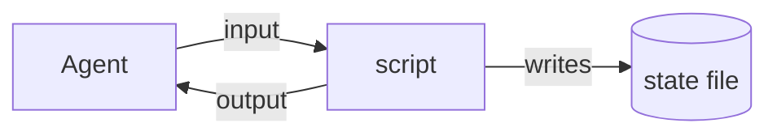
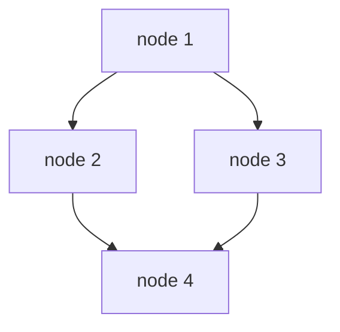
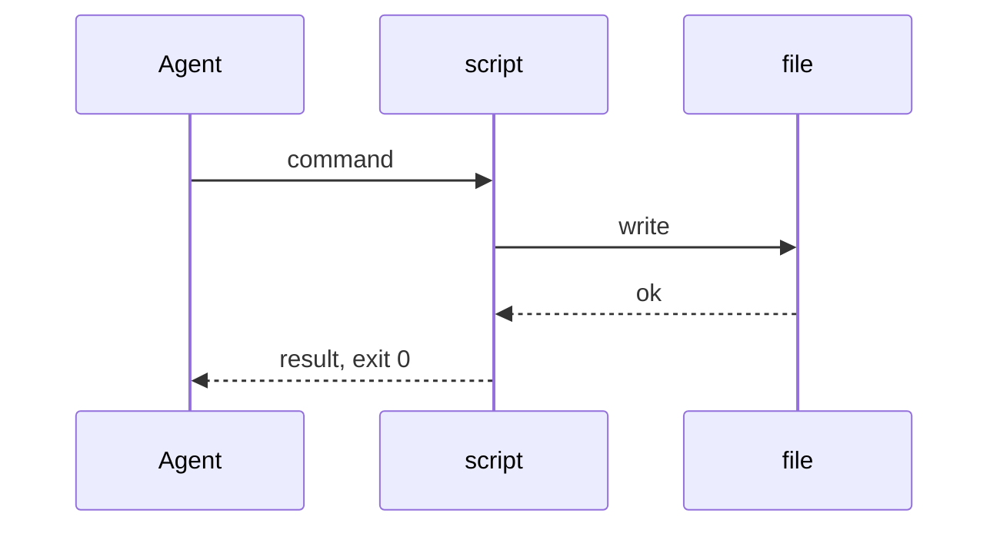

# Design: <title of the design>

> The owner reads this file instead of the XML volumes.
> XML specs and JSON schemas stay as they are, because agents read them.
> Copy this file, keep all 15 headings in this order, and replace every line in italics with real content.
> Real paths, real numbers, real commands. No placeholder text may survive into a finished design.
> Point into the XML volumes by anchor for depth, never copy them here.
> Each of the 15 sections below says in one line what goes there.

## Contents

1. [Contents](#contents)
2. [Status](#status)
3. [Goal](#goal)
4. [What is reused](#what-is-reused)
5. [Architecture](#architecture)
6. [DAG](#dag)
7. [Workflows and flows](#workflows-and-flows)
8. [File format](#file-format)
9. [Commands](#commands)
10. [Inputs and outputs](#inputs-and-outputs)
11. [Status and exit codes](#status-and-exit-codes)
12. [Tool choices](#tool-choices)
13. [Standing rules after build](#standing-rules-after-build)
14. [Files created](#files-created)
15. [Decisions for the owner](#decisions-for-the-owner)

This section is a numbered list with a link to every section, itself included.

## Status

*Draft or approved, what is built so far, and what waits for the owner.*

## Goal

*The problem in numbers first (sizes, counts, times), then the outcome as a bullet list.*

## What is reused

*Working code is copied, not reinvented. One row per source, with a link, and what is copied from it. Then one line starting "Not copied:" for what was left behind.*

| source | what is copied |
| ------ | -------------- |
| *name and link* | *what is taken* |

## Architecture

*Every component and the data that moves between them, as one mermaid flowchart, with the edge labels naming the data.*

## DAG

*The build order as a mermaid flowchart of nodes. Under it, one line per node: the input that starts it and the output that ends it. An agent on a node exists only between the two.*

| node | input that starts it | output that ends it |
| ---- | -------------------- | ------------------- |
| *id and title* | *what must exist* | *what it leaves behind* |

## Workflows and flows

*One mermaid sequence diagram per main flow, showing every actor and every message, including the failure path and the retry.*

## File format

*Paths and one example of each file's contents, in a code block, so the owner can see the exact shape on disk.*

## Commands

*Every command with its flags, what it does, and the dry-run and apply rule: anything that writes is a dry-run unless the apply flag is given.*

| command | does |
| ------- | ---- |
| *command and flags* | *effect* |

## Inputs and outputs

*Every item that goes in or comes out, which direction, and its shape (file, JSON, stdout, event code).*

| item | direction | shape |
| ---- | --------- | ----- |
| *name* | *in or out* | *format and schema path* |

## Status and exit codes

*Every status code and exit code, what it means, and who acts on it. Every code is in this table.*

| code | meaning | who acts |
| ---- | ------- | -------- |
| *code* | *what happened* | *the one role that responds* |

## Tool choices

*One row per job: the tool chosen and why it is the right one, so a later reader does not swap it.*

| job | tool | why |
| --- | ---- | --- |
| *what needs doing* | *tool and version* | *reason* |

## Standing rules after build

*What every agent must always do once this ships, as a short bullet list, and where each rule is recorded (the AGENTS.md section it is added to, after the design is approved and tests pass).*

## Files created

*Every file the build adds, one row each, with its purpose. Then one line saying where state lives outside git and the cleanup command that removes it.*

| path | purpose |
| ---- | ------- |
| *repo-relative path* | *what it is for* |

## Decisions for the owner

*Each open decision, in one or two lines with the options and the recommendation. Each one also goes on the Getting My Bearings page as a card, one at a time.*
