# Factory rebuild design

The rebuilt factory, in one document, for the owner's read.
The XML volumes beside this file stay the agents' source; every section here points into them by anchor for depth.
Written 2026-10-14 (UTC) by the R-03 spec-author seat from the spec book on branch `rebuild/design` (PR 189).

## 1. Contents

1. [Contents](#1-contents)
2. [Status](#2-status)
3. [Goal](#3-goal)
4. [What is reused](#4-what-is-reused)
5. [Architecture](#5-architecture)
6. [DAG](#6-dag)
7. [Workflows and flows](#7-workflows-and-flows)
8. [File format and data shapes](#8-file-format-and-data-shapes)
9. [Commands](#9-commands)
10. [Inputs and outputs](#10-inputs-and-outputs)
11. [Status and exit codes](#11-status-and-exit-codes)
12. [Tool choices](#12-tool-choices)
13. [Standing rules after build](#13-standing-rules-after-build)
14. [Files created](#14-files-created)
15. [Decisions for the owner](#15-decisions-for-the-owner)

## 2. Status

DRAFT for the owner's read.
Nothing in this design is built yet: every one of the 52 nodes ships dark and goes live by its own ticket with a named proof.
No build ticket is cut from this book until the owner closes R-03 and then gives GOFACTORY.

What exists today on main (`4f7f44c`, 2026-10-14):

- The old line: `line/bin/` (`merge.sh`, `verify-main.sh`, `route-retry.sh`), `factory/bin/` (`route.sh`, `suites.sh`, `claims.sh`), herdr seats (`herdr/bin/seat.sh`), the event files under `events/`.
- The bearings page as a Node server (`tools/bearings/scripts/server.mjs`, `wait.mjs`, `front-door.mjs`), with this week's fixes merged: the live strip (PR 184, PR 185), the Tailscale front door (PR 186, PR 187), the Krastorio skin (PR 188), and stable never idling (PR 190).
- The Go scheduler skeleton: `scheduler/api/scheduler/v1/scheduler.proto`, the core interfaces, the fake clock and a CLI (the 1,468-line skeleton named on card C41).
- The CI library `ci/jenkins-lib/vars/coqGate.groovy` and `ci/config/images.json`, which have never posted a verdict to GitHub.
- The rebuild plan (`rebuild/factory-rebuild-plan.xml`, PR 182) and the investigation (`rebuild/investigation/`, PR 183).

What this branch adds (PR 189, branch `rebuild/design`):

- 52 DAG nodes (N-01 to N-52) in seven groups, written as 62 XML volumes (52 node volumes, 9 shared volumes, the index) and 55 JSON schemas.
- `check.sh` with 22 checks (C01 to C22), proven to fire by `bin/test-checks.py` (23 cases, 0 missed); it exits 0 today.
- The no-cog review: 52 of 52 nodes pass (no cog, many agents at once, pointers resolve, 1000-line cap), proof at `~/.local/state/coq/coq-jev-herdr-plugin/rebuild/2026/10/proofs/R-03-no-cog-review.md`.
- This file, the owner's read of the whole design.

What waits for the owner, in order:

1. Read this file and close R-03 (decision 1 in [section 15](#15-decisions-for-the-owner)).
2. Give GOFACTORY (decision 2), which starts the unlanded cleanup as a dry run first and lets build tickets be cut.
3. Later, after the line is proven up to cut-over step 6, give USERGO to clear the hold.

The line is held today: the owner's USERHALT stands, product work is frozen (D19), and the stable bearings page is the one monitor that never stops.

## 3. Goal

Replace the herdr-driven line, where an LLM seat is the trigger for every mechanical step, with a Go service that drives the line by records, so that a ticket moves from cut to merged with no agent and no human typing anything in between.

The problem, measured by the R-01 investigation ([01-ROOT-CAUSES](../investigation/01-ROOT-CAUSES.md#3-root-causes)):

| Fact | Number | Root cause |
| --- | --- | --- |
| `merged 200` records posted by hand by the acting orchestrator LLM | 43 of 92 (merge.sh 44, merger seat 5) | RC1 |
| `verified 201` records posted by one LLM seat, a median 28 minutes after the merge, though `verify-main.sh` exists | 66 of 66 | RC1 |
| `route failed` notes, 2026-10-13T15:29Z to 2026-10-14T02:22Z | 391 (212 of them addressing errors a broker would only store) | RC2 |
| Records that wanted an action and got it | 74 of 880 (8 percent) | RC2 |
| Untracked record copies in the owner checkout | 5,812 | RC3 |
| Seat refusals per day from ticket status living in a git front-matter field | 132 | RC3 |
| Lettered "Cause" tickets cut in one stretch | 51 in 12.6 hours (37 of 101 commits mention a cause) | RC5 |
| Commits of the last 60 that touch the product | 0 (28 change only `work-orders/` and `changelog/`) | RC5 |
| herdr 0.9.0 segfault at 2026-10-13T03:32:18Z, line dark until the owner noticed | about 9.5 hours | RC6 |
| CI builds aborted in a row by a 15-minute timeout, with no status ever posted to GitHub | 54 (builds 39 to 92, about 31 hours) | RC7 |
| Ticket approvals that were overrides | 238 of 238 | RC8 |
| Readers and producers of the owner's page | one each, both agents | RC9 |

The outcome:

- A Go service with gRPC owns scheduling, leases, heartbeats and state; code does every mechanical job (dispatch, merge, verify, retry, stall, cleanup, cards).
- One SQLite store on the host holds every record; nothing runtime lives in the repository; every state path has a cleanup command.
- Seats are one-shot `claude -p` runs that start from a record and end in a machine-readable result; a seat is never typed to, nudged or kept idle.
- The gate verdict is the GitHub required status `coq/gate`, posted by pods on the cluster, readable by an agent and never editable by one.
- The machine merges on a green gate plus a reviewer record and verifies main after every merge; a red main holds every merge but its fix.
- The owner reads and decides on one surface, the bearings page, as cards with receipts; his messages are routed by rule with four acknowledgements.
- The command center map (Factorio and Krastorio 2 look, phone first) replaces `/board` on every tier and is public at `map.gatehouse.click`.
- Every wait has a timeout and a fallback, every automated step retries three times then reports, and the line proves itself with a daily exit test.

## 4. What is reused

Working code and working infrastructure are copied, not reinvented.

| Source | What is copied |
| --- | --- |
| [`scheduler/api/scheduler/v1/scheduler.proto`](../../scheduler/api/scheduler/v1/scheduler.proto) | Kept whole: `Put`, `Get`, `List`, `Subscribe`, `Lease`, `Heartbeat`, `Executor.Run`; the store API and the executor verb table extend it (D09, [N-01](nodes/N-01/spec.xml#mechanism)). |
| [`scheduler/internal/core/`](../../scheduler/internal/core/) and [`scheduler/internal/testkit/`](../../scheduler/internal/testkit/) | The `Clock`, `JobStore`, `Ledger` and `Executor` interfaces and the fake clock every node's tests run on (the D09 small cut, [N-07](nodes/N-07/spec.xml#mechanism)). |
| [`line/bin/merge.sh`](../../line/bin/merge.sh) | Ported to Go as N-09 with the same choices: squash with the head sha guard, already-merged is success, hold read twice, never match refusal text ([N-09](nodes/N-09/spec.xml#mechanism)). |
| [`line/bin/verify-main.sh`](../../line/bin/verify-main.sh) | Its verdict and hold logic, ported as N-10, with the hold file turned into a `merge.hold` record and the suites moved to pods ([N-10](nodes/N-10/spec.xml#mechanism)). |
| [`ci/jenkins-lib/vars/coqGate.groovy`](../../ci/jenkins-lib/vars/coqGate.groovy) | The `runUnit` and `runPod` infrastructure ladder (lines 134 to 188); the plan script and status posts move into the Go service ([N-24](nodes/N-24/spec.xml#mechanism)). |
| [`ci/config/images.json`](../../ci/config/images.json) | The one image config, extended with digests, platforms and suites ([N-22](nodes/N-22/spec.xml#mechanism)). |
| [`factory/bin/suites.sh`](../../factory/bin/suites.sh) and [`factory/config/suites.json`](../../factory/config/suites.json) | The diff to suite map, read from main, never from the head ([N-23](nodes/N-23/spec.xml#mechanism)). |
| [`factory/bin/claims.sh`](../../factory/bin/claims.sh) | The file overlap rule, kept verbatim, for readiness, workspace claims and the validator ([N-03](nodes/N-03/spec.xml#mechanism)). |
| [`events/schema/event.schema.json`](../../events/schema/event.schema.json) | The record id form `YYYYMMDDTHHMMSSZ-CODE-xxxxx` and the HTTP-shaped code enum ([state store envelope](shared/state-store.xml#envelope)). |
| [`tools/bearings/`](../../tools/bearings/) | `page.html` and `theme.css` (the owner's), the key and cookie model, `bearings.json` and its schema, the Playwright suite, the front door of PR 187, the ask, wait and reply contract of `AGENTS.md` ([N-32](nodes/N-32/spec.xml#mechanism), [N-34](nodes/N-34/spec.xml#mechanism)). |
| `herdr/config/leases.json` | The seat lease ttl of 900 s ([N-02](nodes/N-02/spec.xml#mechanism)). |
| [jenkins-shared-lib](https://github.com/jkkelley/jenkins-shared-lib) | `buildKaniko`, `updateGitOpsManifest` and `agentPodYaml`, as the yieldpoint-ai pipeline uses them ([N-22](nodes/N-22/spec.xml#mechanism), [N-35](nodes/N-35/spec.xml#mechanism)). |
| [homelab-gitops](https://github.com/jkkelley/homelab-gitops) | The JCasC seed `apps/jenkins/jenkins.yaml`, the ESO secret `jenkins-eso/externalsecret-ghcr.yaml`, the Application shape of `resume-star.yaml`, the ntfy deployment on branch `feat/ntfy-alerts` ([N-20](nodes/N-20/spec.xml#mechanism), [N-21](nodes/N-21/spec.xml#mechanism), [N-52](nodes/N-52/spec.xml#provider)). |
| Argo CD app-of-apps, HAProxy ingress, WireGuard to k8s-worker-01, Lightsail VPS 44.194.240.148 (Nginx, Let's Encrypt), Route 53 zone `gatehouse.click` | The public path for the map, exactly as yieldpoint-ai runs today: one more name on the existing Nginx server block (owner note 5, [N-35](nodes/N-35/spec.xml#mechanism)). |
| `ghcr.io/jkkelley` | The image registry for every image, pinned by digest. |
| Tailscale user-space front door (PR 186, PR 187) | Ported to Go as the unit `coq-front-door@<page>`, same behaviour ([N-34](nodes/N-34/spec.xml#mechanism)). |
| [Krastorio2Assets v2.0.5](https://codeberg.org/raiguard/Krastorio2Assets) and the vanilla GUI palette | Palette values only, as CSS custom properties (`--k2-frame #313031`, `--k2-accent #FAA838`, `--k2-green #2BE327`, `--k2-red #DA4535` and the rest), and the 260 high-confidence Krastor original sprites with attribution ([principles](shared/principles.xml#krastorio-look), [N-36](nodes/N-36/spec.xml#mechanism)). |
| Titillium Web (SIL Open Font License 1.1) | The Factorio GUI face, allowed on a public page. |
| The Execution Rail status codes (`rebuild/factory-rebuild-plan.xml#status-codes`) | Carried unchanged, so the rail becomes a panel of the page without translation ([N-33](nodes/N-33/spec.xml#mechanism)). |
| SPEC-16.F and SPEC-16.G (branch `feat/go-scheduler-design-one-xml-spec-per-domain-unde`) | The belt heartbeat and stall latch (N-12), the config schema (state store config keys), hypotheses H01 to H26 and bounds B1 to B10 as test names. |
| `tools/bearings/standards/STD-owner-comms-001.json` | The card and bubble wording rules the card checker and the comms checker enforce ([seat contract](shared/seat-contract.xml#standing-policies)). |

Not copied, with the reason ([rejected with reason](shared/rejected-with-reason.xml#rejected)):

- The fourteen SPEC-16 build tickets: cancelled at GOFACTORY by N-50, because the small Go cut on the same proto replaces them (D09, card C41).
- PR 35 and its v2.0 export, SPEC-17 1.0.1 and its 1.1.0 draft: sources, never authority (D14, card C42); PR 35 is closed by N-50.
- Wube-derived and BiusArt sprites (inventory classes 2 to 4: 443, 8 and 131 files): never ship; belts, inserters, lamps and pipes are original art.
- A broker (NATS): one store, no broker; 212 of the 391 route failures were addressing errors a broker would only store (D10, card C34).
- `route.sh` and its routes table, the tester, merger and verifier seats, and the idle alarm with its patrol watches: code does the mechanical jobs and a stall timer replaces the alarm (D11, D17).
- The webhook listener (`line/bin/hook-listener.sh`, PR 177): GitHub cannot reach 192.168.1.245; the poll is the correctness path (D06).
- herdr as scheduler, router or store: herdr is the owner's window only (D08).
- The page polling loop as transport and the Execution Rail as a second page: push for everything, one surface (D20, D21).
- Drive as the source of truth: the repository is the truth, Drive gets copies (D24).
- `bin/work-order.sh` cleanup and approve clauses, the dead hooks `no-hand-start.mjs` and `shell-lex.mjs`, the GitHub Actions Runner Controller CRDs, the r-prefixed record id form.
- The `aws-lightsail-k8s-router` design: the existing Nginx server block gets one more name instead (owner note 5).
- Forgejo now: GitHub now, Forgejo later behind the one forge interface of N-04 (D18).

## 5. Architecture

One Go binary (`coq-service`) runs on the WSL host as a systemd user unit and owns every decision; seats run on the host as one-shot processes; tests, lint and image builds run as pods on the owner's cluster; the owner sees everything through the bearings page.

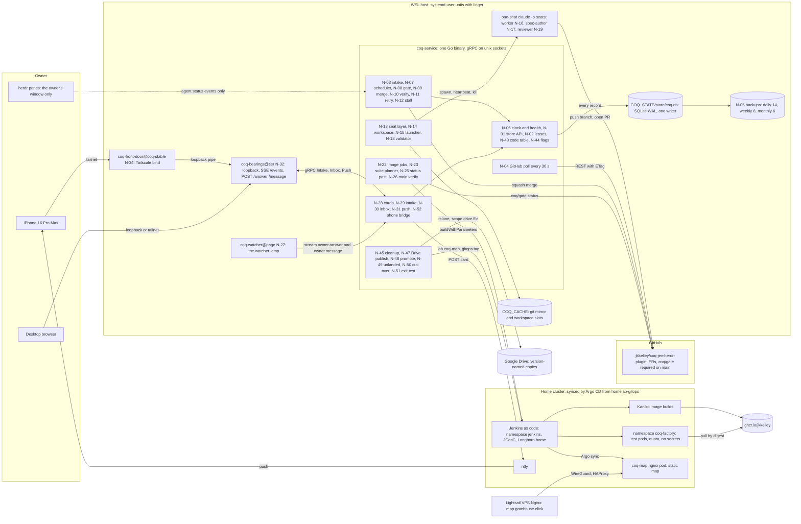

How to read it:

- Every arrow into `coq-service` lands as a record in the store; every arrow out of it is a step a node takes on a record, never a prompt.
- The page service, the watcher and the front door are separate units with separate lifetimes, so a page upgrade never stops the owner's intake ([N-27](nodes/N-27/spec.xml#mechanism)).
- The cluster never reaches the host: pods have egress to GitHub and GHCR only, so the public map is static and live state reaches the phone over the tailnet ([N-38](nodes/N-38/spec.xml#mechanism)).
- herdr sends exactly one thing to the line: the agent status event N-12 uses to see a long-lived seat parked on a prompt.

Depth: [state store](shared/state-store.xml#purpose), [seat contract](shared/seat-contract.xml#run), [command center](shared/command-center.xml#hosting), [N-06 unit](nodes/N-06/spec.xml#mechanism).

## 6. DAG

Every node turns one input record into one output record; a seat or a process on a node exists only between the two.
An edge means the output record of the source is the input record of the target.
The store (N-01) carries every record and the push transport (N-31) carries every page-bound record; their return edges are not drawn, because they would make every node a cycle through the store.
Time loops (a retry, a phase change, an owner answer) are re-entries into the sink `RE` with a counter that only grows, so the graph stays acyclic: 52 nodes, 97 drawn edges, 10 re-entries, checked by Kahn's algorithm in [`bin/dag-check.py`](bin/dag-check.py) (check C16).

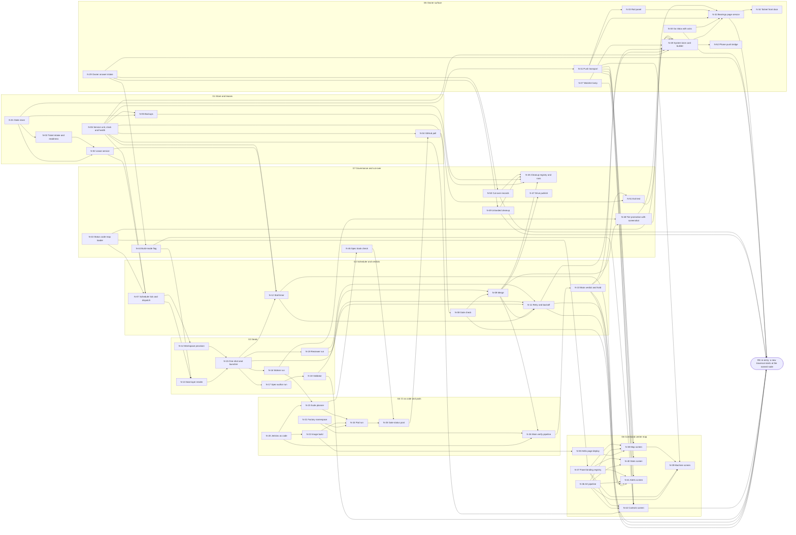

### 6.1 Every node with its input and output

The wave column is the build order of [section 6.3](#63-build-order-as-numbered-waves); the volume column links the node's spec.

| Id | Name | Group | Input record | Output record | Wave | Volume |
| --- | --- | --- | --- | --- | --- | --- |
| N-01 | State store | G1 | record.put request over gRPC (any node, idempotency key, expected version) | record.committed (seq, hash, version) or 409 conflict | 1 | [spec](nodes/N-01/spec.xml#N-01) |
| N-02 | Lease service | G1 | ticket.ready record (claimable node and attempt) | lease record (holder, fencing token, expiry, generation) or lease.refused | 1 | [spec](nodes/N-02/spec.xml#N-02) |
| N-03 | Ticket intake and readiness | G1 | ticket record (validated, files declared, deps named; re-entry from N-18 or an owner cut) or a ticket.request admitted as a spec-phase cut request | ticket.ready record (deps done, no file claimed by another in-flight ticket) or ticket.waiting | 7 | [spec](nodes/N-03/spec.xml#N-03) |
| N-04 | GitHub poll | G1 | tick record (every tick from N-06, plus coq/gate statuses posted by N-25) | forge.snapshot record (open PRs, head shas, coq/gate status, mergeability, main sha) | 4 | [spec](nodes/N-04/spec.xml#N-04) |
| N-05 | Backups | G1 | backup.tick record (schedule from N-06) over the live store | backup record (snapshot path, checksum, retention class) or backup.failed after 3 attempts | 1 | [spec](nodes/N-05/spec.xml#N-05) |
| N-06 | Service unit, clock and health | G1 | unit.start (systemd user unit of the Go service) | tick record (scheduler, poll, backup, stall and daily ticks) and health record (gRPC Health, counters) | 1 | [spec](nodes/N-06/spec.xml#N-06) |
| N-07 | Scheduler tick and dispatch | G2 | lease record plus tick record (level-triggered: compare open work with live runs before any dispatch) | dispatch record (ticket, role, attempt n, deadline, lease token, brief path) | 7 | [spec](nodes/N-07/spec.xml#N-07) |
| N-08 | Gate check | G2 | forge.snapshot record for a PR head sha | gate.verdict record (green, red or pending for the head sha, from the coq/gate status the agent can read but not edit) | 4 | [spec](nodes/N-08/spec.xml#N-08) |
| N-09 | Merge | G2 | gate.verdict green plus review.passed on the same head sha | merge record (merge sha, PR number) or merge.conflict 409 | 7 | [spec](nodes/N-09/spec.xml#N-09) |
| N-10 | Main verdict and hold | G2 | main.gate.status record (coq/gate on the main sha after a merge) | verified 201 record, or rejected 422 plus merge.hold record (no merge until a green main) | 5 | [spec](nodes/N-10/spec.xml#N-10) |
| N-11 | Retry and backoff | G2 | failure record (seat.result blocked or failed, review.changes, merge.conflict, stall, validator refusal) | attempt record n+1 with backoff min(10 s x 2^(n-1), 5 min), or dead record after 3 attempts with one escalation | 7 | [spec](nodes/N-11/spec.xml#N-11) |
| N-12 | Stall timer | G2 | lease record plus heartbeat records plus stall tick | stall record (run killed, lease revoked, reason) when no heartbeat within the stall bound | 7 | [spec](nodes/N-12/spec.xml#N-12) |
| N-13 | Seat layer render | G3 | dispatch record (role, repo, build-mode state) | seat.bundle record (settings.json from the role, deny list from declared files, brief, hash) | 6 | [spec](nodes/N-13/spec.xml#N-13) |
| N-14 | Workspace provision | G3 | dispatch record | workspace record (worktree path, branch from origin/main, slot, file claims checked and recorded) or workspace.refused | 6 | [spec](nodes/N-14/spec.xml#N-14) |
| N-15 | One-shot seat launcher | G3 | seat.bundle plus workspace record | seat.result record always (outcome, cost, turns, terminal reason, session id; a dead run yields blocked) and heartbeat records while it runs | 6 | [spec](nodes/N-15/spec.xml#N-15) |
| N-16 | Worker run | G3 | worker brief inside a seat run (ticket, workspace) | pr.opened record (branch pushed, PR number, head sha) or seat.result blocked | 6 | [spec](nodes/N-16/spec.xml#N-16) |
| N-17 | Spec-author run | G3 | spec-author brief inside a seat run (design anchor, group, verdict from a failed attempt when retried) | ticket-set.draft record (tickets as data: files, acceptance commands, input and output declared) | 6 | [spec](nodes/N-17/spec.xml#N-17) |
| N-18 | Validator | G3 | ticket-set.draft record | ticket records accepted (acceptance commands run on main with observed exit codes) or validator.refused with the failing command | 6 | [spec](nodes/N-18/spec.xml#N-18) |
| N-19 | Reviewer run | G3 | reviewer brief inside a seat run (PR, gate green, diff) | review.passed 201 or review.changes 422 record on the head sha | 6 | [spec](nodes/N-19/spec.xml#N-19) |
| N-20 | Jenkins as code | G4 | jenkins config record (JCasC, job by config, pinned image, resources, Longhorn home; a commit in gitops) | job.registered record (config hash, image digest, resource limits, home volume) | 4 | [spec](nodes/N-20/spec.xml#N-20) |
| N-21 | Factory namespace | G4 | namespace manifest record (ResourceQuota, LimitRange, PriorityClass, service account with no secret access, egress to GitHub and GHCR; a commit in gitops) | namespace.ready record (Argo synced, quota and policy present) | 4 | [spec](nodes/N-21/spec.xml#N-21) |
| N-22 | Image build | G4 | image config record (images.json or Containerfile change, digest pins) | image record (ghcr digest, pinned in config, checksum-verified binaries) | 4 | [spec](nodes/N-22/spec.xml#N-22) |
| N-23 | Suite planner | G4 | pr.opened record (head sha, diff) | suite.plan record (suites from the diff; an unmapped path plans the full set) | 4 | [spec](nodes/N-23/spec.xml#N-23) |
| N-24 | Pod run | G4 | suite.plan entry (one case) | pod.run record (exit code, log path, infrastructure retries by the ladder; an assertion failure never retried) | 4 | [spec](nodes/N-24/spec.xml#N-24) |
| N-25 | Gate status post | G4 | pod.run records for one head sha | commit status coq/gate on the head sha (success, failure, error superseded) plus the gate page link | 4 | [spec](nodes/N-25/spec.xml#N-25) |
| N-26 | Main verify pipeline | G4 | merge record (main push sha) | main.gate.status record (coq/gate on the main sha, full suite set) | 5 | [spec](nodes/N-26/spec.xml#N-26) |
| N-27 | Watcher lamp | G5 | tier unit start (the wait loop of a bearings tier as its own supervised unit) | watcher.alive record (lock with heartbeat per tier); a card cannot post without it | 3 | [spec](nodes/N-27/spec.xml#N-27) |
| N-28 | System lane card builder | G5 | record whose status code maps to owner-acts (dead, rejected main, exit test, unhealthy) plus watcher.alive | card record (one decision: about, decide, options with what happens, recommendation) posted to the tier | 3 | [spec](nodes/N-28/spec.xml#N-28) |
| N-29 | Owner answer intake | G5 | answer record (the owner's pick and words on the page, re-entry from N-32, or relayed from chat and recorded) | ruling record in the store (card id, pick, words, at) that gates and cut-over nodes read | 2 | [spec](nodes/N-29/spec.xml#N-29) |
| N-30 | Go inbox with acks | G5 | message record (the owner's message on the page, re-entry from N-32) | routed.message record (lane and consumer by rule) and ack record delivered back to the page | 3 | [spec](nodes/N-30/spec.xml#N-30) |
| N-31 | Push transport | G5 | record.committed seq from the store | pushed.frame record per client (delivered seq; full state re-read on reconnect) | 3 | [spec](nodes/N-31/spec.xml#N-31) |
| N-32 | Bearings page service | G5 | pushed.frame record (cards, messages, acks, panels, staleness) | page.state record (rendered page, staleness shown); the owner's answers and messages leave as new traversals at N-29 and N-30 | 3 | [spec](nodes/N-32/spec.xml#N-32) |
| N-33 | Rail panel | G5 | plan ledger row (pushed) | rail.panel frame (plan steps, ledger, status codes) inside the page | 3 | [spec](nodes/N-33/spec.xml#N-33) |
| N-34 | Tailnet front door | G5 | page.up record (tier server listening on loopback) | front-door record (tailnet bind, port, pid; retried 3 times then exit 4) | 3 | [spec](nodes/N-34/spec.xml#N-34) |
| N-35 | Hello page deploy | G6 | map app commit (Jenkinsfile with jenkins-shared-lib, image on ghcr.io/jkkelley, app entry in homelab-gitops) | deploy record (image digest, Argo synced, HAProxy route, Lightsail name map.gatehouse.click answering 200) | 8 | [spec](nodes/N-35/spec.xml#N-35) |
| N-36 | Art pipeline | G6 | art inventory record (Krastor class 1 files, original art for belts, inserters, lamps and pipes) | sprite.sheet record (atlas, attribution text, license text; no Wube-derived or BiusArt file) | 8 | [spec](nodes/N-36/spec.xml#N-36) |
| N-37 | Panel binding registry | G6 | screen spec volume (every panel of the five screens) | binding record (panel to store record kind) and binding.check result; an unbound panel fails the build | 8 | [spec](nodes/N-37/spec.xml#N-37) |
| N-38 | Map screen | G6 | pushed.frame record (DAG nodes with status and heartbeat, queues with depth, seats in flight, HOLD or GOFACTORY lamp) | map.frame (machines, belts, inserters, lamps at the frame budget) and selection record | 8 | [spec](nodes/N-38/spec.xml#N-38) |
| N-39 | Machine screen | G6 | selection record plus the node's state frame | machine.panel frame (one node: input, output, attempt, lease, last records) | 8 | [spec](nodes/N-39/spec.xml#N-39) |
| N-40 | Stats screen | G6 | counters frame (records, jobs, wakes, seats, pods, cost) | stats.frame (production statistics panel) | 8 | [spec](nodes/N-40/spec.xml#N-40) |
| N-41 | Alerts screen | G6 | alert records (stall, dead, rejected main, unhealthy) | alerts.frame and alert.ack record | 8 | [spec](nodes/N-41/spec.xml#N-41) |
| N-42 | Controls screen | G6 | controls frame (hold flag, build-mode state, watcher lamp, health) | control.action record (owner-initiated: hold, resume, build-mode, one-time break glass) as a new traversal at N-29 | 8 | [spec](nodes/N-42/spec.xml#N-42) |
| N-43 | Status code map loader | G7 | shared/status-codes.xml commit | code.table record (version hash loaded by Reload; every code names who acts) | 1 | [spec](nodes/N-43/spec.xml#N-43) |
| N-44 | Build-mode flag | G7 | ruling record that sets the flag (with expiry) | build-mode.state record (on or off, expiry; cleared by the system at expiry) | 2 | [spec](nodes/N-44/spec.xml#N-44) |
| N-45 | Cleanup registry and runs | G7 | trigger record (merge record for branch and worktree release, backup record for retention, timer for state paths named in runbook volumes) | cleanup.run record (dry-run listing, then deletions, 3 attempts then reported) | 1 | [spec](nodes/N-45/spec.xml#N-45) |
| N-46 | Spec book check | G7 | spec volume commit in a suite plan (rebuild/design paths) | check.verdict record (XSD, every pointer resolves, 1000-line cap, contents element, parent pointer, many agents section) | 4 | [spec](nodes/N-46/spec.xml#N-46) |
| N-47 | Drive publish | G7 | merge record touching rebuild/design | drive.copy record (version-named file ids, immutable) | 8 | [spec](nodes/N-47/spec.xml#N-47) |
| N-48 | Tier promotion with screenshot | G7 | pr.opened or merge record touching tools/bearings or the map app | promotion record (dev then uat then stable swapped in place without stopping the waits) with the screenshot record attached | 8 | [spec](nodes/N-48/spec.xml#N-48) |
| N-49 | Unlanded cleanup | G7 | GOFACTORY ruling record | disposition records, one per 04-UNLANDED entry (land, supersede, close), dry-run listing first | 2 | [spec](nodes/N-49/spec.xml#N-49) |
| N-50 | Cut-over records | G7 | GOFACTORY ruling plus the D09 and D14 rulings | cancel records for the fourteen SPEC-16 tickets, PR 35 close record, design branch delete record | 2 | [spec](nodes/N-50/spec.xml#N-50) |
| N-51 | Exit test | G7 | daily tick plus the day's verified records, line-ops audit and git status | exit.verdict record (zero agent line operations and a clean checkout, or not); product freeze lifts only on pass | 9 | [spec](nodes/N-51/spec.xml#N-51) |
| N-52 | Phone push bridge | G5 | card record | push.receipt record (delivered to the phone); ships dark until the Go inbox is live | 9 | [spec](nodes/N-52/spec.xml#N-52) |

### 6.2 Re-entries

| Source | What re-enters | Enters at | Bound |
| --- | --- | --- | --- |
| N-08 | `gate.verdict` green | N-03, which moves the ticket to the reviewer phase | one phase change per phase: worker, reviewer, merge |
| N-10 | `rejected` 422 on main | N-03 as a fix-for-hold `ticket.request`, cut by a spec-author | the hold stands until a green main; 3 fix tickets, then one owner card |
| N-11 | `attempt` n+1 | N-02 as a fresh claim | 3 attempts, then `dead` and one card |
| N-18 | accepted `ticket` records | N-03 as new tickets | a ticket set is finite and every ticket names its files |
| N-29 | `ruling` | N-03 (unblock a dead ticket) or N-44 (a flag) | one ruling per card id |
| N-30 | `routed.message` | N-03 as a `ticket.request` (rule R05) | one request per message id |
| N-32 | the owner's answer or message | N-29 or N-30 | the owner acts; nothing loops without him |
| N-42 | `control.action` | N-29 as an owner action | break glass is one time |
| N-49 | LAND dispositions | N-03 as `ticket.request`s | one ticket per LAND row of 04-UNLANDED |
| N-50 | the archive of the fourteen cancels | N-03 as one `ticket.request` | one request per cancel set |

Depth: [dag.md section 4](dag.md#4-re-entries).

### 6.3 Build order as numbered waves

A wave is a set of build tickets that run in parallel under the one-file, one-in-flight-ticket rule; a wave starts when the waves it depends on have merged dark.
Each node is built and tested against record fixtures of its input on the fake clock, so a consumer may be built before its producer (for example N-28 cards before N-11 retry), because its input is a record with a schema, not a running node.
The go-live column is the step of the one cut-over order ([cut-over](shared/cut-over.xml#order)) that turns the wave's flags on.

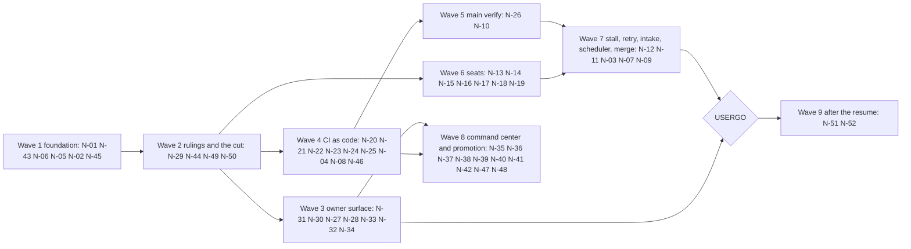

| Wave | Nodes | Why here | Goes live at cut-over step |
| --- | --- | --- | --- |
| 1 | N-01 State store, N-43 Status code map loader, N-06 Service unit, clock and health, N-05 Backups, N-02 Lease service, N-45 Cleanup registry and runs | The system comes up before anyone works; every later node writes to the store, reads the clock and registers a cleanup | 0 |
| 2 | N-29 Owner answer intake, N-44 Build-mode flag, N-49 Unlanded cleanup, N-50 Cut-over records | The rulings C34 to C58 and the standing USERHALT are imported as records; GOFACTORY needs the cleanup plan and the cancels | 0 and 1 |
| 3 | N-31 Push transport, N-30 Go inbox with acks, N-27 Watcher lamp, N-28 System lane card builder, N-33 Rail panel, N-32 Bearings page service, N-34 Tailnet front door | The owner must see the new line before it moves | 2 |
| 4 | N-20 Jenkins as code, N-21 Factory namespace, N-22 Image build, N-23 Suite planner, N-24 Pod run, N-25 Gate status post, N-04 GitHub poll, N-08 Gate check, N-46 Spec book check | A verdict on GitHub before any machine merge; runs beside wave 3 | 3 |
| 5 | N-26 Main verify pipeline, N-10 Main verdict and hold | Main is verified in pods before the merge path goes live | 4 |
| 6 | N-13 Seat layer render, N-14 Workspace provision, N-15 One-shot seat launcher, N-16 Worker run, N-17 Spec-author run, N-18 Validator, N-19 Reviewer run | Seats are built dark; nothing dispatches them until step 6 | 6 (through N-07) |
| 7 | N-12 Stall timer, N-11 Retry and backoff, N-03 Ticket intake and readiness, N-07 Scheduler tick and dispatch, N-09 Merge | The line itself, live under the hold first | 5 and 6 |
| 8 | N-35 Hello page deploy, N-36 Art pipeline, N-37 Panel binding registry, N-38 Map screen, N-39 Machine screen, N-40 Stats screen, N-41 Alerts screen, N-42 Controls screen, N-47 Drive publish, N-48 Tier promotion with screenshot | The command center needs the page, the push stream and the image path; the hello page proves the plumbing before any map code | after 2, beside 4 to 7 |
| 9 | N-51 Exit test, N-52 Phone push bridge | The exit test counts days of the running line; the phone push waits for a day of inbox acks on stable | 11 and 9 |

## 7. Workflows and flows

Eight flows, one sequence diagram each.
Every message is a record put in the store or a call a node makes on a record; nothing is typed into a pane.

### 7.1 Ticket intake to merge

A validated ticket becomes ready, a fresh worker seat writes the change, pods judge it, a fresh reviewer seat judges the diff, and the machine merges.

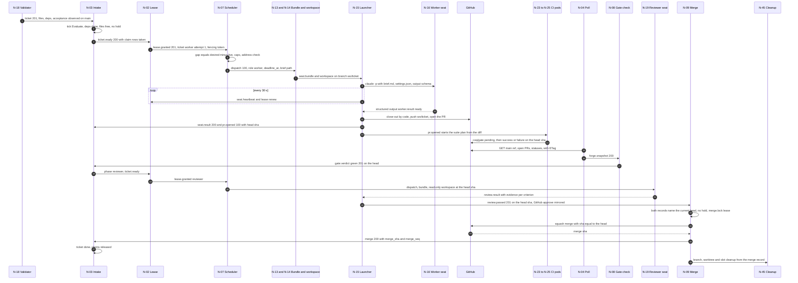

Depth: [N-03](nodes/N-03/spec.xml#mechanism), [N-07](nodes/N-07/spec.xml#mechanism), [N-08](nodes/N-08/spec.xml#mechanism), [N-09](nodes/N-09/spec.xml#mechanism), [N-16](nodes/N-16/spec.xml#mechanism), [N-19](nodes/N-19/spec.xml#mechanism).

### 7.2 Gate verdict, main verify and hold

Every merge is verified on main in pods; a red main holds every merge but the fix, and the owner hears only after three fixes fail.

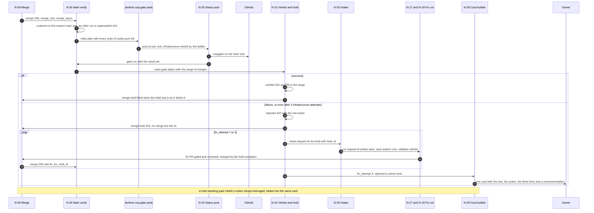

Depth: [N-10](nodes/N-10/spec.xml#mechanism), [N-26](nodes/N-26/spec.xml#mechanism), [N-25](nodes/N-25/spec.xml#mechanism).

### 7.3 Seat launch, run, stall timer and retry

A seat is fenced before it is killed and killed before it is retried, so a zombie can never post after the retry started.

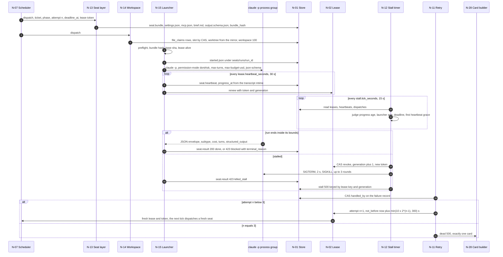

Depth: [N-15](nodes/N-15/spec.xml#mechanism), [N-12](nodes/N-12/spec.xml#mechanism), [N-11](nodes/N-11/spec.xml#mechanism), [seat contract](shared/seat-contract.xml#launch-flags).

### 7.4 Owner card and answer with acks

The system builds the card from a record; a card never posts unwatched; the owner's answer is persisted before it is acknowledged.

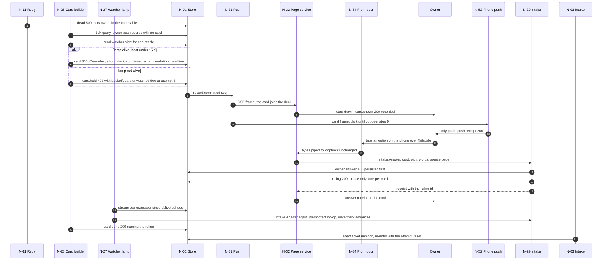

Depth: [N-28](nodes/N-28/spec.xml#mechanism), [N-27](nodes/N-27/spec.xml#mechanism), [N-29](nodes/N-29/spec.xml#mechanism), [N-31](nodes/N-31/spec.xml#mechanism), [N-52](nodes/N-52/spec.xml#mechanism).

### 7.5 Owner message through the Go inbox

Every message gets four receipts (accepted, routed, consumed, answered), or a fifth (stale) that says the system knows it is late.

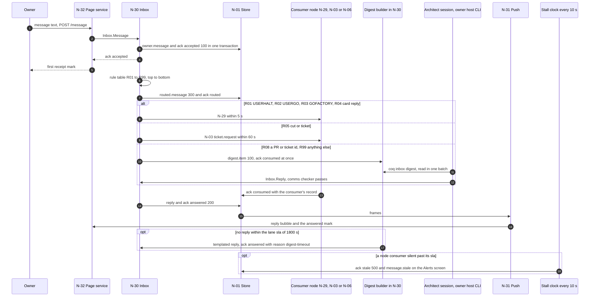

Depth: [N-30](nodes/N-30/spec.xml#mechanism), [lanes](shared/seat-contract.xml#lanes).

### 7.6 Spec cut by AI and validator

An LLM cuts tickets as data; code admits them only after their acceptance commands ran on main.

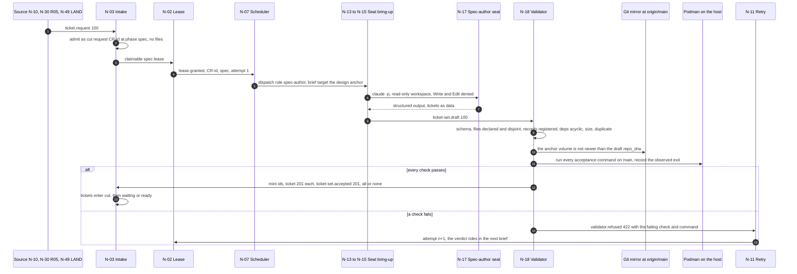

Depth: [N-17](nodes/N-17/spec.xml#mechanism), [N-18](nodes/N-18/spec.xml#mechanism), [N-03 input](nodes/N-03/spec.xml#input).

### 7.7 Prompt-parked detection and the model-limit auto-answer

A long-lived seat parked on a prompt is seen within one minute; a model-limit prompt is answered by the role's ruled model and never by spending extra credits.

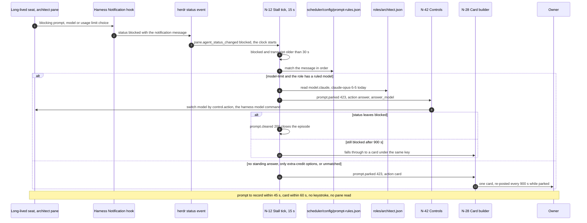

Depth: [N-12 prompt-parked](nodes/N-12/spec.xml#prompt-parked), [failure case](shared/failure-cases.xml#prompt-parked).

### 7.8 GOFACTORY cut-over

The one order from GOFACTORY to the old line retired; each step starts on its trigger record and ends on its proof record.

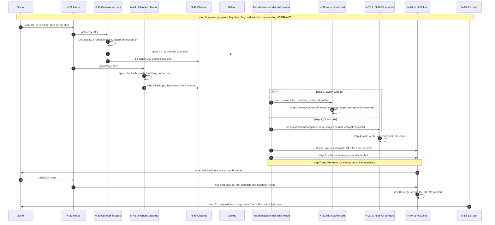

Depth: [cut-over order](shared/cut-over.xml#order), [N-49 order](nodes/N-49/spec.xml#order), [N-50](nodes/N-50/spec.xml#mechanism).

## 8. File format and data shapes

### 8.1 State root

All runtime data lives outside the repository, resolved by [`bin/state-root.sh`](../../bin/state-root.sh) (`COQ_STATE` and `COQ_CACHE` win when set):

```text
~/.local/state/coq/coq-jev-herdr-plugin/          COQ_STATE
  store/coq.db, coq.db-wal, coq.db-shm             the one store (N-01)
  backup/store/YYYY/MM/*.zst                       snapshots (N-05)
  config/service.env                               tokens and keys, mode 0600 (N-04, N-06)
  run/service.lock, service.pid, scheduler.heartbeat
  logs/<node area>/YYYY/MM/*.jsonl                 service, scheduler, gate, merge, verify, retry, stall, cleanup, publish, promote
  briefs/YYYY/MM/<at>-WO-<id>-<phase>-<n>.md       rendered briefs (N-07, N-13)
  seats/bundles/<run_id>/                          settings.json, mcp.json, brief.md, output.schema.json
  seats/runs/<run_id>/                             started.json, result.json, stderr.log, provision.log
  validator/<set_id>/                              validate.log and acceptance outputs
  ci/mirror/repo.git, ci/plan/, ci/logs/gate/, ci/gate/, ci/verify/, ci/image/
  bearings/<page>/server.json, files/, screenshots/, front-door.json
  map/art/, map/dist/<sha>/, map/deploy/, map/registry/, map/screenshots/
  svc/codes/table-<hash>.json                      the loaded code table (N-43)
  cleanup/plans/*.json                             cleanup dry-run listings (N-45)
  publish/<sha>/, publish/manifests/               Drive exports (N-47)
  secrets/rclone.conf, owner/push/token            mode 0600
  tiers/<tier>/src@<sha>, screenshots/<tier>/<sha>/
  unlanded/plan-*.json, backup/unlanded/, cutover/cancel-set-<sha>.json, exittest/<day>.json
  tickets/export/WO-*.md                           read-only exports for humans
~/.cache/coq/coq-jev-herdr-plugin/                 COQ_CACHE, safe to delete
  git/<slug>.git                                   the bare mirror (N-14)
  ws/<slot>/                                       workspace slots
  ci/image/<name>/, cleanup/registry-<sha>.json
$XDG_RUNTIME_DIR/coq/store.sock, control.sock      gRPC sockets
~/.config/systemd/user/coq-service.service, coq-bearings@.service, coq-watcher@.service, coq-front-door@.service, coq-cutover@.service
```

### 8.2 State store tables

One SQLite file in WAL mode, opened by the Go service alone; every table has one owning node and a forward-only migration ([state store](shared/state-store.xml#records)).

| Table | Owner | Mode | Holds |
| --- | --- | --- | --- |
| `records` | N-01 | append-only | Every record of every kind; `seq` strictly increasing; indexes (kind, seq), (ticket, seq), (code, seq) |
| `entities` | N-01 | compare-and-swap | Current state by key (tickets, flags, ticks, health, snapshots); every write is also a record |
| `idempotency` | N-01 | append-only | A seen key replays its first response (200); same key, other payload is 409 |
| `code_table` | N-43 | append-only | The status code map loaded from `shared/status-codes.xml` by hash |
| `leases` | N-02 | compare-and-swap | One holder per key, fencing token, generation, expiry, heartbeat |
| `heartbeats` | N-15 | upsert | Newest heartbeat per run: pid, progress_at, transcript_bytes, adopted |
| `attempts` | N-11 | append-only | One row per attempt of a ticket phase with its backoff; row 4 never exists |
| `slots` | N-14 | compare-and-swap | Workspace slots 1 to `workspace_slots` |
| `tickets` | N-03 | compare-and-swap | The whole ticket; status cut, waiting, ready, in_flight, done, dead, cancelled, refused |
| `claims`, `file_claims` | N-03, N-14 | append-only | One file, one in-flight ticket, taken at ready, released at the terminal state |
| `ticket_sets`, `id_mint` | N-18 | compare-and-swap, append-only | Drafts and accepted sets; reserved ids so a crashed mint resumes with the same ids |
| `flags` | N-44 | compare-and-swap | build-mode, hold, freeze, each with scope, expiry, card and ruling |
| `forge_history` | N-04 | append-only | GitHub snapshots on hash change, 30 days |
| `backups` | N-05 | append-only | Snapshot path, checksums, class, verified |
| `plans`, `suite_budget` | N-23, N-06 | compare-and-swap, upsert | Suite and main plans with Jenkins build numbers; per-suite time budgets |
| `cards`, `rulings`, `messages`, `acks`, `replies`, `routed_messages` | N-28, N-29, N-30 | mixed | The owner surface; one ruling per card id |
| `watcher_alive`, `page_state`, `front_door`, `cutover` | N-27, N-32, N-34 | compare-and-swap | Unit liveness and the page's own staleness |
| `plan_steps`, `plan_sides`, `ledger_rows`, `push_receipts` | N-33, N-52 | mixed | The rail panel and phone receipts |
| `cleanup_runs`, `dispositions`, `publish_cursor`, `promotions`, `exit_verdicts` | N-45, N-49, N-47, N-48, N-51 | mixed | Governance and cut-over |
| `deploy_records`, `sprite_sheets`, `binding_records`, `frame_reports`, `selections`, `counters_frames`, `alert_acks`, `control_actions`, `break_glass_tokens` | G6 nodes | mixed | The command center |
| `counters` | N-40 | view | Windows 1 h, 6 h, 24 h, 7 d: tickets per stage, bring-up median and p95, stalls, cost |

### 8.3 Record examples

Every record carries the envelope `id` (UTC stamp, code, five characters), `at` (UTC), `kind`, `code` and `node`, plus `seq` assigned by the store at commit ([envelope](shared/state-store.xml#envelope), [N-01 schema](nodes/N-01/record.schema.json)).
The examples below are one ticket's path as committed records; each one validates against its node's `record.schema.json`.

A lease granted to the first worker attempt ([N-02 schema](nodes/N-02/record.schema.json)):

```json
{
  "schema_version": "2.0.0",
  "id": "20261014T063000Z-201-k3v9q",
  "at": "2026-10-14T06:30:00Z",
  "kind": "lease.granted",
  "code": 201,
  "node": "N-02",
  "seq": 5101,
  "ticket": "WO-20261014-ab12",
  "attempt": 1,
  "key": "WO-20261014-ab12:worker:1",
  "phase": "worker",
  "role": "worker",
  "holder": "20261014T063005Z-100-p2m7d",
  "token": 184,
  "generation": 1,
  "granted_at": "2026-10-14T06:30:00Z",
  "expires_at": "2026-10-14T06:45:00Z",
  "heartbeat_seconds": 30
}
```

The dispatch that follows it ([N-07 schema](nodes/N-07/record.schema.json)):

```json
{
  "id": "20261014T063005Z-100-p2m7d",
  "at": "2026-10-14T06:30:05Z",
  "kind": "dispatch",
  "code": 100,
  "node": "N-07",
  "seq": 5102,
  "dispatch_id": "20261014T063005Z-100-p2m7d",
  "idempotency_key": "WO-20261014-ab12:worker:1",
  "ticket": "WO-20261014-ab12",
  "role": "worker",
  "phase": "worker",
  "attempt": 1,
  "deadline": "2026-10-14T07:30:05Z",
  "lease_key": "WO-20261014-ab12:worker:1",
  "lease_token": 184,
  "brief_path": "/home/luna/.local/state/coq/coq-jev-herdr-plugin/briefs/2026/10/20261014063005-WO-20261014-ab12-worker-1.md",
  "lane": "build"
}
```

The seat result the launcher parses from the harness envelope ([N-15 schema](nodes/N-15/record.schema.json)):

```json
{
  "schema_version": "2.0.0",
  "id": "20261014T064212Z-200-x81fe",
  "at": "2026-10-14T06:42:12Z",
  "kind": "seat.result",
  "code": 200,
  "node": "N-15",
  "seq": 5188,
  "run_id": "run-20261014T063007Z-ab12-1",
  "ticket": "WO-20261014-ab12",
  "role": "worker",
  "phase": "worker",
  "attempt": 1,
  "outcome": "done",
  "terminal_reason": "success",
  "exit_code": 0,
  "cost_usd": 1.84,
  "turns": 37,
  "session_id": "5b0e2c1a-6d7f-4f3e-9a51-0c2d8e4b7a10",
  "model": "claude-sonnet-5-5",
  "started_at": "2026-10-14T06:30:07Z",
  "finished_at": "2026-10-14T06:42:12Z",
  "duration_seconds": 725,
  "permission_denials": {
    "count": 0,
    "first": []
  },
  "structured": {
    "status": "ready",
    "head_sha": "3f9c2e7a1b04d6e58c9f20b7e4a1d3c6f8b05e92",
    "pr": 201
  },
  "result_path": "/home/luna/.local/state/coq/coq-jev-herdr-plugin/seats/runs/run-20261014T063007Z-ab12-1/result.json",
  "stderr_path": "/home/luna/.local/state/coq/coq-jev-herdr-plugin/seats/runs/run-20261014T063007Z-ab12-1/stderr.log"
}
```

The gate verdict on that head ([N-08 schema](nodes/N-08/record.schema.json)):

```json
{
  "id": "20261014T065130Z-201-q7c4n",
  "at": "2026-10-14T06:51:30Z",
  "kind": "gate.verdict",
  "code": 201,
  "node": "N-08",
  "idempotency_key": "201:3f9c2e7a1b04d6e58c9f20b7e4a1d3c6f8b05e92:green",
  "pr": 201,
  "ticket": "WO-20261014-ab12",
  "head_sha": "3f9c2e7a1b04d6e58c9f20b7e4a1d3c6f8b05e92",
  "verdict": "green",
  "reason": "status",
  "gate_url": "http://jenkins.jenkins.svc.cluster.local:8080/job/coq-gate/412/",
  "main_sha": "4f7f44c0d2a9e1b6c3f8a5d7e9b2c4a6f1d3e5b7",
  "status_updated_at": "2026-10-14T06:51:02Z",
  "snapshot_seq": 5120,
  "seq": 5240
}
```

The merge ([N-09 schema](nodes/N-09/record.schema.json)):

```json
{
  "id": "20261014T070410Z-200-m5a0r",
  "at": "2026-10-14T07:04:10Z",
  "kind": "merge",
  "code": 200,
  "node": "N-09",
  "idempotency_key": "201:3f9c2e7a1b04d6e58c9f20b7e4a1d3c6f8b05e92",
  "pr": 201,
  "ticket": "WO-20261014-ab12",
  "head_sha": "3f9c2e7a1b04d6e58c9f20b7e4a1d3c6f8b05e92",
  "merge_sha": "a71d0b4e2c9f8a6d5b3e1c7f9a2d4b6e8c0f1a3d",
  "merge_seq": 93,
  "branch": "wo/WO-20261014-ab12",
  "paths": [
    "scheduler/internal/lease/lease.go",
    "scheduler/internal/lease/lease_test.go"
  ],
  "gate_verdict_id": "20261014T065130Z-201-q7c4n",
  "review_record_id": "20261014T070122Z-201-v6t2b",
  "seq": 5301
}
```

A card about a dead ticket ([N-28 schema](nodes/N-28/record.schema.json)) and the owner's ruling on it ([N-29 schema](nodes/N-29/record.schema.json)):

```json
{
  "id": "20261014T081500Z-300-c9k2w",
  "at": "2026-10-14T08:15:00Z",
  "kind": "card",
  "code": 300,
  "node": "N-28",
  "card": "C-60",
  "tier": "stable",
  "cause": "20261014T081455Z-500-d4t8h",
  "about": "Lease service - failed three attempts",
  "decide": "Re-cut the ticket smaller, or cancel it?",
  "options": [
    {
      "label": "Re-cut smaller",
      "then": "spec-author cuts a smaller ticket"
    },
    {
      "label": "Cancel",
      "then": "ticket closed, files released"
    }
  ],
  "rec": 0,
  "ticket": {
    "id": "WO-20261014-ab12",
    "title": "Lease service claim, renew, release and sweep"
  },
  "deadline": "2026-10-15T08:15:00Z",
  "default": 0,
  "watcher": 7,
  "posted_at": "2026-10-14T08:15:00Z",
  "idempotency_key": "cause:20261014T081455Z-500-d4t8h",
  "seq": 5402
}
```

```json
{
  "id": "20261014T082233Z-200-r3v6y",
  "at": "2026-10-14T08:22:33Z",
  "kind": "ruling",
  "code": 200,
  "node": "N-29",
  "card": "C-60",
  "cause": "20261014T081455Z-500-d4t8h",
  "pick": 0,
  "choice": "Re-cut smaller",
  "words": "",
  "source": "page",
  "by": "owner",
  "answer": "a-20261014082231907-k2p4z",
  "effects": [
    {
      "kind": "ticket.unblock",
      "ticket": "WO-20261014-ab12"
    }
  ],
  "idempotency_key": "ruling:C-60",
  "seq": 5417
}
```

One acknowledgement of an owner message, an upsert keyed by the message whose state only moves forward ([N-30 schema](nodes/N-30/record.schema.json)):

```json
{
  "id": "20261014T090102Z-100-a1s8k",
  "at": "2026-10-14T09:01:02Z",
  "kind": "ack",
  "code": 100,
  "node": "N-30",
  "message": "m-20261014090101544-h2k9q",
  "state": "routed",
  "by": "inbox",
  "ref": "20261014T090102Z-300-l0r5u",
  "version": 2,
  "seq": 5502
}
```

### 8.4 Ticket lifecycle

The closed status set of a ticket; a transition not drawn here is 409 `ticket.transition_refused` ([N-03](nodes/N-03/spec.xml#mechanism)).

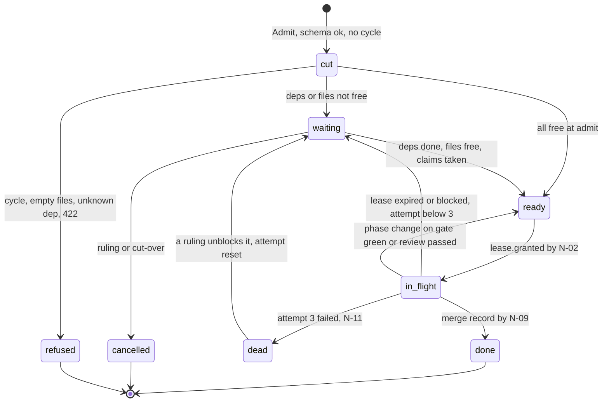

### 8.5 Config keys that matter most

Every value is a key in `STATE/config/service.env` or the config table, applied by `Reload` without a restart ([config keys](shared/state-store.xml#config-keys)).

| Key | Default | Owner |
| --- | --- | --- |
| `lease.ttl_seconds`, `lease.heartbeat_seconds` | 900 s, 30 s (a dead launcher is judged at 3 x 30 = 90 s) | N-02 |
| tick intervals | scheduler 5 s, poll 30 s, stall 15 s, health 15 s, backup 6 h, daily 00:05Z | N-06 |
| `forge.poll_seconds`, `forge.calls_per_poll_max` | 30 s, 60 (halves under 1000 remaining) | N-04 |
| `gate.absent_seconds`, `gate.pending_seconds` | 1800 s, 3600 s | N-08 |
| `merge.hold_age_alert_seconds` | 14400 s | N-09 |
| stall bounds per role | worker 300 s, reviewer 300 s, spec-author 300 s, gate 60 s; first heartbeat grace 120 s | N-12 |
| `stall.prompt_park_seconds`, `stall.prompt_recard_seconds` | 30 s, 900 s | N-12 |
| retry backoff | min(10 x 2^(n-1), 300) s, 3 attempts | N-11 |
| `gate.runs_in_flight_max`, `image.builds_in_flight_max` | 2 (main first), 2 | N-07, N-22 |
| `flags.build_mode.max_duration` | P7D | N-44 |
| `tiers.stable.port`, `tiers.uat.port_range`, `tiers.dev.port_range` | 44900, 44910 to 44919, 44920 to 44939 | N-48 |
| `map.frame_budget_ms`, `map.stale_after_s` | 16 ms, 90 s | N-38 |
| every `*.enabled` flag | false: each node ships dark and goes live by its own ticket | per node |

## 9. Commands

Every command that deletes, publishes, promotes or changes the line is a dry run unless it is given its apply flag, and the apply refuses when the plan it was shown has changed (409).
The line runs these by itself as `Executor.Run` verbs; the owner runs the break glass ones, once, and each is recorded and counted by the exit test.
No seat may run anything in the "owner only" or "service only" rows: the seat layer denies them and the store refuses the record (403).

| Command | What it does | Dry run and apply | Who runs it |
| --- | --- | --- | --- |
| `make -C scheduler build` then `make -C scheduler install-unit` | Builds `coq-service`, installs `~/.config/systemd/user/coq-service.service`, prints the `loginctl enable-linger` line | none; install is the owner's one-time step | owner, once |
| `systemctl --user status coq-service`, `journalctl --user -u coq-service -f` | Unit state and the process journal | read-only | anyone |
| `scheduler ctl health`, `scheduler ctl status` | gRPC health with reasons; counters, ticks, held and dead jobs | read-only | anyone |
| `scheduler ctl store status`, `scheduler ctl record get ID`, `scheduler ctl record list --since SEQ --kind KIND` | Store size, top seq, tail clients; read records | read-only | anyone |
| `scheduler ctl reload` | Applies a merged config change by hash, writes `reload.applied` | none; the config change is a merged PR | service, after a merge |
| `scheduler ctl hold set --reason TEXT`, `scheduler ctl hold clear` | Sets or clears `flag:hold` as a `control.action` through N-29 | none; recorded | owner (or the Controls screen) |
| `scheduler/host/bin/restore-store.sh --from BACKUP --dry-run`, then `--apply` | Restores the store from a backup and prints the seq gap | `--dry-run` lists, `--apply` moves the live file aside with a UTC stamp | owner, unit stopped |
| `line/bin/cleanup.sh plan --entry ID`, then `line/bin/cleanup.sh apply --plan HASH --fence TOKEN` | Expands a registry entry, lists what would go, then deletes exactly that | `plan` is the dry run; `apply` refuses if the expansion changed | service (N-45); `apply` outside a plan is owner break glass |
| `line/bin/cleanup.sh --entry ID` | The registry verb for one state path (176 entries) | plan first, always | service (N-45) |
| `coq owner answer --relay --card C-42 --pick 3 --words "..."` | Records an answer the owner gave in chat or on the phone, verbatim, before any gate reads it | none; refused for any caller with `COQ_SEAT` set | owner or the owner's own architect session |
| `coq owner import-answers --file ~/.bearings/coq-stable/answers.jsonl` | Imports the legacy answers once at cut-over | `--dry-run`, then `--yes`; refuses an existing id unless `--skip-existing` | owner, once |
| `coq owner import-messages --file ~/.bearings/coq-stable/messages.jsonl` | Imports legacy messages once | `--dry-run`, then `--yes` | owner, once |
| `coq owner reply --to m-ID "text"` | Replies on the page through `Inbox.Reply` with the comms checker | refused with the violations | the only way a seat speaks on the page |
| `coq owner inbox --tier stable --open`, `coq inbox digest --since T` | Open messages with ack state; the architect digest | read-only | owner, architect |
| `coq owner url --page coq-stable` | Prints the loopback and tailnet URLs with the key, to the terminal only | read-only | owner |
| `coq owner rotate-key --page coq-stable` | Mints a new page key | none | owner break glass |
| `tools/bearings/scripts/promote.sh --tier stable --sha SHA` | Promotes a page build to stable by hand | none | owner break glass, counted by the exit test |
| `systemctl --user start coq-cutover@coq-stable` | Runs the one-shot page cut-over by hand | none | owner break glass |
| `rebuild/bin/unlanded.sh plan`, `apply --step N --plan HASH`, `status` | The 04-UNLANDED cleanup in its seven steps | `plan` is the dry run on the GOFACTORY card; `apply` refuses a changed hash | service (N-49); `apply` by hand is owner break glass |
| `rebuild/design/bin/publish-drive.sh` | Publishes version-named copies of this book to Drive | skips titles already present; refuses an unbumped version | service (N-47) |
| `rclone config create drive-coq drive scope=drive.file` | Authorises the Drive publisher once | none | owner, once |
| `ci/bin/branch-protection.sh --check` | Asserts `coq/gate` is a required, strict check on main | `--check` is read-only | service, daily |
| `factory/bin/suites.sh plan --repo DIR --base SHA --head SHA` | Prints the suites a diff needs; runs nothing | read-only | service (N-23), worker locally |
| `make -C tools/map build`, `make -C tools/map test`, `make -C tools/map lint`, `make -C tools/map art` | Builds and checks the map bundle and the atlas | none | pods; worker locally |
| `rebuild/design/check.sh` | Validates the spec book; exit 0 pass, 1 failures, 2 cannot run | read-only | anyone; N-46 in a pod |
| `uv run --with xmlschema --with jsonschema python3 -I rebuild/design/bin/test-checks.py` | Proves every check fires on a mutated copy of the book | read-only, works on a temporary copy | anyone |
| `python3 rebuild/design/bin/make-index.py`, `make-kinds.py`, `registry.py` | Regenerate `index.xml`, `shared/record-kinds.xml`, `shared/cleanup-registry.json` | `--check` reports staleness without writing | spec-author, in the same PR |

Depth: [N-01 runbook](nodes/N-01/spec.xml#runbook), [N-06 runbook](nodes/N-06/spec.xml#runbook), [N-29 runbook](nodes/N-29/spec.xml#runbook), [N-30 runbook](nodes/N-30/spec.xml#runbook), [N-45 runbook](nodes/N-45/spec.xml#runbook), [break glass](shared/seat-contract.xml#break-glass).

## 10. Inputs and outputs

| Item | Direction | Shape |
| --- | --- | --- |
| GitHub main ref, open PRs, combined statuses | in | REST v3 with ETag, budgeted 60 calls per 30 s poll, into `forge:snapshot` (N-04) |
| `coq/gate` commit status | out | GitHub status on the head or main sha: pending, success, failure, error with the gate page link (N-25) |
| Squash merge | out | GitHub merge API with `sha` equal to the head (N-09) |
| PR review mirror | out | `gh pr review --approve` or `--request-changes` with the reviewer's body (N-19) |
| Jenkins jobs `coq-gate`, `coq-image`, `coq-map` | out | `buildWithParameters` with SHA, ATTEMPT, plan; followed by build number (N-22, N-24, N-35) |
| Pod results | in | `pod.run` per unit: exit code, log path, wall time (N-24) |
| `roles/<role>.json` and `scheduler/config/seats.json` | in | Role model, allow and deny lists, limits `max_turns`, `max_budget_usd`, `wall_clock_seconds`, `stall_seconds` (N-13) |
| Seat bundle | out | `settings.json`, `mcp.json`, `brief.md`, `output.schema.json` with a bundle hash (N-13) |
| `claude -p` JSON envelope | in | `type`, `subtype`, `is_error`, `total_cost_usd`, `num_turns`, `session_id`, `structured_output`, `permission_denials` (N-15) |
| `scheduler/config/retry.json` | in | Retry table per failure kind (N-11) |
| `scheduler/config/prompt-rules.json` | in | Ordered match rules: id, regex, action answer, card or down (N-12) |
| `shared/status-codes.xml` and `shared/record-kinds.xml` | in | The live code table and kinds registry, loaded by hash (N-43) |
| `tools/bearings/config/cards.template.json`, `answer-effects.json`, `inbox-rules.json`, `bearings.json` | in | Card templates, answer effects, message routing rules, tier config, each schema-checked at lint (N-28, N-29, N-30, N-32) |
| Owner answer, message, file | in | `POST /answer {card, pick, words}`, `POST /message {id, text, files, reply_to}`, `POST /file` (N-32) |
| Page stream | out | Server-sent events on `/events`: `id` = seq, snapshot on reconnect, 1 s heartbeat (N-31, N-32) |
| herdr agent status event | in | `pane.agent_status_changed` with the harness notification text, for registered long-lived seats only (N-12) |
| Phone push | out | ntfy POST with title, body, priority by code, click to the tailnet page without the key (N-52) |
| Map public page | out | Static bundle at `map.gatehouse.click` with `healthz.json` naming the sha (N-35) |
| Drive copies | out | Version-named immutable files with a manifest, scope `drive.file` (N-47) |
| Screenshots | out | PNG at 1280x800 and 430x932 under `$COQ_STATE/screenshots/<tier>/<sha>/` (N-48) |
| Service tokens | in | `STATE/config/service.env` (mode 0600): the fine-grained GitHub read token; Jenkins and kube credentials from the host keyring; never in a record |
| Backups | out | `VACUUM INTO` snapshots compressed to `.zst` with checksums (N-05) |

## 11. Status and exit codes

### 11.1 Record status codes

Every record carries one of these codes; the code decides the lamp every screen draws and who moves next.
A code whose actor is the owner becomes exactly one card; nothing else reaches the owner ([status codes](shared/status-codes.xml#codes), [owner-acts](shared/status-codes.xml#owner-acts)).

| Code | Name | Lamp | Meaning | Who acts |
| --- | --- | --- | --- | --- |
| 100 | accepted | amber | Exists or in progress: the record opens a traversal or marks a step still running; the next node on the edge acts on the next tick. | system: the next node on the DAG edge; never a wait by a seat. |
| 200 | done | green | Done or applied: the step finished and its output is the record; a replayed idempotent put also answers 200 with the first response. | system: the phase post step; nobody waits on it. |
| 201 | passed | green | Accepted, passed, verified or published: a gate or a validator said yes, or a row was created the first time. | system: N-03 on an accepted ticket, N-09 on review.passed, N-10 on verified, N-26 on job and namespace readiness. |
| 204 | nothing-to-do | green | Nothing to do, released or not run: a terminal transition with no output to act on. | nobody; N-45 releases claims and slots on it. |
| 206 | degraded | amber | Partial: a frame rendered with some panels stale or missing; the screen says so instead of hiding it. | system: the next pushed frame replaces it; N-41 lists it when it persists past map.stale_after_s. |
| 300 | routed | amber | Routed or informational: a card was posted, a message was routed by rule, a question is open, or a rule bit a rebuild ticket under build mode. | owner for a card (card, break.glass, promotion.confirm, art.gap); system for routed.message, rule.bit, plan.question routing; the owner answers on the page, never in a reply. |
| 400 | invalid | red | Bad record: schema refused, unknown code, bad map or registry entry, unkeyable row; the writer is wrong, not the system. | system: N-11 on a validator refusal, plus a defect on N-15 when two schema checks disagree; owner only for a code map that fails to load (N-43 keeps the previous table). |
| 403 | refused-by-role | red | A seat put a line-operation kind (code.table, build-mode.state, rule.bit, cleanup.run, disposition, cancel, pr.close, branch.delete, promotion, exit.verdict, freeze.state, any flag): refused by N-01 and counted. | system: N-11 records it on the run; N-51 counts it as an agent line operation for the day; a seat never retries it. |
| 404 | not-found | amber | The selection names a node or record that does not exist in the frame; the screen shows the miss. | nobody; the next frame or selection replaces it. |
| 409 | conflict | amber | Conflict: a compare-and-swap miss, an idempotency key seen with a different payload, a claim race, a duplicate ruling, a second instance, a dirty checkout or a cancel-set mismatch; the loser re-reads and retries or reports. | system: the writer re-reads the current version and retries within its 3 attempts; N-11 on merge.conflict; a second answer or a second instance is refused for good (owner on a cancel-set mismatch). |
| 410 | superseded | grey | A newer head sha, main sha, gitops sha or frame replaced this run or check; the superseded work stops and nobody acts on it; the one exception is alert.aged, an open alert past its escalation bound. | nobody for supersession (N-07 stops the Jenkins build, N-25 posts error superseded); owner for alert.aged. |
| 412 | precondition-refused | amber | A precondition failed: stale lease or fencing token, missing ruling, frozen intake, claim overlap, head moved, bundle or workspace mismatch, import not recorded, a seat trying a verdict write; the step did not run. | system: N-11 by reason, or N-03 for claim_overlap without an attempt; owner only when the reason is a missing ruling or a frozen intake that needs the freeze lifted. |
| 422 | failed-with-evidence | red | Rejected with evidence: a check ran and said no (a red gate, a failed test, review changes, a failed promotion attempt, an invalid frame); the evidence is in the record; a result is never retried, only infrastructure is (V05). | system: N-11 cuts the next attempt or the dead record; owner when it is rejected on main (N-10 opens the merge.hold and one card) or an exit test day fails every third time. |
| 423 | blocked | amber | Blocked or held: a lease is held by another, a merge hold stands, a card is held, a run ended blocked with a terminal reason, a promotion or a Drive publish needs set-up; the work waits on a named condition with a bound. | system: N-11 by terminal reason (success, error_max_turns, error_max_budget_usd, error_during_execution, error_max_structured_output_retries, killed_deadline, killed_stall, killed_lease_lost, killed_by_record, crashed, no_result, schema_invalid, output_rejected, seat_blocked); owner at a second 423 on the same key, on a prompt.parked long-lived seat that no standing answer covers (one card; a model-limit prompt of a role with a ruled model is answered by the system and is no card), on a stable promotion, on Drive auth and on other-repository rows. |
| 429 | no-capacity | amber | Refused for capacity: a cap on leases, slots, ports or push clients; the request is not queued, the next tick asks again. | system: N-07 on a later tick, never a waiting loop; nobody is told unless it persists past the stall bound (then N-41). |
| 500 | failed | red | Failed after 3 attempts, stalled, dead, corrupt or a defect: the system has recovered what it can and reports; the kinds marked system-handled below are counted and watched, the rest become one card. | owner for dead, stall.kill.failed, store.corrupt, unit.crashloop, ticket.stale, backup.failed, backup.rotten, forge.overflow, watcher.dead, cutover.failed, hold.ignored, counters.failed after three skipped ticks, merge.hold.aged, main.verify.missing; system-handled with a counter and an N-41 row: tick.missed, lease.expired, lease.failed under three in ten minutes, intake.slow, forge.slow, backup.mirror_failed under a day, gate.write.failed, status.post.failed, verify.write.failed, deploy.build-failed, art.failed, binding.failed, push.stalled, push.failed, reply.failed, delivery.failed, inbox.unroutable, message.stale. |
| 502 | unreachable | red | A front door or upstream did not answer: the map is offline or the gitops front door did not serve the new digest. | system for the first three attempts; owner after 3 (deploy.front-door-unreachable). |
| 503 | unavailable | red | Unavailable or halted: the store, disk, forge, stream, mirror, checker, publisher or intake is not serving, or the line is halted by the owner; monitoring never stops under it. | system: refuse the put once, skip the run, keep ticking; owner for line.halted (a card), store.unavailable, store.disk and backup.disk after N-45 ran, forge.unreachable after three failed polls past forge.stale_after_seconds, Drive not set up. |
| 504 | timeout | amber | A bounded wait expired: a deploy, a first frame, a view or a counters tick did not finish inside its bound; the fallback named by the wait runs. | system: the wait's fallback; N-41 lists it; owner never, unless the same key times out three times (then 500 by the three-attempts rule). |

### 11.2 Script and unit exit codes

| Exit | Meaning | Who acts |
| --- | --- | --- |
| 0 | OK, or the dry run was shown | nobody |
| 1 | Checks failed (one `FAIL` line each), or a unit was fenced by a newer lease generation and exits for systemd to restart | the writer of the failing file; systemd for a fenced unit |
| 2 | Usage, or the checker cannot run (no validator) | the caller |
| 3 | Refused: a second instance of a unit (systemd `RestartPreventExitStatus=3` stops the loop), a validation failure, an unknown config variable | nobody for a second instance; the config author otherwise |
| 4 | I/O or a step failed after its 3 attempts (bind, cleanup, publish, promotion), or an owner-only verb was called with `COQ_SEAT` set | the system reports it as a record; the owner only through the card it produces |

## 12. Tool choices

| Job | Tool | Why |
| --- | --- | --- |
| Control plane | One Go service with gRPC on unix sockets | Owner ruling 2026-10-14 ~04:00Z ("GO ... handles this, agents and humans dont", "grpc for the win"); the proto and the fake clock already exist; one binary, one test harness (D01, D09) |
| State | SQLite in WAL mode, one file, one writer | One host, no broker to run; compare-and-swap and idempotency keys give the many-writer safety; a broker would only have stored 212 of the 391 misaddressed wakes (D10, card C34) |
| Supervision | systemd user units with linger, `Restart=always`, `WatchdogSec=60` | A crash restarts in 5 s and a hang is killed by the watchdog, never by a pane reader; the 9.5 hour dark outage cannot repeat |
| Gate verdict | GitHub required status `coq/gate` | Readable by an agent, editable by none; GitHub itself refuses a merge without it (D05, card C43) |
| GitHub events | Poll every 30 s with ETags | GitHub cannot reach 192.168.1.245; a missed webhook is never redelivered; a webhook may only call `poll_now` later (D06, card C44) |
| CI executor | Jenkins as code: JCasC, job by config, image pinned by digest, Longhorn home, synced by Argo | The owner's working pipeline, fixed instead of replaced; no UI clicks; no CIFS home on a Windows PC (D07, card C45) |
| Tests, lint, image builds | Pods in namespace `coq-factory`: quota, priority -100, no secrets, egress GitHub and GHCR only | Pod tests already pass 30 of 31 herdr cases; the WSL host had eleven crashes in seven weeks (D22, D23, cards C38, C53) |
| Image builds | Kaniko through `jenkins-shared-lib`, pushed to `ghcr.io/jkkelley` | The yieldpoint-ai path, already working |
| Seats | `claude -p` one-shot with `--json-schema`, `--permission-mode dontAsk`, limits as flags | Result, cost, turns and terminal state come from the harness, not the model; a miss is a recorded denial, not a prompt (D02, card C36) |
| Seat credential | Subscription login on the host; API key only for pod seats | No new bill now; exact caps when seats move to pods (D03, card C37) |
| Model per seat | The role file's model; Sonnet by default; Opus only by a ruling | Right-size rule (owner 2026-10-13); a model-limit prompt switches to the ruled model, never spends extra credits |
| Ticket cutting | An LLM spec-author cuts tickets as data; a code validator runs every acceptance command on main first | Judgement where it helps, proof before admission (D16, card C48) |
| Validator runtime | Podman on the host with the pinned images | An exit code within a minute; the same digests the pods use |
| Owner's window | herdr panes, for viewing only | herdr is not a bus, store or supervisor; its crash took the whole line (D08, card C46) |
| Owner surface | The bearings page as the one surface, rail folded in as a panel | One place to read and decide (D20, card C51) |
| Page transport | Server-sent events from the Go page service, full state on reconnect | `EventSource` reconnects by itself with `Last-Event-ID`; WebSocket only if a measured phone frame-time miss demands it (D21, card C52) |
| Phone access | Tailscale front door unit `coq-front-door@<page>` | Works today (PR 186, PR 187), no root, rebinds by itself when the tailnet address changes |
| Phone push | Self-hosted ntfy on the cluster | No app to build, no third party holding card titles, one POST per push (C58) |
| Public map hosting | Jenkins, `jenkins-shared-lib`, ghcr, homelab-gitops Helm chart, Argo, HAProxy, Lightsail Nginx, Route 53 | Owner note 5: "the plumbing needs to work first ... lets not make this hard"; a hello page proves it before map code |
| Map rendering | TypeScript, Canvas 2D, fixed 60 Hz simulation, 16 ms frame budget | 60 fps pushed state on a phone; no framework beyond the renderer |
| Look | Krastorio 2 token table as CSS custom properties, Titillium Web, original art only | Owner rule "all views shown to me better have that krastorio look"; Titillium is SIL OFL 1.1; no Wube or BiusArt file ships |
| Screenshots | Playwright in a pinned container at 1280x800 and 430x932 | Every page change is pictured before the owner is asked |
| Specs and schemas | XML volumes of 1000 lines or fewer with one XSD; JSON Schema 2020-12; Mermaid; this Markdown for the owner | Owner rules: specs are XML, schemas are JSON, diagrams are Mermaid, the owner reads one design file |
| Drive copies | `rclone` pinned by sha256, scope `drive.file` | The repository is the truth; Drive gets immutable version-named copies (D24, card C54) |
| Cleanup | One script, `line/bin/cleanup.sh`, driven by a generated registry | Owner (C35): "keep all artifacts out of the git repo ... just ensure we have cleanup scripts" |
| Forge | GitHub now, behind the one `Forge` interface of N-04 | Forgejo later is one node, off the critical path (D18, card C55) |

## 13. Standing rules after build

These bind every agent once the rebuilt line runs; each is enforced by a node, not by memory.

- Never type into a seat, nudge a seat or keep a seat waiting; a seat exists only between its input record and its output record.
- Never write a line-operation record (`merge`, `verified`, `dispatch`, `cleanup.run`, `promotion`, `exit.verdict`, any flag, any lease); the store refuses it from a seat with 403 and the exit test counts it.
- Never merge, close a PR, delete a branch, post a commit status, restart a unit or run `make upgrade`, `make stop` or `systemctl --user` from a seat.
- Read state only through the store (`scheduler ctl record get`, `record list`, `ticket get`); never open the SQLite file and never write runtime data under the repository.
- Cut tickets only through the spec-author and validator path; a ticket names its files, its input and output records, and acceptance commands with their observed exit on main.
- Name every ticket with its id and its full title, in every reply and every card.
- Touch only the files your ticket declares; one file, one in-flight ticket.
- Every new state path ships with its `state-paths` entry, a cleanup script and a regenerated `shared/cleanup-registry.json` in the same pull request.
- Every new record kind ships as a row in its node volume and in `shared/status-codes.xml`, with `shared/record-kinds.xml` regenerated; `check.sh` refuses it otherwise.
- Every change to the book edits the volumes, regenerates `index.xml`, bumps `BOOK_VERSION` and passes `rebuild/design/check.sh` in the same pull request.
- Every design ships one design `.md` in this fifteen-section format (owner order 2026-10-14 ~17:35Z), beside its XML.
- Every page change is screenshotted at 1280 and 430 wide and the picture is read before any card asks the owner about it.
- Talk to the owner only on the page: a card for a decision, `coq owner reply` for a reply; an answer he gives in chat is recorded with `coq owner answer --relay` before anyone acts on it.
- A model-limit prompt is answered with the role's ruled model; never pick an option that spends extra credits.
- A rule that blocks a rebuild ticket under build mode is a defect in the rule (`rule.bit` 300), not a failure of the ticket.
- A hand fix is a defect: turn it into a ticket that makes the system do it.
- Leave the breadcrumb at the fix site: what broke, why it mattered, why this fix, what it costs.
- Never select the privileged AWS profile `minecraft-admin`.

## 14. Files created

### 14.1 In the repositories

| Path | Purpose |
| --- | --- |
| `scheduler/internal/store`, `lease`, `intake`, `forge`, `backup`, `unit` | G1: the store with migrations under `store/migrations/`, leases, ticket intake, the GitHub poll, backups, the unit and ticks |
| `scheduler/internal/sched`, `gate`, `merge`, `verify`, `retry`, `stall` | G2: the scheduler tick, the gate check, the merge, the main verdict and hold, retry, the stall timer |
| `scheduler/internal/seatlayer`, `workspace`, `launcher` (with `worker.go`, `specauthor.go`, `reviewer.go`), `validator` | G3: bundle render, workspace provision, the one-shot launcher and post steps, the validator |
| `scheduler/internal/owner/watcher`, `cards`, `intake`, `inbox`, `push`, `pushbridge` | G5: the owner surface inside the Go module, plus the commands `coq-bearings` and `coq-watcher` |
| `scheduler/internal/flags`, `cleanup`, `promote`, `cutover`, `exittest` | G7: build mode and hold flags, cleanup runs, tier promotion, cut-over records, the exit test |
| `scheduler/host/systemd/coq-service.service` | The service unit |
| `scheduler/host/bin/restore-store.sh` and `cleanup-*.sh` (store, run, logs, leases, forge, backups, unit, seat-bundles, seat-runs, workspaces, validator, git-mirror, tickets, branches) | Restore and the per-area cleanup scripts the registry calls |
| `scheduler/config/seats.json`, `retry.json`, `prompt-rules.json`, `cleanup.json` | Seat limits and git identity, the retry table, prompt routing, cleanup config |
| `roles/schema/role.schema.json` gains `max_turns`, `max_budget_usd`, `wall_clock_seconds`, `stall_seconds` | Limits as fields, never prose ([N-13](nodes/N-13/spec.xml#mechanism)) |
| `line/bin/cleanup.sh` | The one cleanup verb: `plan`, `apply`, `--entry` |
| `ci/jenkins/Containerfile`, `plugins.txt`, `gate.Jenkinsfile`, `image.Jenkinsfile`, `migrate-home.sh` | The Jenkins controller image, plugins, job files, the one-time home move from CIFS to Longhorn |
| `ci/bin/plan-units.sh`, `unit-wrap.sh`, `images.sh`, `branch-protection.sh`, `jenkins-check.sh`, `namespace-check.sh`, `egress-policy.sh`, `cleanup-ci-state.sh`, `cleanup-cluster.sh`, `cleanup-ghcr.sh` | CI planning, checks and cleanup |
| `ci/config/images.lock.json`, `ci/image/manifest.sh`, `ci/image/verify.sh` | Image pins and verification |
| `tools/bearings/units/coq-bearings@.service`, `coq-watcher@.service`, `coq-front-door@.service` | The page, watcher and front door units |
| `tools/bearings/config/cards.template.json` (and schema), `answer-effects.json`, `inbox-rules.json`, `plans.json` | Card templates, answer effects, message rules, rail plans |
| `tools/bearings/bin/install-units.sh`, `cutover.sh`, `cleanup-tier.sh`, `cleanup-files.sh`, `cleanup-journal.sh`, `cleanup-push.sh` | Install, cut-over and page cleanup |
| `tools/bearings/scripts/promote.sh`, `screenshot.sh` | Tier promotion and the screenshot proof |
| `tools/map/` (`Makefile`, `Containerfile`, `Jenkinsfile`, `src/`, `registry/`, `art/`, `bin/`) | The command center map: bundle, registries, art pipeline, look and binding checks |
| `rebuild/bin/unlanded.sh`, `rebuild/design/bin/publish-drive.sh` | The unlanded cleanup and the Drive publisher |
| homelab-gitops `apps/jenkins/`, `argocd-apps/infrastructure/jenkins-app.yaml` | Jenkins as code |
| homelab-gitops `apps/coq-factory/`, `argocd-apps/workloads/coq-factory.yaml` | The factory namespace |
| homelab-gitops `apps/coq-map/`, `argocd-apps/coq-map.yaml` | The public map |

Built by tickets cut from this book after GOFACTORY, each shipped dark and turned on by its own go-live ticket.

### 14.2 Outside git, with the cleanup command

Every state path a volume names is an entry of [`shared/cleanup-registry.json`](shared/cleanup-registry.json) (176 entries, generated by `bin/registry.py`); the one verb is `line/bin/cleanup.sh --entry <id>`, and every run lists first.

| Path | Purpose | Cleanup |
| --- | --- | --- |
| `$COQ_STATE/store/coq.db` and its WAL | The one store | Never deleted live; rows by retention class: `line/bin/cleanup.sh --entry N-01.store`, leases `--entry N-02.store-coq-db-table-leases-entity-counter` |
| `$COQ_STATE/backup/store/YYYY/MM/*.zst` | Snapshots | `--entry N-05.backup-store-yyyy-mm-zst` (keeps daily 14, weekly 8, monthly 6, never the newest verified) |
| `$COQ_STATE/logs/**/*.jsonl` | Structured logs by node | `--entry N-01.logs-service-store-jsonl`, `N-07.logs`, `N-08.logs`, `N-09.logs` and the other `.logs` entries |
| `$COQ_STATE/briefs/` | Rendered briefs | `--entry N-07.briefs` (30 days after verified) |
| `$COQ_STATE/seats/bundles/<run_id>/`, `seats/runs/<run_id>/` | Seat bundles and run files | `--entry N-13.seats-bundles-run-id`, `--entry N-15.seats-runs-run-id` |
| `$COQ_CACHE/ws/<slot>/`, `$COQ_CACHE/git/<slug>.git` | Workspaces and the mirror | `--entry N-14.workspace`, `--entry N-14.git-slug-git` |
| `$COQ_STATE/validator/<set_id>/` | Validator runs | `--entry N-18.validator-set-id` |
| `$COQ_STATE/ci/` (mirror, plan, logs, gate, verify, image) | CI planning and results | `--entry N-23.ci-plan-sha12-attempt`, `N-24.ci-logs-gate-yyyy-mm-sha12-attempt-units`, `N-25.ci-gate-yyyy-mm-sha12-attempt-json` |
| `$COQ_STATE/bearings/<page>/` | Page key, files, screenshots, front door lock | `--entry N-32.bearings-page-files`, `N-32.bearings-page-screenshots`, `N-34.bearings-page-front-door-json` |
| `$COQ_STATE/map/` | Art work, dist, deploy probes, registry checks, screenshots | `--entry N-36.map-art-work-sha`, `N-38.map-dist-sha`, `N-38.map-screenshots-yyyy-mm-sha-tier-device` |
| `$COQ_STATE/svc/codes/`, `cleanup/plans/`, `publish/`, `tiers/`, `screenshots/` | Code tables, cleanup plans, Drive exports, tier sources, promotion pictures | `--entry N-43.table`, `N-45.plans`, `N-47.export`, `N-48.tier-src`, `N-48.screenshots` |
| `$COQ_STATE/unlanded/`, `backup/unlanded/`, `cutover/`, `exittest/` | Cut-over and exit-test working files | `--entry N-49.plan`, `N-49.backup`, `N-50.cancel-set`, `N-51.rows` |
| `$COQ_STATE/secrets/rclone.conf`, `owner/push/token`, `config/service.env` | Secrets, mode 0600 | `--entry N-47.secret`, `N-52.owner-push-token`, `N-06.config-service-env` (owner only) |
| `~/.config/systemd/user/coq-*.service`, `~/.local/bin/coq-service` | Units and the binary | `--entry N-06.config-systemd-user-coq-service-service`, `tools/bearings/bin/install-units.sh --remove` |
| `~/.bearings/coq-stable/` | The legacy page state, retired at cut-over step 10 | `tools/bearings/bin/cleanup-tier.sh coq-stable --legacy` |
| Cluster: namespace `coq-factory` pods, Kaniko pods, ghcr package versions | Test pods and images | `ci/bin/cleanup-cluster.sh --what`, `ci/bin/cleanup-ghcr.sh --image NAME` |
| GitHub: branches `wo/<ticket>` | Ticket branches | Deleted on merge (`forge.delete_branch_on_merge`), checked by `scheduler/host/bin/cleanup-branches.sh` |

## 15. Decisions for the owner

Only the open ones; the R-02 rulings (C34 to C58) are closed and not asked again.
Each goes on the stable page as its own card, one at a time, in this order.

1. **Close R-03 on this read?**
   Recommendation: close it.
   Then: PR 189 merges, this book becomes the one design on main, and no build ticket is cut until GOFACTORY.

2. **Give GOFACTORY once R-03 is closed, with the system nodes built first after it?**
   The book's cut-over says the store, clock, backups and code table come up "before GOFACTORY", but your HOLD says nothing new starts before it, so the book cannot do both.
   Recommendation: give GOFACTORY right after closing R-03; the unlanded cleanup runs first as a dry-run listing you see before anything is deleted (your ruling on C57), then wave 1 is built dark and cut-over step 0 runs as soon as it merges.

3. **Ship only the 260 high-confidence Krastor originals until the rest are confirmed?**
   The art inventory found 766 Krastor originals, but only 260 have commit-level proof, and whether the LGPLv3 grant covers a public web page is a question for you or a lawyer.
   Recommendation: ship the 260 with the conservative notice and the license text, hold the 506 medium files until each is checked by eye, and draw belts, inserters, lamps and pipes as original art.

4. **Accept a static map at map.gatehouse.click, with live state only over the tailnet, for now?**
   Cluster pods cannot reach the host, so a live public map needs a cluster to host tunnel with your key's auth, which is a node of its own.
   Recommendation: accept; your phone already gets the live map anywhere through Tailscale, and the tunnel is cut as its own design later.

5. **Which Google Drive folder gets the version-named copies of the book?**
   The publisher needs a folder id and one browser consent for `rclone` with scope `drive.file`; until then the repository stays the truth and publishing simply waits.
   Recommendation: a new folder named "coq spec book", authorised once with scope `drive.file`, so the token can touch only what it created.

Not asked now: the second repository for R-10 is asked when R-09 completes.
