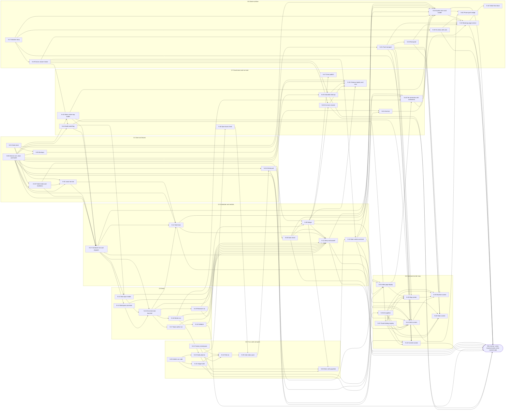

# Factory rebuild design - the DAG

Written by the R-03 spec-author seat for the node set, 2026-10-14T04:28:51Z UTC, against brief C (`$HOME/.local/state/coq/coq-jev-herdr-plugin/rebuild/2026/10/briefs/20261014-brief-C-design-spec-book.md`).
Version 1.1.0, issued 2026-10-15T06:00:00Z: every edge a node volume declares is now either drawn or listed with its reason in section 2.1 ([review dispositions](shared/review-dispositions.xml)).
This is the single canonical node set of the rebuilt factory (owner ruling C42, 2026-10-14): every build ticket is cut from a node below and from nothing else.
The Mermaid block, the node table, the re-entry table and the cycle check statement are checked against each other by `rebuild/design/bin/dag-check.py` (check.sh C16), so they cannot disagree: a ticket that changes the DAG edits the block and the tables in one pull request, and the check refuses any mismatch, any cycle and any stale count.

## Contents

1. How to read this DAG
2. The DAG (Mermaid)
3. Every node: id, name, group, input record, output record
4. Re-entries: where a loop in time is a new traversal
5. Groups for parallel authors
6. Cycle check statement
7. Rules every node obeys
8. Many agents at once
9. Decisions each group is written against
10. Sources

## 1. How to read this DAG

Every node is a piece of the system that turns one input record into one output record.
A seat on a node exists only between the two; code on a node runs only between the two.
An edge means the output record of the source is the input record of the target.
The store (N-01) is the carrier of every record: every output is a write to N-01, and those return writes are not drawn, because drawing them would turn every node into a cycle through the store and say nothing.
The push transport (N-31) is the carrier of every page-bound record for the same reason: a record that a screen shows reaches it through N-01 and N-31, and the drawn edge names which record.

Time loops exist in a factory: a tick repeats, a failed attempt retries, the owner answers a card that unblocks a ticket.
None of them is a back edge.
Each is a re-entry: the output record starts a new traversal at a named node with a counter that only grows (attempt, phase, card id), so the graph stays acyclic and the loop stays bounded.
Section 4 lists every re-entry and its bound.
The sink `RE` in the diagram is where those outputs leave the traversal.
A counter that only grows does not by itself prove that the loops end; what bounds them is the retry owner and the budgets: [retry owner](shared/contracts.xml#retry-owner), [budgets](shared/retry-budget.xml#budgets) and [deadlines](shared/retry-budget.xml#deadlines).
The cyclic runtime view (ticket transitions, the lease machine, bootstrap) is drawn as state machines in `DESIGN.md` section 8.4, from [ticket transitions](shared/contracts.xml#ticket-transitions), [lease machine](shared/contracts.xml#lease-machine) and [bootstrap](shared/cut-over.xml#bootstrap).

Record names use the form `kind.state` (`gate.verdict`, `seat.result`, `merge.hold`).
Every record carries `at` in UTC as `2006-01-02T15:04:05Z`, a status code from `shared/status-codes.xml`, the node id that wrote it, and the attempt number where one applies.
The schema of every record named here is a volume under `rebuild/design/nodes/<node-id>/` with a `.schema.json` beside it.

## 2. The DAG

### 2.1 Declared edges that are not drawn

Every `in`, `out` and `edge` element of a node volume names an edge, and `bin/dag-check.py` (C16-edges) requires each one to be drawn above, to be a re-entry row of section 4, or to carry `drawn="false"` in its volume.
A declared edge that would close a cycle is a read of state or a loop in time, so it is a re-entry row of section 4: N-04 to N-43, N-10 to N-09, N-11 to N-07, N-28 to N-29, N-32 to N-29 and N-30, N-42 to N-29.
The edges their volumes mark `drawn="false"`, and why:

| From | To | What it carries | Why it is not drawn |
| --- | --- | --- | --- |
| N-04 | N-20, N-21, N-22, N-23 | the gitops or repository commit seen by the poll | the input is a commit, and drawing it would close a cycle through N-25 to N-04 |
| N-15 | N-02 | `Lease.Start`, `Lease.Renew` and `Lease.Release` calls | calls on the lease the dispatch already holds, not new records ([lease machine](shared/contracts.xml#lease-machine)) |
| N-22 | N-26 | image records as a precondition | read through N-23's plan code |
| N-26 | N-24 | `main.plan` entries run as pods | would close a cycle through N-25, N-04 and N-09 |
| N-29 | N-12 | a ruling with effect run.kill (the owner's kill) | an owner act read by N-12's tick, like the hold; not a data flow of the line |
| N-30 | N-29 | an owner word routed to its standing card (R01 to R03) | the owner's own message; the ruling is N-29's |

## 3. Every node

| Id | Name | Group | Input record | Output record |
| --- | --- | --- | --- | --- |
| N-01 | State store | G1 Store and leases | Commit request over gRPC from an authenticated principal (operation key with request hash, fence, preconditions, entity writes, records, outbox effects) | commit reply (seq, epoch, hash, versions) or a refusal: 403 record.refused, 409 conflict, 412 stale token |
| N-02 | Lease service | G1 Store and leases | ticket.ready record (claimable node and attempt) | lease row (class, state, non-empty holder, integer token, generation, expiry) reserved in N-07's GrantDispatch, or lease.refused |
| N-03 | Ticket intake and readiness | G1 Store and leases | ticket record (validated, files declared, deps named; re-entry from N-18 or an owner cut) or a ticket.request admitted as a spec-phase cut request | ticket.ready record (deps done, no file claimed by another in-flight ticket) or ticket.waiting |
| N-04 | GitHub poll | G1 Store and leases | tick record (every tick from N-06, plus coq/gate statuses posted by N-25) | forge.snapshot record (open PRs, head shas, coq/gate status, mergeability, main sha) |
| N-05 | Backups | G1 Store and leases | backup.tick record (schedule from N-06) over the live store | backup record (snapshot path, checksum, class tick, daily, monthly or manual) or backup.failed |
| N-06 | Service unit, clock and health | G1 Store and leases | unit.start (systemd user unit of the Go service) | tick record (scheduler, poll, backup, stall and daily ticks) and health record (gRPC Health, counters) |
| N-07 | Scheduler tick and dispatch | G2 Scheduler and verdicts | lease record plus tick record (level-triggered: compare open work with live runs before any dispatch) | dispatch record (the contracts dispatch body: ticket, phase, role, attempt, lease key and token, deadline_at, repo_sha, brief path), committed with the lease and the ticket transition in one GrantDispatch |
| N-08 | Gate check | G2 Scheduler and verdicts | forge.snapshot record for a PR head sha | gate.verdict record (green, red or pending for the head sha, from the coq/gate status the agent can read but not edit) |
| N-09 | Merge | G2 Scheduler and verdicts | gate.verdict green plus review.passed on the same head sha | merge record (merge sha, PR number) or merge.conflict 409 |
| N-10 | Main verdict and hold | G2 Scheduler and verdicts | main.gate.status record (coq/gate on the main sha after a merge) | verified 201 record, or rejected 422 plus merge.hold record (no merge until a green main) |
| N-11 | Retry and backoff | G2 Scheduler and verdicts | failure record (seat.result blocked or failed, review.changes, merge.conflict, stall, validator refusal) | attempt record n+1 when the [retry owner](shared/contracts.xml#retry-owner) table charges it, or dead record with one escalation |
| N-12 | Stall timer | G2 Scheduler and verdicts | lease record plus heartbeat records plus stall tick | stall record (lease revoked, kill:run_id written for the launcher, reason) when no progress within the stall bound |
| N-13 | Seat layer render | G3 Seats | dispatch record (role, repo, build-mode state) | seat.bundle record (settings.json from the role, deny list from declared files, brief, hash) |
| N-14 | Workspace provision | G3 Seats | dispatch record | workspace record (worktree path, branch from origin/main, slot, file claims checked and recorded) or workspace.refused |
| N-15 | One-shot seat launcher | G3 Seats | seat.bundle plus workspace record | seat.result record always (outcome, cost, turns, terminal reason, session id; a dead run yields blocked) and heartbeat records while it runs |
| N-16 | Worker run | G3 Seats | worker brief inside a seat run (ticket, workspace) | pr.opened record (branch pushed, PR number, head sha) or seat.result blocked |
| N-17 | Spec-author run | G3 Seats | spec-author brief inside a seat run (design anchor, group, verdict from a failed attempt when retried) | ticket-set.draft record (tickets as data: files, acceptance commands, input and output declared) |
| N-18 | Validator | G3 Seats | ticket-set.draft record | ticket records accepted (acceptance commands run on main with observed exit codes) or validator.refused with the failing command |
| N-19 | Reviewer run | G3 Seats | reviewer brief inside a seat run (PR, gate green, diff) | review.passed 201 or review.changes 422 record on the head sha |
| N-20 | Jenkins as code | G4 CI as code and pods | jenkins config record (JCasC, job by config, pinned image, resources, Longhorn home; a commit in gitops) | job.registered record (config hash, image digest, resource limits, home volume) |
| N-21 | Factory namespace | G4 CI as code and pods | namespace manifest record (ResourceQuota, LimitRange, PriorityClass, service account with no secret access, egress to cluster DNS, the Jenkins controller, GitHub and GHCR; a commit in gitops) | namespace.ready record (Argo synced, quota and policy present) |
| N-22 | Image build | G4 CI as code and pods | image config record (images.json or Containerfile change, digest pins) | image record (ghcr digest, pinned in config, checksum-verified binaries) |
| N-23 | Suite planner | G4 CI as code and pods | pr.opened record (head sha, diff) | suite.plan record (suites from the diff; an unmapped path plans the full set) |
| N-24 | Pod run | G4 CI as code and pods | suite.plan entry (one case) | pod.run record (exit code, log path, infrastructure retries by the ladder; an assertion failure never retried) |
| N-25 | Gate status post | G4 CI as code and pods | pod.run records for one head sha | commit status coq/gate on the head sha (success, failure, error superseded) plus the gate page link |
| N-26 | Main verify pipeline | G4 CI as code and pods | merge record (main push sha) | main.gate.status record (coq/gate on the main sha, full suite set) |
| N-27 | Watcher lamp | G5 Owner surface | tier unit start (the wait loop of a bearings tier as its own supervised unit) | watcher.alive record (lock with heartbeat per tier); a card cannot post without it |
| N-28 | System lane card builder | G5 Owner surface | record whose status code maps to owner-acts (dead, rejected main, exit test, unhealthy) plus watcher.alive | card record (one decision: about, decide, options with what happens, recommendation) posted to the tier |
| N-29 | Owner answer intake | G5 Owner surface | answer record (the owner's pick and words on the page, re-entry from N-32, or relayed from chat and recorded) | ruling record in the store (card id, pick, words, at) that gates and cut-over nodes read |
| N-30 | Go inbox with acks | G5 Owner surface | message record (the owner's message on the page, re-entry from N-32) | routed.message record (lane and consumer by rule) and ack record delivered back to the page |
| N-31 | Push transport | G5 Owner surface | record.committed seq from the store | pushed.frame record per client (delivered seq; full state re-read on reconnect) |
| N-32 | Bearings page service | G5 Owner surface | pushed.frame record (cards, messages, acks, panels, staleness) | page.state record (rendered page, staleness shown); the owner's answers and messages leave as new traversals at N-29 and N-30 |
| N-33 | Rail panel | G5 Owner surface | plan ledger row (pushed) | rail.panel frame (plan steps, ledger, status codes) inside the page |
| N-34 | Tailnet front door | G5 Owner surface | page.up record (tier server listening on loopback) | front-door record (tailnet bind, port, pid; retried 3 times then exit 4) |
| N-35 | Hello page deploy | G6 Command center map | map app commit (Jenkinsfile with jenkins-shared-lib, image on ghcr.io/jkkelley, app entry in homelab-gitops) | deploy record (image digest, Argo synced, HAProxy route, Lightsail name map.gatehouse.click answering 200) |
| N-36 | Art pipeline | G6 Command center map | art inventory record (Krastor class 1 files, original art for belts, inserters, lamps and pipes) | sprite.sheet record (atlas, attribution text, license text; no Wube-derived or BiusArt file) |
| N-37 | Panel binding registry | G6 Command center map | screen spec volume (every panel of the five screens) | binding record (panel to store record kind) and binding.check result; an unbound panel fails the build |
| N-38 | Map screen | G6 Command center map | pushed.frame record (DAG nodes with status and heartbeat, queues with depth, seats in flight, the hold lamp) | map.frame (machines, belts, inserters, lamps at the frame budget) and selection record |
| N-39 | Machine screen | G6 Command center map | selection record plus the node's state frame | machine.panel frame (one node: input, output, attempt, lease, last records) |
| N-40 | Stats screen | G6 Command center map | counters frame (records, jobs, wakes, seats, pods, cost) | stats.frame (production statistics panel) |
| N-41 | Alerts screen | G6 Command center map | alert records (stall, dead, rejected main, unhealthy) | alerts.frame and alert.ack record |
| N-42 | Controls screen | G6 Command center map | controls frame (hold flag, build-mode state, watcher lamp, health) | control.action record (owner-initiated: hold, resume, build-mode, one-time break glass) as a new traversal at N-29 |
| N-43 | Status code map loader | G7 Governance and cut-over | shared/status-codes.xml commit | code.table record (version hash loaded by Reload; every code names who acts) |
| N-44 | Build-mode flag | G7 Governance and cut-over | ruling record that sets the flag (with expiry) | build-mode.state record (on or off, expiry; cleared by the system at expiry) |
| N-45 | Cleanup registry and runs | G7 Governance and cut-over | trigger record (merge record for branch and worktree release, backup record for retention, timer for state paths named in runbook volumes) | cleanup.run record (dry-run listing, then deletions, 3 attempts then reported) |
| N-46 | Spec book check | G7 Governance and cut-over | spec volume commit in a suite plan (rebuild/design paths) | check.verdict record (XSD, every pointer resolves, 1000-line cap, contents element, parent pointer, many agents section) |
| N-47 | Drive publish | G7 Governance and cut-over | merge record touching rebuild/design | drive.copy record (version-named file ids, immutable) |
| N-48 | Tier promotion with screenshot | G7 Governance and cut-over | pr.opened or merge record touching tools/bearings or the map app | promotion record (dev then uat then stable swapped in place without stopping the waits) with the screenshot record attached |
| N-49 | Unlanded cleanup | G7 Governance and cut-over | GOFACTORY ruling record | disposition records, one per 04-UNLANDED entry (land, supersede, close), dry-run listing first |
| N-50 | Cut-over records | G7 Governance and cut-over | GOFACTORY ruling plus the D09 and D14 rulings | cancel records for the fourteen SPEC-16 tickets, PR 35 close record, design branch delete record |
| N-51 | Exit test | G7 Governance and cut-over | daily tick plus the day's verified records, line-ops audit and git status | exit.verdict record (zero agent line operations and a clean checkout, or not); product freeze lifts only on pass |
| N-52 | Phone push bridge | G5 Owner surface | card record | push.receipt record (the provider accepted it) and push.observed (the phone fetched it); ships dark until the Go inbox is live |

## 4. Re-entries

| Source | What re-enters | Enters at | Bound |
| --- | --- | --- | --- |
| N-04 | a commit to `shared/status-codes.xml` seen on main in a forge.snapshot | N-43, which loads the new code table by hash | one load per table hash; a table that fails to load keeps the previous one |
| N-08 | gate.verdict green | N-07, which grants the reviewer phase on the gated head (GrantDispatch, pr_open to in_flight, [ticket transitions](shared/contracts.xml#ticket-transitions)) | one phase change per ticket: worker, then reviewer, then merge |
| N-10 | rejected 422 on main, and merge.hold or merge.hold.lifted | N-03 as a ticket.request (fix-for-hold) admitted as a spec-phase cut request CR-..., leased at N-02 and dispatched to a spec-author by N-07; N-09 reads the hold and merges only the fix | merge.hold stays until a green main; 3 fix attempts then the owner's card |
| N-11 | attempt record n+1, or a free regrant | N-07, which grants attempt n+1 (a new lease key) once not_before passes, or regrants the same key with a new token ([lease machine](shared/contracts.xml#lease-machine)) | the [retry owner](shared/contracts.xml#retry-owner) charge, then dead and one escalation |
| N-18 | accepted ticket records | N-03 as new tickets | a ticket set is finite and every ticket names its files |
| N-28 | a card's policy default at its deadline | N-29 as a defaulted answer | only a card that is not owner-only carries a default; one ruling per card id ([owner words](shared/authority.xml#owner-words)) |
| N-29 | ruling record | N-03 (a ruling that unblocks a dead ticket) or N-44 (a flag) | one ruling per card id; a second answer to the same card is refused |
| N-30 | routed.message record | N-03 as a ticket.request (rule R05) admitted as a spec-phase cut request | one ticket request per message id |
| N-32 | the owner's answer or message | N-29 or N-30 | the owner acts; nothing loops without the owner |
| N-42 | control.action record | N-29 as an owner action | owner-initiated; break glass is one time |
| N-49 | land dispositions | N-03 as ticket.requests admitted as spec-phase cut requests | one ticket per LAND row of 04-UNLANDED |
| N-50 | the archive of the fourteen cancels | N-03 as one ticket.request admitted as a spec-phase cut request | one request per cancel set |

Every re-entry carries a counter that only grows, and each loop is bounded by a budget, not by the counter alone: attempts stop where the [retry owner](shared/contracts.xml#retry-owner) says, pods and spend stop at the [budgets](shared/retry-budget.xml#budgets), phases run worker then reviewer then merge once, and a card has one answer.
The scheduler (N-07) is level-triggered: on every tick it compares open work with live runs before it dispatches, so a lost record never strands a ticket and a duplicate record never double-dispatches.

## 5. Groups for parallel authors

One spec-author seat takes one group and writes one or more XML volumes per node under `rebuild/design/nodes/<node-id>/`.
Groups are cut so their files never overlap and their weight is close: the two Go groups carry fewer nodes because each node is more code.

| Group | Name | Nodes | Count |
| --- | --- | --- | --- |
| G1 | Store and leases | N-01, N-02, N-03, N-04, N-05, N-06 | 6 |
| G2 | Scheduler and verdicts | N-07, N-08, N-09, N-10, N-11, N-12 | 6 |
| G3 | Seats | N-13, N-14, N-15, N-16, N-17, N-18, N-19 | 7 |
| G4 | CI as code and pods | N-20, N-21, N-22, N-23, N-24, N-25, N-26 | 7 |
| G5 | Owner surface | N-27, N-28, N-29, N-30, N-31, N-32, N-33, N-34, N-52 | 9 |
| G6 | Command center map | N-35, N-36, N-37, N-38, N-39, N-40, N-41, N-42 | 8 |
| G7 | Governance and cut-over | N-43, N-44, N-45, N-46, N-47, N-48, N-49, N-50, N-51 | 9 |

Author order inside a group is free; nodes inside a group do not wait on each other to be specified, only to be built.
The index volume `rebuild/design/index.xml` lists every node id and points to every volume; `shared/` holds the status code map, principles, seat contract, state store schema, failure cases and rejected-with-reason that every group cites, and since 1.1.0 the contracts, authority, CI capacity, retry budget, outside probe and review dispositions volumes, each the one authority for what it names.

## 6. Cycle check statement

Nodes: 52. Drawn edges: 129. Re-entries (not edges): 12.
Result of Kahn's algorithm over the drawn edges: acyclic; every node appears in the topological order, no node is isolated, and no edge points at an unknown node.
Topological order: N-01 N-06 N-20 N-21 N-27 N-31 N-03 N-05 N-43 N-22 N-29 N-30 N-33 N-02 N-37 N-44 N-49 N-07 N-13 N-14 N-15 N-12 N-16 N-17 N-19 N-23 N-18 N-24 N-36 N-46 N-40 N-42 N-25 N-04 N-08 N-09 N-11 N-26 N-47 N-50 N-10 N-45 N-35 N-41 N-51 N-38 N-48 N-39 N-28 N-32 N-52 N-34.
The check ran at 2026-10-14T04:28:51Z, again for 1.1.0 at 2026-10-15T06:00:00Z after the declared edges of section 2.1 were drawn, and re-runs on every change to this file through `rebuild/design/bin/dag-check.py` (check.sh C16), which recounts the nodes, the drawn edges (edges into the sink RE are re-entries, not counted) and the re-entry rows, runs Kahn's algorithm and verifies that the order above is a valid topological order.

## 7. Rules every node obeys

1. Input to output: the node declares the record that starts it and the record that ends it, and nothing else starts or ends it.
2. No cog: every wait inside a node has a timeout and a fallback; no agent is a gate; nothing starts by an agent typing; the system drives (N-06 owns the clock, N-07 dispatches).
3. One retry owner: a failure is retried only by the innermost layer that owns it, inside the budgets of [retry budget](shared/retry-budget.xml#layers), then recovers and reports as a record; a dead record becomes exactly one card (N-28), never a repeat.
4. One store: every record lives in N-01 under the state root, never in the repository; every state path the node names has a cleanup script registered in N-45.
5. Code does mechanical jobs; an LLM appears only inside N-16, N-17 and N-19.
6. The verdict the agent reads and cannot edit is the GitHub status `coq/gate` on the head sha (N-25, N-08); the merge is a machine verdict (N-09); the owner holds the line through cards and the Controls screen, never through the per-PR path.
7. herdr is the owner's window: no node calls herdr to schedule, route or store; every system process is its own supervised unit.
8. Build mode (N-44) is a flag with an expiry that N-13 reads; it never applies to the rebuild's own governance except where a node volume says so.
9. Every node ships dark and goes live by its own ticket with a named proof; a rule that blocks a rebuild ticket is a defect in the rule.

## 8. Many agents at once

Twenty seats can read this file at once because it is one page with stable anchors; each author takes a group from section 5 and reads only that group's rows and the shared volumes.
Two authors never write the same node directory, because a node belongs to exactly one group and the file claims are declared at cut (N-18) and refused at start (N-14).
This file is the node data: one ticket at a time edits it under the one-file, one-in-flight-ticket rule; a second author who needs a node change cuts a ticket against this file, and `rebuild/design/bin/dag-check.py` refuses a change that leaves the Mermaid block, the tables and section 6 disagreeing; `index.xml` is regenerated from it by `bin/make-index.py` in the same pull request.
At run time, the collision answer is in the nodes themselves: claims are leases with fencing tokens (N-02), writes are compare-and-swap on a version inside one Commit (N-01), every effect is idempotent by an operation key with a request hash ([operation keys](shared/contracts.xml#operation-keys)), stalls are timed out and revoked (N-12), and a conflict is a 409 record that reports, never a silent overwrite.

## 9. Decisions each group is written against

| Group | Decisions and rulings |
| --- | --- |
| G1 | D01 (C-row 1), D10 (C34), D04 (C35), D06 (C44), D22 (C38); backups scheduled per C34's catch |
| G2 | D01, D05 (C43), D15 (C50), D17 (C49), D11 (C39); V03, V05, T02, T03, T06 |
| G3 | D02 (C36), D03 (C37), D13 (C47), D16 (C48), D11 (C39); V07, V10, V15, T01, T07 |
| G4 | D07 (C45), D23 (C53), D22 (C38), D05 (C43); V04, V05, V06, V11, T12 |
| G5 | D12 (C40), D20 (C51), D21 (C52), C58 comms, D08 (C46); V16, V17; tools/bearings/AGENTS.md as the current page contract; PR 186 and 187 as the current front door |
| G6 | build-notes.md notes 1 to 6, build-plan.json (50 frames, five screens), krastorio-art-inventory.md, C32 wireframe approval, the C32 defect (watcher lamp) |
| G7 | D13 (C47), D14 (C42), D24 (C54), D25 (C57), D09 (C41), D18 (C55), D19 (C56); 04-UNLANDED section 12 order |

## 10. Sources

- `rebuild/investigation/03-DECISIONS.md` on main (D01 to D25, sections 3 to 27) and `02-MAPPING.md` (V01 to V18, K01 to K12, T01 to T15).
- `rebuild/investigation/04-UNLANDED.md` sections 1, 2 and 12 (verdict codes, PR 35, cleanup order).
- `rebuild/investigation/L07-ci-and-pods.md` section 8 (what CI carries forward).
- `$HOME/.local/state/coq/coq-jev-herdr-plugin/rebuild/2026/10/plan/rulings-r02.jsonl` (C43 to C58) and `$HOME/.bearings/coq-stable/answers.jsonl` (C34 to C42).
- `$HOME/.local/state/coq/coq-jev-herdr-plugin/rebuild/2026/10/HANDOFF.md` rulings 1 to 27 and the C32 defect note (a card never posts unwatched).
- `rebuild/factory-rebuild-plan.xml` (principles, status codes, steps R-03 to R-10, failure cases).
- `scheduler/api/scheduler/v1/scheduler.proto`, `scheduler/internal/core/`, `scheduler/internal/testkit/`, `specs/scheduler/SPEC-16-scheduler-overview.xml` (the small Go cut keeps the proto, the interfaces and the fake clock; the rest is a source).
- `tools/bearings/AGENTS.md` (tiers, ask, wait, reply, board, SITREP, front door).
- `$HOME/.local/state/coq/coq-jev-herdr-plugin/rebuild/2026/10/map/build-notes.md`, `build-plan.json`, `reference/krastorio-art-inventory.md`.
- Memory rules: multi-agent-first-design, no-cog-system-drives, spec-book-many-small-xml, build-mode-rule, map-hosting-and-feel-rules, command-center-visual-bar, factorio-map-replaces-board, control-plane-go-grpc, no-bureaucracy-creep.
- Rejected sources are listed with their reason in `rebuild/design/shared/rejected-with-reason.xml` by the shared-volume author; SPEC-17 1.0.1, its 1.1.0 draft and PR 35's v2.0 export are sources here, never authority (D14).
