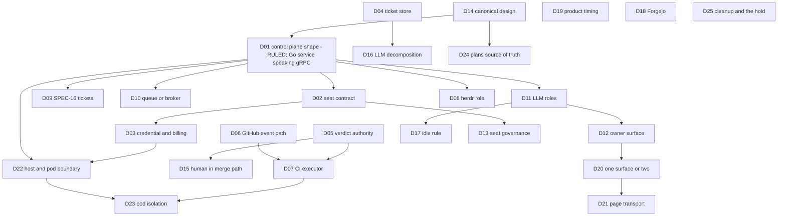

# 03 - Decisions the owner has to make

Lead deliverable of step R-01 of the Factory Rebuild investigation.
Finished 2026-10-14T03:17Z (UTC) by the merge seat; revised 2026-10-14T03:45Z to close the completeness critic's gaps (D20 to D25 and section 29 added; D01, D10, D12 and D19 amended).
Revised again by the merge editor to record the owner's ruling on D01 (a Go service speaking gRPC, 2026-10-14T03:28Z); D09, D10 and D22 now name what that ruling leaves open.
One decision per entry.
Each entry has the question, two to four options with what happens under each, the recommended option with the reason, the evidence, and what it depends on.
Area files are cited by id (L01 is `L01-line-scripts.md`, and so on); root causes are cited as RC1 to RC9 from `01-ROOT-CAUSES.md`.
These are inputs to the design document; nothing here is started before the owner's GOFACTORY signal (`~/.claude/history.jsonl` line 21028, 2026-10-14T02:52Z).

## Contents

1. Status code map for this register
2. Dependency order (mermaid)
3. D01 Control plane shape (RULED 2026-10-14: a Go service speaking gRPC)
4. D02 Seat contract
5. D03 Seat credential and billing
6. D04 Where tickets and their status live
7. D05 Where a gate verdict lives
8. D06 How GitHub events reach the system
9. D07 CI executor
10. D08 herdr's role and version
11. D09 The SPEC-16 Go scheduler and its 14 build tickets
12. D10 Durable queue or broker
13. D11 Which LLM roles remain
14. D12 Owner surface: who produces cards and who reads messages
15. D13 Seat governance layer and the build-mode switch
16. D14 The canonical design document
17. D15 Human in the merge path
18. D16 May an LLM decompose work into tickets
19. D17 The one-minute idle rule
20. D18 Forgejo now or later
21. D19 Product work before the line runs itself
22. D20 One owner surface or two: bearings and the execution rail
23. D21 Page transport: polling or push
24. D22 Which steps stay on the WSL host and which go to pods
25. D23 Factory pods on a shared cluster: isolation and quota
26. D24 Google Drive or the repository as the source of truth for plans
27. D25 Is the cleanup in `04-UNLANDED.md` exempt from the GOFACTORY hold
28. Questions recorded as assumptions or out of scope
29. Sources

## 1. Status code map for this register

| Code       | Meaning                                                                 | Who acts                                                       |
| ---------- | ----------------------------------------------------------------------- | -------------------------------------------------------------- |
| OPEN       | The owner has not answered                                              | Owner, on the bearings page, one card at a time                |
| RULED      | The owner answered; the answer is recorded as a record before any build | Architect records it, system reads it                          |
| BLOCKED-ON | Cannot be answered before another entry is ruled                        | Owner answers the named entry first                            |
| SUPERSEDES | Ruling this entry overturns a locked decision named in it               | Architect updates `ROADMAP.md` locked table and the graph node |

Every entry below is OPEN except D01, which the owner RULED on 2026-10-14T03:28Z (section 3).
The D01 ruling is recorded here and must also be posted as a ruling record before any build reads it (memory note "Rulings a gate checks are records").

## 2. Dependency order

D14 is drawn first because the design that the build follows must be one document; D01 is the first decision of substance, and it is now ruled, so its edges show what it unblocks.

## 3. D01 Control plane shape

Status: RULED by the owner, 2026-10-14T03:28Z: the control plane is a Go service speaking gRPC (the ruling text as relayed to the merge editor; the owner's own words follow).
Owner words, `~/.claude/history.jsonl` line 21069 (03:28:03Z): "thats why a system like GO is good for this shit, it handles this, agents and huamns dont"; line 21070 (03:28:12Z): "grpc for the win!".

What the ruling settles:

- The driver is a deterministic Go service, not an agent, a human or a bash loop; that is the shape of B's Go sub-choice and of A, and it matches the owner's earlier "GO gprc central system ... that drives everything" (2026-09-21T01:23Z, L14 section 2).
- Its interface is gRPC; the existing contract is `scheduler/api/scheduler/v1/scheduler.proto`, two services over unix sockets, `Executor` (Run, Health) and `Scheduler` (Health, Status, Reload, Drain, Retry), with no streaming (lines 1-30, L14 section 4.1), and the `internal/core` interfaces and testkit beside it.
- C, a cluster workflow engine as the control plane, is closed; Argo stays available only as an executor the Go service submits to, as the last Why bullet below already allowed.
- D is closed for Optio; I03 records Sortie as a single Go binary (I03 section 4.3) but not whether it speaks gRPC, so it stays a reference, not a candidate, unless the design shows it does.

What the ruling leaves open, each as its own entry:

- Scope, the full SPEC-16 build (A) or the small reconciler cut on the SPEC-16 skeleton (B): D09.
- The durable store the service owns, for work and claims: D10, with the ticket store in D04.
- Placement, the service on the WSL host or in a cluster pod, and which steps it runs where: D22.

The options and the recommendation below are kept as the record the ruling was made against.

Question: what drives the factory, from a ticket being ready to its merge and verification, so that no agent or human is on the critical path?

Options:

- A. Finish the SPEC-16 Go scheduler as designed: eleven domain specs, fourteen build tickets, a container and a host executor joined by a unix-socket gRPC, a shadow cut-over.
  What happens: the design is the owner's ruled "end state" (L14 section 3.1), but only the wave-0 skeleton exists (1,468 hand-written lines, `version` is the only subcommand), the fourteen tickets have never started, and the line keeps running on bash and agents until the whole of it is done (L01 F14; L14 section 4.1).
- B. One small reconciler on the host, in the shape of OpenAI's Symphony spec: one loop under one systemd user unit, one authoritative store, a level-triggered pass every tick that compares open work with live workers, an address check before any dispatch, bounded retry with backoff and one escalation record, a stall timeout, concurrency caps from config, and the existing scripts (`merge.sh`, `verify-main.sh`, `claims.sh`, `wo-start.sh`, `gate.sh`, `board.sh`) as its actions; seats start as headless one-shot runs (D02); Make is the entry and static-DAG layer: "bring the line up", "start a ticket", "seat a worker", "merge" and "verify main" become Make targets with real prerequisites, each recipe calls the existing script, `.DELETE_ON_ERROR:` is set, stamps live under the state root, and the reconciler calls the same targets, so the owner's "i love driving automation with make files" (brief section 1) drives the line itself and not only lint and images (L01 F9; S03 F6, section 8 item 1; build item BI04 in `00-INVENTORY.md`).
  Language sub-choice: Go, reusing the SPEC-16 core interfaces and testkit (`Ledger`, `Executor`, `Clock`, fake clock and executor), cut to config, ledger and intake, job with retries, and executor verbs.
  What happens: the agent triggers in RC1 and the one-shot wakes in RC2 disappear in the first slice, no ingress decision is needed, nothing new is installed on the cluster, and the work is about four packages rather than fourteen tickets.
- C. A cluster workflow engine: install Argo Workflows and Argo Events with a JetStream bus; each ticket is a Workflow of pods, including headless agent pods; herdr stays only for the owner to watch.
  What happens: DAG, retries, timeouts, semaphores and exit handlers come declared (S01 section 4), but both are new installs with no resource requests on three Pis already running Jenkins, Argo CD, Vault and Longhorn (S01 section 5), Argo Events cannot receive GitHub webhooks until D06 is answered, no evidence was found of anyone running Claude Code or Codex as an Argo step (S01 section 5), and agent pods need an API key (D03).
- D. Adopt an open-source control plane: Optio on Kubernetes, or Sortie as a single binary.
  What happens: a reconciler, leases and auto-merge arrive ready, but Optio brings PostgreSQL and Redis and one API replica, both are 91 to 98 percent one author, and neither knows this repository's records, routes or seats (I03 sections 4.3 and 5 F7).

Recommended: B.
Why:

- Every action the line needs already exists as tested code; what is missing is the driver, and B is exactly a driver (RC1; L01 section 8 item 3; L05 section 8).
- B is the field's proven shape: a deterministic daemon that polls, reconciles before dispatch, kills stalled runs and retries with a capped backoff, with the agent only inside the node (I01 section 4.2; I02 section 4.4; I03 section 4.3).
  Symphony is published to be reimplemented (I01 section 8).
- Reconcile, not events, is what survives contact in the field: "Events make it fast; reconciliation makes it true" (I03 F3; S03 section 8 item 3), so B does not wait on the unanswered ingress question (D06).
- Writing it in Go on the existing SPEC-16 skeleton honours the owner's "lite weight Go" preference and Drive doc 31 ("Keep protocol handling, polling, retries, filtering and state transitions deterministic", L14 section 4.6) without a bash loop as control plane, which failed silently in rime and stable (L09 section 9).
- A is the same idea at roughly three to four times the scope, and the owner's Go control-plane designs have failed to get built five times because the builder was the line they were meant to replace (L14 sections 2 and 5.3).
- C remains the next step for pod-able work once D03 and D06 are ruled; B's actions can later submit Argo Workflows without changing the reconciler's contract.
  Cost: B stays on the WSL host, whose PC had eleven bugchecks between 2026-07-24 and 2026-09-11 (L10 section 5.3); it is mitigated by systemd supervision and by not depending on panes (D08), not removed.
  B must be built by the rebuild's own deterministic workflow (brief section 2), not by the old line.

Evidence: RC1, RC2, RC5; L01 F1, F2, F12, F14; L13 section 5; L14 sections 4.1, 5.3, 8; S01 section 5; S03 F3; I01 section 4.2; I03 sections 4.3, 5 F3, F9.
SUPERSEDES: nothing by the owner's ruling itself, which keeps the SPEC-16 ruling's Go and gRPC (ruling lvvtd, L12 section 2); B as recommended would supersede that ruling in scope, not in language, and that scope question is now D09.

## 4. D02 Seat contract

Question: is a seat an interactive Claude Code TUI in a herdr pane woken by typed prompts, or a bounded run that ends in a machine-readable result?

Options:

- A. Keep interactive TUI seats (today).
  What happens: the brief stays a typed prompt, the trust-file writer, the ACK nudge and the compaction guard stay, completion stays self-reported, and a wake to a busy or absent seat is still lost (S04 section 5; RC4).
- B. Headless one-shot runs: `claude -p` with the brief as argument, `--settings` rendered from the role, `--permission-prompts none`, `--max-turns`, `--max-budget-usd`, `--json-schema` for the seat result, `--output-format json`; the launcher turns the result into the record, so a seat that dies still yields a `blocked` record; a follow-up is a new run that resumes by session id.
  What happens: no trust dialog, no nudge, no typed brief, no idle state, and cost, turns and terminal reason arrive as data (S04 sections 4.1 and 8 item 1).
- C. Background sessions with `claude --bg`, supervised by Claude Code's own supervisor and read through `claude agents --json`.
  What happens: the owner can attach and watch; state is reported as working, blocked, done, failed or stopped; the supervisor stops an idle unattached session after about an hour (S04 section 4.1).
- D. The Claude Agent SDK as the driver, with hooks, `can_use_tool` and `session_store` in code.
  What happens: the most control, and the most code the owner must write (S04 section 8 item 2).

Recommended: B, with C allowed where the owner wants to attach to a seat.
Why: every surveyed worker is a bounded process whose result the harness returns (S04 section 2); B removes the three mechanisms that exist only because the seat is interactive (S04 section 9 item 1); the owner's "a seat exists only between its input and its output" rule is then true by construction (L06 section 8).
Cost: no human-watchable TUI by default, and the Agent SDK has no session timeout, so the reconciler (D01) supplies the wall-clock deadline (S04 section 5 item 8).

Evidence: RC4; S04 sections 4, 5, 8, 9; L04 section 9; L11 F10, F13; I01 section 8.

## 5. D03 Seat credential and billing

Question: which credential do unattended seats run on?

Options:

- A. The owner's Claude subscription with `claude setup-token`, without `--bare`, and with the user layer cut by `--settings`, `--setting-sources project` and `--strict-mcp-config`.
  What happens: no new bill; spend is not capped exactly; whether `--setting-sources` also drops user plugin hooks is untested (L11 F1); a subscription can run out, which stopped rime for 53 hours (L09 section 5.2).
- B. An Anthropic API key with `--bare`, `--max-budget-usd` and per-run caps.
  What happens: exact spend caps, no hooks or plugins load, seats can run in pods; spend is billed per token (S04 section 10; S01 section 10).
- C. Subscription for host seats now, API key required before any seat moves into a pod.
  What happens: the first slice runs on the current login with no new bill; the move to pods (D22) carries the billing change with it, and spend caps become exact only for pod seats.

Recommended: C.
Why: D01 B runs on the host, so the first slice needs no new credential; a pod seat cannot use the subscription in bare mode (S01 section 10), so the API key becomes required exactly when pods are used.
The evidence cannot settle the billing choice; it is the owner's call (S04 section 10 question 1).

Evidence: S04 sections 8 item 1 and 10; S01 section 10; L11 F1, F9; L09 section 5.2.

## 6. D04 Where tickets and their status live

Question: where do tickets and their status live, given that status in git is read from the main checkout and every cut is a PR?

Options:

- A. Keep tickets in `work-orders/` in git with a status field, cut as PRs (today).
  What happens: cut PRs stay (38 of 142 merged PRs, 21 carry branches), start residue keeps dirtying the checkout, and 132 seat refusals per day from status read on main continue (L05 sections 5 and 9; L02 section 5 item 5).
- B. Ticket body in git, status in a store the system writes, set by the merge event.
  What happens: status stops lagging and stops dirtying the checkout; cuts still need PRs.
- C. Whole tickets in the state root as the system's work store, rendered to a read-only view; only code changes are PRs (the direction of ROADMAP item F and A4, L05 section 7).
  What happens: no cut PRs, no carry branches, no residue; the work-order skill must be re-homed off its single-checkout assumptions (L11 F4).
- D. GitHub issues as the ticket system (card C14 moved the backlog there).
  What happens: one public ledger; today no merge has ever closed an issue (0 of 142, L05 section 5 item 6), and status would be read over the network on every tick.

Recommended: C.
Why: every symptom in RC3 traced to tickets (refusals, residue, carry branches, close PRs) comes from status being a file on a branch; the field's stable systems keep one authoritative store (I02 section 5.3, Gas Town's fix; Symphony reads the tracker as truth, I01 section 4.2); C keeps the work-order concepts (closed status set, dependency graph, evidence gates) that L11 section 8 says are sound.

Evidence: RC3; L02 sections 5 item 5, 7, 10; L05 sections 5, 7, 10; L11 F4; I02 section 5.3.

## 7. D05 Where a gate verdict lives

Question: is the authority for "this head passed test and review" the record log or GitHub's commit status?

Options:

- A. Records in the state root (today; `merge.sh` reads `test.passed` and `review.passed` records).
  What happens: GitHub cannot refuse a merge, and the verdict is invisible outside the line (L05 section 5 item 8).
- B. GitHub commit status `coq/gate` on the head sha is the authority and a required status check on `main`; records are derived notifications.
  What happens: a merge without a green gate is refused by GitHub itself; the agent can read the verdict and cannot edit it.
- C. Both independently.
  What happens: two sources of truth, which is what the owner's files changed three times in 24 hours (L06 section 5.8).

Recommended: B.
Why: a factory closes its loop when correctness is "a number the agent can read but not change" (I03 F8a); B makes the merge rule enforceable by the forge and ends the three-way drift (L06 section 5.8); it is what the CI gate design already assumes (L07 section 8).

Evidence: RC3, RC7; L02 section 10 question 2; L06 section 5.8; L07 sections 5 and 8; L11 section 5.1 item 4; I03 F8a.

## 8. D06 How GitHub events reach the system

Question: GitHub cannot reach the home LAN; how do pushes, PRs and statuses reach Jenkins and the reconciler?

Options:

- A. Public ingress: route webhooks through the existing Lightsail VPS and WireGuard path to HAProxy.
  What happens: real webhooks for Jenkins and later Argo Events; a public endpoint must be secured; GitHub still does not redeliver a missed delivery (L10 section 6 notes; S01 section 5).
- B. Outbound-only: `gh webhook forward` on the host, or Actions Runner Controller runners that dial out.
  What happens: no inbound port; the forwarder is one more process that can die silently, and ARC is a second CI path (S02 section 8).
- C. A deliberate poll named as a poll, run by the reconciler every tick against GitHub, with webhooks added later only as accelerators.
  What happens: correctness never depends on a delivery; latency is one tick; Jenkins already polls in 0.37 s per check (S02 B3).

Recommended: C now, A later as an accelerator.
Why: GitHub does not redeliver failed webhooks and Argo Events cannot fetch them back, so a reconciler is needed under any event path (S01 section 5); the field accepts a poll as the correctness path when an event path only makes it faster (I03 section 6 lessons).

Evidence: RC7; S01 sections 5 and 10; S02 B3 and section 10; L07 section 10; L10 sections 5.2 and 6; I03 F3.

## 9. D07 CI executor

Question: which engine runs test pods and posts `coq/gate`?

Options:

- A. Keep Jenkins and fix it as code: register `coq-ci` by JCasC, make the job multibranch, pin the image, set resources, move `JENKINS_HOME` off the owner's PC onto Longhorn, run suite pods in their own namespace with no secret access, replace the `make lint` unit, and set the Blueprint budget from measurement.
  What happens: the four gates between the repo and a first green `coq/gate` close with configuration, not a rewrite (S02 B1 to B7 and section 8).
- B. Install Argo Workflows and run the suites as a WorkflowTemplate.
  What happens: declarative retries and semaphores; a second engine next to a Jenkins that serves 27 other jobs (S01 section 10; S02 section 5).
- C. Tekton with Pipelines-as-Code.
  What happens: reproduces the inbound-webhook gap exactly (S02 section 8).
- D. Actions Runner Controller self-hosted runners.
  What happens: no inbound webhook needed; a public repository bills no minutes on self-hosted runners; the owner earlier rejected Actions on cost (S02 section 8).

Recommended: A.
Why: the CI design, the pod spec and the ladder are sound (L07 section 8), and every defect found is setup that was never turned into code (RC7; L10 section 5.5).
Cost: Jenkins stays a shared pet until JCasC and storage move; the floating image and `cluster-admin` binding are fixed in the same work (L10 section 9).

Evidence: RC7; L07; L10 sections 5 and 9; S02 sections 5 and 8; S01 section 10.

## 10. D08 herdr's role and version

Question: what is herdr in the rebuilt factory?

Options:

- A. Keep herdr as terminal, service host, bus, state source and supervisor, pinned at 0.9.0 (today).
  What happens: one crash takes everything down again (RC6).
- B. herdr is the owner's window only: seats may attach a pane for watching, every system process runs under its own systemd user unit with a memory limit, herdr moves to 0.9.4 through a planned stop and restore (not `--handoff`, upstream issue 4972), and seat state comes from hooks (`pane.report_agent`) and `events.subscribe`, never from screen reads.
  What happens: a herdr crash costs the view, not the line; the pin for a removed API goes (L04 sections 8 and 9).
- C. Drop herdr from the line entirely; seats are headless and the owner watches through `claude agents` and the page.
  What happens: simplest; loses the owner's one visible surface onto running agents (L04 section 4.1).

Recommended: B.
Why: herdr does what nothing else here does (agent state detection, one owner-visible surface, PTY persistence) and is fragile only as a control plane (L04 section 10); the owner's September stable already ran this split and survived two crashes (L04 section 5.2).

Evidence: RC6; L04 sections 4, 5, 8, 9, 10; L06 section 5.2; L08 section 5 item 4; I03 F5.

## 11. D09 The SPEC-16 Go scheduler and its 14 build tickets

Question: what happens to the fourteen ready SPEC-16 tickets and the nine domain specs on the unmerged design branch?

Since the D01 ruling (a Go service speaking gRPC, 2026-10-14T03:28Z), this entry also carries D01's open scope question: the full SPEC-16 build, or the small reconciler cut on the same proto, interfaces and testkit.
The ruling fits A and B equally; it does not pick between them.

Options:

- A. Build them as written.
  What happens: about a week of rebuilding intake, routing, retry and health (L14 section 9).
- B. Cancel the fourteen, keep the proto, `internal/core` interfaces and testkit, and re-cut only the packages D01 B needs.
  What happens: about four small packages are cut in their place; the design branch is kept only for the files those packages take, then deleted (L05 section 9).
- C. Freeze them untouched until the D01 slice runs, then decide.
  What happens: nothing is lost and nothing is built; fourteen ready tickets stay in the queue as noise until the re-verdict.

Recommended: B, the reconciler cut, because D01's recommended B is the scope the evidence supports; C if the owner rules the full SPEC-16 scope is to wait for the first slice.
Why: the skeleton's interfaces and fake clock are the useful part; the rest re-implements what the reconciler or Argo gives (L14 section 8); "any further Go control-plane design document before one Go piece runs" is on the kill list (L14 section 9).

Evidence: L14 sections 4.1, 5.1, 8, 9; L01 F14; L03 section 5.2; L05 section 9 (design branch kept until the tickets land).

## 12. D10 Durable queue or broker

Question: does the factory need a message broker for wake-ups?

Since the D01 ruling, this is the durable store question for the Go service: what it claims work from and records attempts in; the ruling does not answer it.

Options:

- A. No broker: one store on the host (the claim-by-rename board or a SQLite file in WAL mode with `UPDATE ... RETURNING`), with the reconciler as the redelivery.
  What happens: atomic claim, retry counter and dead state with no daemon; host-only (S03 section 8 items 4 and 6).
- B. NATS JetStream, single replica, `sync_interval: always`, with a consumer-metrics probe.
  What happens: broker-owned redelivery verified live (ack wait, max deliver, advisory); no built-in dead-letter queue; needs its own liveness watchdog (S03 sections 4 item 9 and F8).
- C. Temporal.
  What happens: the right model for multi-step durable runs; a database, four services and deterministic-code discipline (S03 F10).

Recommended: A, unless D22 places the Go service on the cluster, in which case use the JetStream that Argo Events brings and no second broker.
Why: the largest failure class is addressing, which a broker stores but does not fix (S03 F3); the owner's own ticket already excluded a second broker (S03 F5).
Question for the owner inside this entry: why was NATS dropped in card C15 on 2026-10-12, weight, operations cost, or because the Go scheduler was to own the bus?
No document records it: `ROADMAP.md:62` and the roadmap ledger line 43 restate the decision with no rationale, and the cancelled ticket's reason line explains only the cancellation (S03 F5, section 10 question 2).
The recommendation holds either way while the control plane is on the host (D01 B): if the reason was "one more daemon", a host-side store keeps that answer; if it was "the Go scheduler owns the bus", the reconciler owns the store instead and the answer is the same.
The reason matters only if D22 places the Go service on the cluster or Argo Events is added as an executor path, where JetStream arrives with Argo Events and the reason decides whether it is used as the bus or only as Argo's internal transport.

Evidence: RC2, RC3; S03 sections 4, 5, 8, 10; L09 section 6.7; S01 section 5.

## 13. D11 Which LLM roles remain

Question: of the eleven roles and two acting orchestrators, which keep an LLM?

Options:

- A. Keep all roles.
  What happens: hand merges (43 of 92) and hand verifies (66 of 66) by LLM seats continue, with the 786 router failure notes of the last 26 hours that came from addressing seats (L13 sections 5.2 and 5.4).
- B. Keep worker, spec-author and the semantic half of reviewer as one-shot runs; the architect rules only through cards with recorded rulings; retire tester, merger, orchestrator, monitor, compliance-officer and the interface-agent seat into code (CI gate, `merge.sh`, the reconciler, probes, the owner lane).
  What happens: an LLM appears only where judgement is needed (writing code, judging a diff, a ruling on a third failure), which is the rule of the owner's own line-ops design (L03 section 4.8).
- C. B, and also retire the architect seat, with rulings as owner cards that fall back to standing-policy defaults.
  What happens: every ruling reaches the owner as a card, and `policy.sh` defaults answer when the owner does not; design work goes to a spec-author run (L06 section 7 item 15).

Recommended: B.
Why: 21 of 25 enumerated LLM decisions already have an existing or designed rule (L13 section 7); the field keeps exactly planner, worker and clean-context reviewer and puts dispatch, claim, stall, retry and merge in code (I02 sections 4.1 to 4.3; I03 section 7).
SUPERSEDES: locked card C12 ("the tester, reviewer and merger seats stay", L03 section 5.4).

Evidence: RC1; L13 sections 5, 7, 9; L06 section 7; L03 section 5.4; I01 section 9; I02 section 9.

## 14. D12 Owner surface: who produces cards and who reads messages

Question: how does the owner's page get its cards and where do the owner's messages go?

Options:

- A. Agents write cards with `make ask` and every message is typed into the architect's pane (today).
  What happens: a decision reaches the owner only if an agent remembers to ask, and the owner's throughput is one agent's attention (L08 section 5 items 1 and 3).
- B. The system lane: the owner lane is wired (`owner_board` configured, the board posts items), cards are built from records by status code, messages are routed by rule to the lane they name, the stable page runs as a supervised service with no idle shutdown, and the page shows its own staleness.
  The owner's 2026-10-14 request for a Factorio-style command-center view of the line (`~/.claude/history.jsonl` lines 21029, 21033, 21037) is a render of this same board data, wireframed and approved through the dev, uat and stable tiers.
  What happens: cards and the health line come from the system, every owner message lands in a lane with a rule-chosen consumer, and the page cannot go stale or stop without saying so.
- C. The interface-agent seat is the single reader and raises only escalations.
  What happens: the architect leaves the raw stream, but the reader is still one LLM seat and its ticket is a draft today (L08 section 5 item 9).

Recommended: B.
Why: the transport already works (median reply 32 s); the defect is one agent reader and agent-only producers (RC9; L08 section 5); the reader code `owner.mjs` is built and needs wiring, not rewriting (L08 section 8).
This entry covers who produces and who consumes; whether bearings is the only owner surface is D20, and how the page receives state is D21.

Evidence: RC9; L08 sections 4, 5, 7, 8, 9; L02 section 5 item 14; L06 section 5.

## 15. D13 Seat governance layer and the build-mode switch

Question: what rules and hooks does an unattended seat load, and how is the rebuild exempted from old rules?

Options:

- A. Seats load the whole user layer (today): about 44k tokens of preamble, user plugins and skills, the architect's memory, user MCP servers with cluster and Jenkins credentials, a global prettier hook.
  What happens: every seat keeps paying the payload, the denials and the contradictions in RC8.
- B. Seats load a repository-owned layer only: settings rendered from the role, `--setting-sources project`, `--strict-mcp-config`, no AutoMem, no user plugins; rules kept as data with one source and rendered; exemptions such as build mode as a flag with an expiry that the gates read (the shape of `herdr/config/exemptions.json`).
  What happens: seat behaviour is decided by the launch command and the repository, and a push to the dotfiles repository no longer changes every seat (L11 F5).
- C. `--bare` with an API key for every seat.
  What happens: no hook, plugin, memory or MCP server loads at all; it requires D03 B for every seat.

Recommended: B (C follows automatically for pod seats under D03 C).
Why: the cost is prose, payload and fences, not hooks (L11 section 5.1); B makes "which layers a seat loads" a property of the launch command (L11 section 8).

Evidence: RC8; L11 F1 to F10, F16, F17, section 8; S04 section 5 item 2.

## 16. D14 The canonical design document

Question: which description of the factory does the build follow?

Options:

- A. SPEC-17 1.0.1 as merged.
  What happens: the build follows a spec that still gives seven line operations to an LLM orchestrator seat (L13 section 5.1).
- B. The SPEC-17 1.1.0 side draft.
  What happens: two loops and a maintenance controller on systemd, frozen out of PR 84 by card C27 and never reviewed against this evidence (L03 section 5.4).
- C. PR 35's factory spec v2.0 export (114 commits behind, conflicting).
  What happens: the build follows a snapshot of roles and routes that no longer exist as written (L03 section 5.5).
- D. A new rebuild design built from the rebuild plan on main (`b7a3c5d`) and this investigation, with SPEC-17's hand-fix inventory H01 to H26 and bring-up B1 to B10 kept as acceptance lists, and PR 35 closed.
  What happens: one document, written design-first with an inventory and a DAG as the owner ordered (`~/.claude/history.jsonl` line 21029), and the three older descriptions become sources.

Recommended: D.
Why: the documents disagree on who verifies main, whether tester and merger seats exist, the bus and the engine (L03 section 5.4); one document is needed before any build ticket is cut (global rule "design first").

Evidence: RC5; L03 sections 4.7, 5.4, 8, 9, 10; L05 section 9 (PR 35 verdict).

## 17. D15 Human in the merge path

Question: does the owner review every pull request before merge?

Options:

- A. The owner reviews every PR.
  What happens: the owner becomes the bottleneck the field measured (review time up 441 percent in one vendor report, I02 section 5.5).
- B. Machine verdict merges: green `coq/gate` plus a reviewer record on the head sha; the owner sees intent through cards and can hold the line.
  What happens: no human waits on the per-PR path; the owner's control is the hold and the cards.
- C. Post-merge only, with pre-deploy tests (Anthropic's internal shape, I01 section 4.2).
  What happens: fastest; the verifier must be near perfect, which the line's red mains on 2026-10-13 show it is not yet (L06 section 5.4).

Recommended: B.
Why: the PR path is already fast (median 47 minutes, L05 section 2); the owner's bottleneck is gating and seats, not human review (I02 section 5.5); Stripe and Symphony keep a gate, Anthropic and OpenAI's harness team do not require one, so B is the middle the evidence supports.

Evidence: I01 sections 4.2 and 10; I02 sections 5.5 and 10; L05 sections 2 and 4.

## 18. D16 May an LLM decompose work into tickets

Question: may an LLM cut tickets from a design?

Options:

- A. Only the owner or the architect cuts tickets.
  What happens: the architect stays a hub for every cut, which the owner halted for overload on 2026-10-14T00:38Z (L06 section 7 item 15).
- B. A spec-author run decomposes an approved design into tickets as data; a validator approves (files declared, acceptance commands run on main with the observed exit code recorded, input and output declared); no approval stamp.
  What happens: cuts stop waiting on the architect, and a ticket whose acceptance cannot run on main is refused before it is cut.
- C. No LLM decomposition; tickets are derived mechanically from the design.
  What happens: stricter than any published system; it needs a design format precise enough to compile into tickets, which none of the owner's specs is today (I02 section 10).

Recommended: B.
Why: the field lets an LLM decompose and keeps dispatch in code (I01 section 5; I02 section 5.9); approval today is a stamp (238 of 238 overrides, L11 F3); rime's lesson R3, run acceptance before cut, was specified and never enforced by code (L09 section 7).

Evidence: I01 sections 5 and 10; I02 section 10; L09 sections 5.2 and 7; L11 F3; L13 D01.

## 19. D17 The one-minute idle rule

Question: how is "no agent sits idle for more than one minute" enforced?

Options:

- A. Keep the idle alarm and the patrol.
  What happens: 350 "PATROL idle" notes in one day; the owner's own research warned an idle alarm teaches agents to invent busywork (L06 section 5.6).
- B. Seats are one-shot runs that end at their output (D02), so an idle seat cannot exist; a run with no event for a stall timeout (Symphony's default is 5 minutes) is killed and retried by the reconciler; capacity that sits unused is a reconciler defect, not a seat defect.
  What happens: the 350 idle notes a day stop because the condition they report cannot occur; stalls are bounded by a timer.
- C. Both.
  What happens: the idle notes continue beside the stall timeout, and the owner page keeps a second, noisier signal.

Recommended: B.
Why: B meets the rule's intent, no idle cog, by construction, and the field alarms on stalls with a bound, not on idleness (I02 section 5.9).

Evidence: L06 sections 5.6 and 9; I02 section 5.9; L13 section 5.7.

## 20. D18 Forgejo now or later

Question: the owner confirmed "forgeo" means Forgejo (`~/.claude/history.jsonl` line 21040); is it adopted now?

Options:

- A. Deploy Forgejo now as the forge and boards; the rime deploy tree is merged and was never applied (L12 section 8).
  What happens: a second system holds board state beside GitHub during the rebuild, on a deploy path with no bound and a hand step (L12 sections 5 and 6).
- B. GitHub stays the forge for the rebuild; Forgejo gets its own design later, off the critical path.
  What happens: the rebuild has one forge; the Forgejo material stays as reference (`04-UNLANDED.md` section 10).
- C. Never.
  What happens: the forge trio, the rime deploy tree and the Drive design are archived.

Recommended: B.
Why: the owner's own words "forgeo is gonna be github" point the forge role at GitHub now (L12 section 2); rime's design for it was "two systems stay in sync instead of one" (L09 section 9); Forgejo's API has no board endpoint and its deploy path has no bound and a hand step (L12 sections 5 and 6).
Detail in `05-FORGEO.md`.

Evidence: L12 and its addendum; L10 section 9; L09 section 9; L15 section 2.1 item 19.

## 21. D19 Product work before the line runs itself

Question: does product work (the game, coq-term) share the line now, or is the line frozen to infrastructure until it runs itself (L06 section 10 question 4)?

Options:

- A. Product tickets resume as soon as the first rebuild slice runs.
  What happens: product work competes with line repair on a line that is not yet proven, which is how rime's product never reached the owner (L09 section 5.2).
- B. The line is frozen to infrastructure until a named exit test passes, for example a day in which tickets start, merge and verify with zero agent line operations and a clean checkout (the Phase 2 exit test of `ROADMAP.md:134`, L05 section 5 item 5).
  What happens: the product waits a known, testable time, and the line proves itself on its own repair work first.
- C. A product lane in parallel now.
  What happens: the line that halted for overload carries two lanes before it carries one.

Recommended: B, with the exit test written into the design.
Why: 0 of the last 60 commits are product (L05 section 4); in rime the product never reached the owner (L09 section 5.2); the owner has already held the line until GOFACTORY.

Evidence: L05 section 4; L06 section 10 question 4 (no file records the owner's choice; roadmap:396 says the game is untouched and about two weeks away); L09 section 5.2.

## 22. D20 One owner surface or two: bearings and the execution rail

Question: is the bearings page the only owner-facing surface, or does a claude.ai artifact (the execution rail) remain a second surface for plans and progress (L08 section 10 question 1; L11 section 10 question 2)?

The rules conflict today, and L11 F2 lists it first of its eight contradictions.
The global file says Getting My Bearings is the only permitted visual surface (`~/.claude/CLAUDE.md`, owner interaction surface rule).
The project's `AGENTS.md` "Law: the surface follows the runtime" (about lines 220 to 245 on `origin/main`) sends a Claude seat to a claude.ai artifact through `report/rail.sh`, and `seat.sh` exports `RAIL_SURFACE=artifact` (L11 F2, row 1).
The rebuild plan on main already ships a rail generator, `rebuild/bin/plan-to-rail.sh` and `rebuild/rail.sh` (commit `b7a3c5d`, PR 182, read by the merge seat at 03:30Z), so the conflict is live for the rebuild itself.

Options:

- A. Bearings only, and the rail is deleted.
  What happens: one surface; the rail's plan, ledger and step model is lost, and the rebuild plan's progress has no view until the board shows it.
- B. Two surfaces, as the project law says: bearings for cards and messages, a claude.ai artifact rail for plan progress.
  What happens: the owner reads two places; the rail needs a manual republish step (L08 section 9), the owner's standard already refuses artifact-link pages for status (`STD-owner-comms-001` `bad[1]`, L08 section 9), and the global rule stays broken by the project rule.
- C. Bearings is the only surface, and the rail's plan, ledger and step model is re-homed as a bearings panel fed from the same files, with no separate publish step.
  What happens: one surface that the system writes, the rail's useful data model survives, `AGENTS.md`'s surface law is rewritten to match the global rule for Claude seats, and the non-Claude exception in the global file is untouched.

Recommended: C.
Why: L08's carry-forward and kill lists reach exactly this ("fold its plan/ledger/step model into the board instead", L08 section 9); the owner asked for one command center that "everything hooks into" (`~/.claude/history.jsonl` line 21033, 2026-10-14T02:55:10Z) and called it "the cmd center, the health dash board, the view" (line 21042, 03:06:11Z); under D02 B no seat publishes a page at all, so the runtime split the project law encodes stops being needed for seats.
SUPERSEDES: `AGENTS.md` "Law: the surface follows the runtime" for Claude seats, and the rail parts of `rebuild/`.

Evidence: L08 sections 3, 9, 10; L11 F2 rows 1 and 2, F3, section 10 question 2; commit `b7a3c5d` file list; owner messages lines 21033 and 21042.

## 23. D21 Page transport: polling or push

Question: does the page keep polling `/state` every 2 seconds, or does the state reach it by push (L08 section 10 question 3)?

Facts: the WebSocket transport the owner accepted in the bearings-v2 requirements was never built; the live page polls every 2 s (`assets/page.html:1213-1245`, L08 section 5); the median owner reply of 32 s is the agent's reply time, not the transport (L08 section 4).
The owner's new bar for the command-center view is that it must be smooth (`~/.claude/history.jsonl` line 21037, 2026-10-14T02:56:56Z) and "visually stunning and perfect" (line 21042).

Options:

- A. Keep 2 s polling for everything.
  What happens: messages and cards are fine; a live map animates in 2 s steps and every open page re-reads the whole state each poll.
- B. Push for everything: server-sent events or WebSocket from the state store, with a full state read on every reconnect so a dropped stream never leaves the page wrong.
  What happens: one transport; the map moves as records land; reconnect-and-resync is the level-triggered safety net, the same shape as D01.
- C. Polling for cards and messages, push only for the command-center map.
  What happens: two transports to build, test and keep in step.

Recommended: B, with the choice between server-sent events and WebSocket made in the design from a measured frame budget.
Why: the owner's smoothness bar cannot be met at 2 s steps, one transport is simpler than two, and resync on reconnect keeps correctness off the stream (I03 F3, "events make it fast; reconciliation makes it true").

Evidence: L08 sections 4, 5, 10; I03 F3; owner messages lines 21037 and 21042.

## 24. D22 Which steps stay on the WSL host and which go to pods

Question: which factory steps must stay on the WSL host and which run as cluster pods (S01 section 10 question 3)?

Since the D01 ruling, this entry also holds the placement of the Go service itself; the ruling names its language and interface, not where it runs.

Options:

- A. Everything on the host (today, and D01 B's first slice; it includes the Go service D01 ruled).
  What happens: no cluster dependency; the host's crash history and one machine's capacity bound the whole line (L10 section 5.3).
- B. The host keeps what needs the real display or a live pane (the Qud player and its window, the herdr owner view, the bearings stable server) plus the reconciler (the Go service D01 ruled) and the seats; every hermetic batch step that fetches by sha (test suites, lint, image builds) runs as a pod; headless seats move to pods only after D03's API key exists.
  What happens: the pod path that is already proven (30 of 31 herdr cases passing in pods, L07 section 4) carries the slow serial work that aborted lint 54 times (L10 section 5.1), and nothing that needs a display is asked to run where it cannot.
- C. Everything that can be a pod moves now, including seats.
  What happens: needs an API key in a cluster secret (D03 B), a pod image with Claude Code, and evidence that nobody has published for running Claude Code as an Argo step (S01 section 5).

Recommended: B.
Why: Argo and pods cannot host herdr panes or the game window (S01 section 9: "herdr for the interactive and Qud-playing parts that need a live pane; Argo cannot host that"); the pod-per-case design is validated (V04 in `02-MAPPING.md`); D03 C already ties seats-in-pods to the credential change.

Evidence: S01 sections 5, 9, 10; L07 section 4; L10 sections 5.1 and 5.3; D03.

## 25. D23 Factory pods on a shared cluster: isolation and quota

Question: may factory job pods run next to the live tenants `resume-star` and `yieldpoint-ai`, and with what fence (L10 section 10 question 3)?

Facts: there is no taint, ResourceQuota or LimitRange on any node; Jenkins' `containerCap` is 10 pods for all jobs; the Jenkins agent Role can read secrets and 9 leaked `kaniko-ghcr-*` secrets sit in the namespace the suite pods run in; Jenkins and most platform pods share `worker-01` (L10 sections 4, 5 and 6; L07 section 4).
An earlier agent program retired `yieldpoint-ai` by mistake and the public site returned 404 for about 29 days with no alert (L10 section 5).

Options:

- A. Share the cluster as today, inside the `jenkins` namespace.
  What happens: nothing to build; a suite storm can starve a tenant, and suite pods keep a path to secrets.
- B. A factory namespace with a ResourceQuota, a LimitRange, a PriorityClass below the tenants, a service account with no secret access, and egress limited to GitHub and GHCR.
  What happens: tenants keep priority, factory pods are bounded and cannot read secrets, and all three Pis stay available.
- C. A dedicated node: taint one of the three Pis for factory pods only.
  What happens: strongest isolation; the factory loses two thirds of the cluster and the tenants lose a third.

Recommended: B, with C only if measured contention appears after B.
Why: B closes the secret exposure and the starvation risk with configuration, it is the same work as D07 A's "suite pods in their own namespace with no secret access" (S02 section 8), and it keeps the capacity that slow serial suites need (L10 section 5.1).

Evidence: L10 sections 4, 5, 6, 9, 10; L07 section 4; S02 B5 and section 8.

## 26. D24 Google Drive or the repository as the source of truth for plans

Question: is Google Drive still the source of truth for plans and designs (L15 section 10 question 1)?

Facts: the 2026-09-21 PROCESS-SEED rule says "Google Drive, immutable and versioned, is the source of truth for plans and documentation ... the repo copy is the fallback" (L15 section 10 question 1, citing the PROCESS-SEED document listed in L15 section 4); the Drive has no factory write after 2026-10-06, so the whole current iteration is absent from it (L15 section 2); the owner's 2026-10-14 order for the spec book is unlimited XML volumes of 1,000 lines or fewer (`~/.claude/history.jsonl` line 21022, 02:48:44Z).

Options:

- A. Drive is the truth and the repository is the fallback (PROCESS-SEED).
  What happens: CI, lint and the reconciler cannot read the truth, and a second copy must be kept in step by hand.
- B. The repository's spec book is the truth, and Drive receives immutable, version-named copies published by a script, as `~/.claude/skills/compaction-guard-publish` already does for the compaction-guard documents.
  What happens: the system reads and checks what it builds from; the owner keeps Drive as a reading and archive surface with no second truth.
- C. Drive becomes an archive only, with no new writes.
  What happens: simplest; the owner loses the Drive copies the PROCESS-SEED habit expects.

Recommended: B.
Why: a gate can only check what it can read, and "two sources of truth kept in sync" is on the kill list (K07 in `02-MAPPING.md`); B keeps the owner's Drive habit as a published output rather than an input.
SUPERSEDES: the PROCESS-SEED source-of-truth sentence (L15 section 10 question 1).

Evidence: L15 sections 2, 4, 10; owner message line 21022; I02 section 5.3.

## 27. D25 Is the cleanup in `04-UNLANDED.md` exempt from the GOFACTORY hold

Question: the owner ordered that nothing be left lying around (`~/.claude/history.jsonl` line 21023, 02:49:18Z) and, three minutes later, that nothing starts again until GOFACTORY (line 21028, 02:52:15Z); does the cleanup run before the signal?

Options:

- A. Not exempt: the cleanup is the first slice GOFACTORY starts, run as one script generated from the `04-UNLANDED.md` tables, with a dry-run output attached to the GOFACTORY card.
  What happens: the later order wins, the owner sees exactly what will be deleted before saying go, and nothing moves while the line is held.
- B. Partly exempt: only steps that change nothing the owner sees and that are reversible run now (backups of the dirty files, fast-forward of the checkout, deletion of branches whose content is on main, closing the seven FIXED issues); everything else waits.
  What happens: some clutter goes now; each step still writes to the repository or GitHub during a hold the owner declared.
- C. Fully exempt.
  What happens: the cut-over of the 5,812 event copies runs during a hold, although its own ticket requires USERHALT and a written rollback (WO-20261012-99d6 - Roadmap A4 - events/ and factory/state leave git: cut over under USERHALT, records copied to the state root, merging main strips events/ from a branch, rollback written).

Recommended: A.
Why: the hold is the later and broader order; the dirty bearings assets are live on the stable page, which is the one always-on owner monitor, so touching them during a hold risks the owner's view; a scripted, dry-run-first cleanup is system-driven, which is what the owner asked for in this step ("we need it driven by system, not agent", brief section 2).
The order of the cleanup steps is in `04-UNLANDED.md` section 12.

Evidence: owner messages lines 21023 and 21028; `04-UNLANDED.md` sections 7 and 12; L08 section 5 item 10.

## 28. Questions recorded as assumptions or out of scope

These area questions were checked against every entry above.
None changes a recommendation today, so each is recorded as a stated assumption with the event that reopens it.

| Id  | Question (source)                                                                                | Assumption or scope                                           | Why it is not a decision now                                                                                                                         | Reopens when                                                                                                                                  |
| --- | ------------------------------------------------------------------------------------------------ | ------------------------------------------------------------- | ---------------------------------------------------------------------------------------------------------------------------------------------------- | --------------------------------------------------------------------------------------------------------------------------------------------- |
| A01 | Is the Claude organisation on a Team or Enterprise plan? (S04 section 10 question 2)             | Assumed no; Claude Code self-hosted environments are not used | They are public beta and only on those plans, and they would add optional vendor-run capacity; D02 B does not depend on them (S04 section 4.1 table) | The owner says the plan is Team or Enterprise and wants a vendor-run queue                                                                    |
| A02 | Will the repository ever become private? (L07 section 10 question 4)                             | Assumed public for the rebuild                                | Pods fetch by sha anonymously and hold no repository credential (L07 section 4); D22 and D23 assume that                                             | The owner makes it private: a read-only credential then enters the pod path, from Vault, and D23 B's no-secret service account is re-designed |
| A03 | Is cloning a third-party commercial product ever a factory workload? (I03 section 10 question 2) | Out of scope                                                  | Nothing in the rebuild depends on it; REA and the Adobe clones are not usable as factory components (I03 F1, F2)                                     | The owner proposes such a ticket; a legal and clean-room ruling is then needed before it is cut                                               |

## 29. Sources

All area files in this directory (list in `01-ROOT-CAUSES.md` section 7), written 2026-10-14 between 02:40Z and 03:02Z.
Owner messages read by the merge seat in `~/.claude/history.jsonl`: line 21022 (02:48Z, spec book), 21023 (02:49Z, everything on main), 21028 (02:52Z, GOFACTORY hold), 21029 (02:53Z, doc design first with DAG, Factorio view), 21033 (02:55Z, command center), 21037 (02:56Z, smooth and 1 to 1 Factorio style), 21040 (03:02Z, forgeo is Forgejo), 21042 (03:06Z, the command center must be visually right).
Owner ruling on D01 read by the merge editor in `~/.claude/history.jsonl`: lines 21069 (03:28:03Z) and 21070 (03:28:12Z).
Repository read by the merge seat at 03:30Z: `git show --stat origin/main` (`b7a3c5d`) and `git show origin/main:AGENTS.md` lines 215 to 250.
