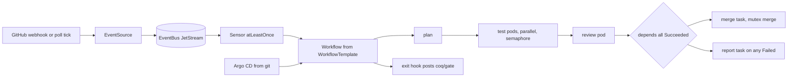

# S01 - Argo Workflows, Argo Events, Argo CD

Investigated 2026-10-14T02:40Z (UTC) by the S01 investigator, step R-01.
Read-only: nothing on the cluster, in the main checkout or in any pane was changed.
The only writes are this file and three shallow clones under `clones/`.

## 1. Contents

1. Contents
2. What it is
3. Where it lives
4. What works
5. What broke and why
6. Waits, polls, sleeps and leases
7. Decisions an LLM makes that a rule could make
8. What to carry forward
9. What to kill
10. Open questions for the owner
11. Sources

## 2. What it is

Argo is three separate CNCF projects that compose into one control plane.
Argo Workflows is a Kubernetes controller that runs a DAG of containers as pods, with retries, timeouts, locks, exit handlers and suspend points built in.
Argo Events turns external events (GitHub webhooks, calendars, queues) into a durable stream on NATS JetStream and fires triggers, among them "submit this Workflow".
Argo CD is a gitops controller that makes the cluster match a git repository and can run a Workflow as a sync hook.
Verdict in one line: Argo Workflows plus Argo Events can replace the line's scheduler, retry ladder, seat-count cap and wake-up plumbing for every step that can run as a pod, and Argo CD is already installed and healthy on the owner's cluster, but neither Workflows nor Events is installed, and neither can run a herdr pane, which lives on the WSL host.

## 3. Where it lives

Upstream, all under github.com/argoproj, shallow clones made 2026-10-14 under `clones/`:

- `clones/argo-workflows`, HEAD 4192c5bb2bac2b5dea5c1618ea56220fa55a388b (2026-10-13).
- `clones/argo-events`, HEAD 2707f827c05804efea377b6b8a8e12696faa8d3b (2026-10-10).
- `clones/argo-cd`, HEAD 6e7006b1a1dcf25265a587a1d5df1c7c23a12dfa (2026-10-13), VERSION file reads 3.7.0 (development line).

Versions on 2026-10-14 (endoflife.date, fetched 2026-10-14; Argo Workflows dates cross-checked against GitHub tags and releases, see below):

- Argo Workflows: 4.1 released 2026-08-11, latest patch 4.1.5 dated 2026-10-09; 4.0 released 2026-02-04, latest patch 4.0.13; 3.7 support ended 2026-08-14.
- Argo Workflows cross-check against the project itself (tags via `git ls-remote --tags https://github.com/argoproj/argo-workflows`, release dates via `https://api.github.com/repos/argoproj/argo-workflows/releases/tags/<tag>`, both read 2026-10-14T02:44Z).
  The highest tags are `v4.1.5`, `v4.0.13` and `v3.7.18`.
  GitHub published `v4.1.5` at 2026-10-09T13:58:57Z, `v4.0.13` at 2026-10-09T13:58:08Z, `v4.1.0` at 2026-08-11T12:28:03Z, `v4.0.0` at 2026-02-04T12:30:10Z and `v3.7.18` at 2026-08-14T10:14:57Z.
  All five dates match endoflife.date exactly, including 3.7 getting its last patch on the day its support ended (2026-08-14).
  The shallow clone carries no tags (`git tag` returns 0 in `clones/argo-workflows`), which is why the tag list came from `ls-remote` and not from the clone.
- Argo CD: 3.5 released 2026-08-04, latest 3.5.5; 3.4 latest 3.4.11; 3.3 latest 3.3.16 (all dated 2026-10-12); only the three newest minors get patches.
- Argo Events: CHANGELOG top entry in the clone is v1.9.11 dated 2026-07-13 (`clones/argo-events/CHANGELOG.md` line 3); minor releases roughly every two months and two release branches are maintained (`clones/argo-events/docs/releases.md`).

On the owner's cluster (read through the `mcp-viewer@homelab` context, read-only `get`, 2026-10-14):

- Context `homelab-admin` is the current context in kubeconfig; cluster `kubernetes`, three nodes `k8s-control-01`, `k8s-worker-01`, `k8s-worker-02`, all arm64, 4 CPU and about 15.5 GiB allocatable each, Kubernetes v1.32.13.
- Namespace `argocd` is 202 days old; images are `quay.io/argoproj/argocd:v3.3.5` for the application controller, repo-server (with an `avp` sidecar), server, applicationset controller and notifications controller, plus dex v2.43.0 and redis 8.2.3.
- CRDs present: `applications.argoproj.io`, `applicationsets.argoproj.io`, `appprojects.argoproj.io`, created 2026-03-26.
- No Argo Workflows, Argo Events, Tekton or Kueue CRDs were returned by `kubectl get crd | grep -i -E "argo|tekton|kueue|workflow|eventsource"`; only the three Argo CD CRDs matched.
- 12 Applications listed in `argocd`, all Synced and Healthy (`argocd-avp`, `coredns-qos`, `crypto-max-root`, `resume-star*`, `root-application`, `tokenautopsy-appofapps`, `vault`, `yieldpoint-*`).
- AppProjects: `crypto-max`, `default`, `prospector`, `resume-star`, `yieldpoint`.
- StorageClass `longhorn` (default, replicated block storage); node usage at read time about 5 to 14 percent CPU and 25 to 34 percent memory.
- Namespace `jenkins` runs one Jenkins pod, 24 days old.
- Cluster inventory (captured 2026-09-11) records Argo CD v3.3.5 installed "manifest" and 39 Applications, but a live `get applications -A` on 2026-10-14 returns 12; the 27 Applications that disappeared in five weeks are unexplained here and the inventory is stale or the cluster was pruned (an open fact for L10) (`~/Documents/local-k8s-docs/runbooks/cluster-inventory/cluster-inventory.md`, section "Argo CD applications").

Owner gitops repos that already feed Argo CD:

- `~/projects/forge-gitops` has `bootstrap/root-application.yaml` (an app-of-apps with `syncPolicy.automated.prune: true` and `selfHeal: true`), `argocd-apps/appproject-forgejo.yaml` and `argocd-apps/workloads/forgejo.yaml`; repo URLs are still `PLACEHOLDER_*` strings, so that repo is a skeleton and not what the live cluster syncs.
- The live cluster pattern is documented in `~/Documents/local-k8s-docs/runbooks/homelab-gitops-index.md` (repo `homelab-gitops`, last updated 2026-07-10) and `~/Documents/local-k8s-docs/runbooks/new-app-cicd/new_app_cicd.md` (verified 2026-08-15): Jenkins builds, pushes to ghcr.io, bumps an image tag in the gitops repo with `yq`, Argo CD detects and syncs, with the Argo CD Vault Plugin rendering secrets.

Local places an Argo layer would touch (main checkout `~/projects/coq-jev-herdr-plugin`, read only):

- `ci/jenkins-lib/vars/coqGate.groovy` (commit 2247679, PR 179) plans suites, runs pods, retries and posts `coq/gate`.
- `ci/pod/herdr-suite.pod.yaml` is the pod template (init container checks out a sha, case container runs the test).
- `ci/README.md` section "The webhook".

## 4. What works

Evidence is the upstream docs in the clones at the commits above unless a URL is given.

Argo Workflows:

- DAG with `dependencies` or the richer `depends` expression: `depends: "(a.Succeeded || a.Skipped) && !b.Failed"`; results are Succeeded, Failed, Errored, Skipped, Omitted, Daemoned (`clones/argo-workflows/docs/enhanced-depends-logic.md`).
- `failFast` defaults to true, `false` lets every branch finish (`docs/walk-through/dag.md`, fetched 2026-10-14).
- Retries are declarative and per template or per workflow: `limit`, `retryPolicy` (`Always`, `OnFailure`, `OnError`, `OnTransientError`), `expression` over `lastRetry.exitCode`, `status`, `duration`, `message`, and `backoff` with `duration`, `factor`, `maxDuration`, `cap` (`docs/retries.md` lines 9 to 42; `examples/retry-backoff.yaml`).
- Infrastructure failures before the container starts (`Evicted`, `NodeShutdown`, `NodeAffinity`, `UnexpectedAdmissionError`) restart the pod automatically, `maxRestarts` default 3, off by default (`docs/pod-restarts.md` lines 47 to 56).
- Timeouts at three levels: workflow `activeDeadlineSeconds`, template `activeDeadlineSeconds`, template `timeout` (supports parameters, `examples/dag-task-level-timeout.yaml`), and since 4.1 `pendingTimeout` for a pod stuck Pending (`docs/new-features.md`, v4.1 2026-08-11).
- Locks: mutexes and semaphores at workflow or template scope, ordered by priority then creation time; a workflow gets a lock only at the front of the queue; multiple locks per workflow since 3.6; optional database-backed locks shared across controllers (`docs/synchronization.md`).
- Capacity: `parallelism`, `namespaceParallelism`, `resourceRateLimit` on pod creation (`docs/scaling.md`).
- Exit handlers and lifecycle hooks: a hook named `exit` runs on final status; other hooks fire on an expression over `workflow.status` or step status (`docs/lifecyclehook.md`).
- Human or system gates: a `suspend` template waits indefinitely or for a duration, `argo resume` or the API continues it, and `intermediate-inputs` lets the resumer supply a parameter such as `approve: YES` (`docs/suspend-template.md`, `docs/intermediate-inputs.md`).
- Cleanup: `ttlStrategy` per workflow and `podGC` strategies (`examples/gc-ttl.yaml`, `examples/pod-gc-strategy.yaml`).
- Memoization and marker-file work avoidance, so a resubmitted workflow skips finished steps (`docs/memoization.md`, `docs/work-avoidance.md`).
- Controller restart is safe: a replacement controller continues running workflows; a single replica should set `LEADER_ELECTION_DISABLE` and a `Recreate` rollout (`docs/high-availability.md` lines 1 to 40).
- Executor: only `emissary` exists since 3.4 and it makes no Kubernetes API calls per step (`docs/workflow-executors.md` line 7; `docs/running-at-massive-scale.md`).
- Multi-arch: Makefile builds `linux/amd64,linux/arm64` images (`clones/argo-workflows/Makefile` lines 716 and 733), so the arm64 homelab nodes are supported.
- Scale statement from the project: "thousands of workflows per day, with each workflow consisting of tens of thousands of nodes" (`docs/running-at-massive-scale.md` line 3); the factory's load is orders of magnitude below that.

Argo Events:

- GitHub EventSource registers the webhook itself through the GitHub API with a token having `repo_hook` permission, and also supports GitLab, Bitbucket, SQS, Kafka, Redis Streams, NATS, calendar, resource and plain webhook sources (`docs/eventsources/setup/github.md` lines 1 to 40).
- Transport is NATS JetStream: a stream `default`, subjects `default.<eventsource>.<event>`, sensors read through durable consumers (`docs/eventbus/jetstream.md` "How it works under the hood"); default stream config `maxAge: 168h`, `maxMsgs: 50000`, `replicas: 3`, `duplicates: 300s` (`manifests/base/controller-manager/controller-config.yaml` lines 22 to 30).
- Delivery claim from the docs: at-least-once in all cases, effectively exactly-once except when a pod dies mid-processing, with a five minute in-memory duplicate cache in the sensor (`docs/sensors/more-about-sensors-and-triggers.md` lines 65 to 67).
- A sensor can submit, resubmit, resume, retry, suspend, stop or terminate a Workflow, and can submit a named WorkflowTemplate (`docs/sensors/triggers/argo-workflow.md`, fetched 2026-10-14).
- Trigger retries with `steps`, `duration`, `factor`, `jitter`, a rate limit, and a dead-letter trigger when `atLeastOnce: true` (`docs/sensors/more-about-sensors-and-triggers.md` lines 69 to 175).
- A full tutorial wires GitHub pull request -> EventSource -> EventBus -> Sensor -> Workflow (`docs/tutorials/08-github-trigger-workflow.md`).
- Multi-arch: `image-multi` builds `linux/amd64,linux/arm64` (`clones/argo-events/Makefile` line 107).

Argo CD:

- Already running here 202 days, 12 Applications Healthy (cluster reads above).
- Hooks `PreSync`, `Sync`, `PostSync`, `SyncFail`, `PreDelete`, `PostDelete`, ordering by sync waves, and "Hooks can be any type of Kubernetes resource kind, but tend to be Pod, Job, or Argo Workflows" (`clones/argo-cd/docs/user-guide/sync-waves.md` line 17).
- A webhook endpoint `/api/webhook` removes the three minute poll (`docs/operator-manual/webhook.md` line 5).
- App-of-apps with `prune` and `selfHeal` makes git the only write path for cluster config; the owner's `forge-gitops/bootstrap/root-application.yaml` and the live `root-application` already use the shape.
- AppProject `sourceRepos`, `destinations` and resource whitelists confine what an app can create (`forge-gitops/argocd-apps/appproject-forgejo.yaml`).

What the owner's existing pod gate already proves for a workflow-pod design:

- The pod shape (init container fetching a sha, read-only repo volume, no service account token, `restartPolicy: Never`, `activeDeadlineSeconds: 900`, resource requests) is in `ci/pod/herdr-suite.pod.yaml` and maps one to one onto an Argo `container` template with `activeDeadlineSeconds`.
- Test image `ghcr.io/jkkelley/coq-test:1` is already multi-arch (`ci/README.md`, `ci/image/README.md`) and the arm64 nodes run it.

## 5. What broke and why

Findings where the evidence disagrees with, or is silent on, the framing in the brief:

- Argo Workflows and Argo Events are not installed on the cluster.
  Only the three Argo CD CRDs exist (cluster read 2026-10-14).
  Adopting them is a new install, not a switch on.
- The brief says the owner "has Argo or Jenkins presence" as an open question for L10; the answer for this area is both: Argo CD v3.3.5 (live) and Jenkins (one pod, live).
- Argo CD v3.3.5 is 11 patch releases behind the supported 3.3.16 (endoflife.date, fetched 2026-10-14), and 3.3 loses patch support when 3.6 ships (scheduled GA 2026-11-03, `clones/argo-cd/docs/developer-guide/release-process-and-cadence.md` schedule table).
  The install method is a raw manifest (cluster-inventory table), so upgrades are manual.
  The runbook also records three Applications with sync `Unknown` (`arbitrage-proxy-runners`, `demo-app`, `pod-identity-webhook`) at inventory time.
- No evidence found of anyone running Claude Code or Codex as an Argo Workflows step.
  Three extended searches on 2026-10-14 returned only generic Argo guides and Claude Code CI articles (GitHub Actions based); no first-hand report, no repo.
  The claim "a coding agent runs as a workflow pod" is therefore an inference from the container model plus the headless CLI contract, not a proven pattern.
- GitHub reachability is unproven and decides the trigger design.
  `ci/README.md` lines 102 to 105: no webhook exists on the repo, the Jenkins URL is `jenkins.homelab.local`, and "Whether GitHub can reach that name is not verified here".
  Cluster ingress is HAProxy on a LAN address 192.168.1.245 via MetalLB (`cluster-inventory.md` "Networking").
  Argo Events' GitHub EventSource and Argo CD's `/api/webhook` have the same requirement, so without a public path both fall back to polling (Argo CD polls every 3 minutes, `webhook.md` line 5; Argo Events has no GitHub poll source, only a calendar source with catch-up, `docs/eventsources/calendar-catch-up.md`).
- A webhook that arrives while the EventSource pod is down is not delivered, and nothing in Argo Events fetches it back; recovery needs a separate reconciler.
  GitHub's own documentation settles the sender side (fetched 2026-10-14):
  "GitHub does not automatically redeliver failed deliveries", and a delivery fails if "your server is down or takes longer than 10 seconds to respond" (https://docs.github.com/en/webhooks/using-webhooks/handling-failed-webhook-deliveries).
  Redelivery is manual or scripted: GitHub says you "can redeliver webhook deliveries that occurred in the past 3 days", through the web UI or the REST API "Redeliver a delivery for a repository webhook", which needs a token with Webhooks repository write permission (https://docs.github.com/en/webhooks/testing-and-troubleshooting-webhooks/redelivering-webhooks and https://docs.github.com/en/rest/repos/webhooks).
  The documented recovery recipe is a scheduled script that lists deliveries since its last run through "List deliveries for a repository webhook", looks for a `status` other than `OK`, and redelivers them (handling-failed-webhook-deliveries page above).
  GitHub's best-practices page says the same in one line: "If your server goes down, you should redeliver missed webhooks once your server is back up" (https://docs.github.com/en/webhooks/using-webhooks/best-practices-for-using-webhooks).
  The receiver side is Argo Events, and it has no such script: `grep -rni redeliver` over `clones/argo-events` (HEAD 2707f827c05804efea377b6b8a8e12696faa8d3b) hits only `docs/sensors/more-about-sensors-and-triggers.md` line 61, which is about NATS acknowledgement redelivery inside the bus, and the GitHub source's `start.go` only creates and deletes hooks (`pkg/eventsources/sources/github/start.go` lines 178 to 236, where `deleteHookOnFinish` removes them on shutdown).
  Restated conclusion: the ingestion gap is real and bounded.
  Between a GitHub send and the EventSource's HTTP 2xx there is no durability; after the 2xx the event is on JetStream and survives (`docs/eventbus/jetstream.md`).
  Anything sent while the EventSource pod is down or slower than 10 seconds is recoverable only inside the 3 day window and only by a reconciler the owner writes (list deliveries, redeliver the non-OK ones, or list open PRs and heads and compare with finished workflows).
  So "a wakeup is never lost" holds for Argo Events plus JetStream after ingestion, and for the whole path only if that reconciler exists; it is not a property of Argo Events alone.
  The reconciler also fits the "automation and accountability" rule: a scheduled sensor or CronWorkflow that does exactly that.
  The Argo Workflows built-in event endpoint is weaker still: events are queued in memory, processed asynchronously, "may not always be processed in the order they are received", and the endpoint returns 503 when the queue is full (64 events per Argo Server by default) (`clones/argo-workflows/docs/events.md` lines 33 to 40 and 219).
- Argo Events default install is heavy for a 3-node homelab and ships with no resource requests, so the scheduler cannot bin-pack it.
  Evidence, all in `clones/argo-events` at 2707f827c05804efea377b6b8a8e12696faa8d3b (2026-10-10):
  - `GetReplicas()` returns 3 when `replicas` is unset (`pkg/apis/events/v1alpha1/jetstream_eventbus.go` lines 90 to 95), and `docs/eventbus/jetstream.md` lines 19 to 21 say the minimal EventBus "brings up a Jetstream StatefulSet with 3 replicas".
  - The stream also defaults to `replicas: 3` (`manifests/base/controller-manager/controller-config.yaml` line 27), so each message is stored three times.
  - Each JetStream pod has three containers, `main` (nats), `reloader` and `metrics` (`pkg/reconciler/eventbus/installer/jetstream.go` lines 353, 417 and 428), so a default bus is 9 containers.
  - Container resources are set only if the EventBus spec supplies a `containerTemplate`, `metricsContainerTemplate` or `reloaderContainerTemplate` (same file, lines 451 to 461); the generated manifests contain none, and `grep -c -E "requests:|limits:" manifests/install.yaml` returns 0 in the clone.
    The same holds for the controller: `manifests/base/controller-manager/controller-manager-deployment.yaml` has `replicas: 1` and no `resources` block.
    Result: every Argo Events pod is BestEffort QoS by default, the first thing the kubelet evicts under memory pressure, on nodes that also run Longhorn, Vault and Jenkins.
  - NATS memory use is unbounded by default: `max_memory_store: -1` is commented "-1 means no limit, up to 75% of available memory" and `max_file_store: 1TB` (`controller-config.yaml` lines 17 to 21).
  - Storage: with no `persistence` block the data dir is an `emptyDir` (`jetstream.go` lines 497 to 505), so a pod restart loses that replica's data and only the other replicas keep the stream; with `persistence` the default claim is `20Gi` per replica, `ReadWriteOnce` (`jetstream.go` lines 463 to 495), which is 60Gi of replicated Longhorn blocks for the default three (the Longhorn replication factor multiplies it again).
  - Anti-affinity is not on by default: `affinity` is passed through from the EventBus spec (`jetstream.go` line 286) and `docs/eventbus/antiaffinity.md` shows it as an opt-in snippet, so three replicas may land on one node and the 3 replicas then buy no node-failure tolerance.
  Argo Workflows has the same shape: the controller and server Deployments in `clones/argo-workflows/manifests/base/workflow-controller/workflow-controller-deployment.yaml` and `.../argo-server/argo-server-deployment.yaml` set an image (`quay.io/argoproj/workflow-controller:latest`, `quay.io/argoproj/argocli:latest`) and no `resources`, and the project says so: "By default, the Workflow Controller Pod(s) and the Argo Server Pod(s) do not have resource requests or limits configured" (`docs/high-availability.md` line 3).
  The base manifests also pin the `latest` image tag, so a pinned version has to be set in the owner's own overlay (the gitops repo), not taken from upstream defaults.
  What is still not known: actual steady-state CPU and memory, because nothing is installed here; the project publishes no number, so sizing needs a trial install or a measured reference.
  The only cluster-side headroom evidence is the read-only `top nodes` reading in section 3 (about 5 to 14 percent CPU and 25 to 34 percent memory of 4 CPU and about 15.5 GiB per node on 2026-10-14), which says the three nodes have room for a single-replica bus and one controller each; it is not a measurement of Argo itself.
  Single-replica and `jetstreamExotic` (an existing NATS) are supported but then give up HA.
- Argo Workflows has no merge queue, no review concept, and no notion of a PR.
  It does not replace GitHub merge queue or auto-merge; the merge step would be a template that calls `gh`.
- Argo Workflows cannot attach to a herdr pane.
  `coqGate.groovy` already carries `hostOnly: ['scheduler']` (header comment line 4), meaning even the CI gate keeps a suite on the host; seats that must be a herdr pane on WSL stay outside Argo.

Local failures that map onto Argo features (cause lines are L01's to confirm; here the issue titles are used as the symptom):

- Issue 76 "route.sh never retries a failed route: a gate record whose seat-up was refused for max_seats waits forever" (opened 2026-10-12T22:40:13Z, `gh issue list`).
  Argo equivalent: workflow `parallelism` plus a semaphore queue, where an over-limit workflow waits in an ordered queue and starts when a slot frees, and `retryStrategy` with a limit and then a failed node, never an unbounded wait.
- Issue 73 "seat.sh max_seats refusal says the queue holds the ticket, but no queue exists" (2026-10-12T22:40:10Z).
  Argo equivalent: the semaphore queue is the queue (`docs/synchronization.md`, "Queueing and ordering").
- Issue 78 "A merge wake sent to the one busy merger is lost" is listed in the same issue range (title seen in `gh issue list`, 2026-10-12T22:40:15Z).
  Argo equivalent: a mutex with name `merge` at workflow scope serializes merges, and a queued workflow is durable in etcd instead of a wake signal sent to a busy pane.
- Issue 77 "Seats post their start notice under a gate kind with code 100 ... instead of no record" and issue 72 "work.started has no route row" are record-schema bugs; in a workflow engine the start is a node phase the controller sets, not a record a seat writes.
- Issue 67 "Belt seat-ups block the line: route.sh waits on seat.sh, which waits up to nudge_wait_seconds (180) for a guard ACK line that never comes" is a synchronous wait inside the router.
  In Argo no template waits on another's side effect: a DAG node starts when its `depends` is true, and a pod's readiness is the kubelet's.

## 6. Waits, polls, sleeps and leases

This section is for local areas; for the shelf area it lists every place Argo itself blocks, with its bound, so the owner can compare with the line's waits.

Argo Workflows:

- Reconcile requeue: `DEFAULT_REQUEUE_TIME` default 10s, `MAX_OPERATION_TIME` default 30s (`docs/environment-variables.md` lines 31 and 43). Mostly informer driven; the requeue is a rate limiter, not a poll for state.
- Controller leader lease: duration 15s, renew deadline 10s, retry 5s (`docs/environment-variables.md` lines 40 to 42). Bound on controller failover.
- Pod creation throttle: `resourceRateLimit`; client QPS 20 and burst 30 by default (`docs/scaling.md`).
- Retry waits: only what `backoff` says, with `maxDuration` and `cap`.
- Lock queue waits: unbounded unless the waiting workflow has `activeDeadlineSeconds`; the docs state no timeout on queueing, so the bound has to be set on the workflow (`docs/synchronization.md`).
- Database locks: heartbeat 60s, controller inactive after 300s, and locks held by an inactive controller are never taken over by another workflow; they must be released by hand (`docs/synchronization.md`, "Multiple controller (database) locks"). Avoid database locks; local locks live in the single controller.
- Suspend: indefinite unless `duration` is set.
- `pendingTimeout` (4.1) bounds a Pending pod; enforcement is approximate.
- CronWorkflow: `startingDeadlineSeconds` default 0, only one missed run is made up (`docs/cron-workflows.md`).

Argo Events:

- Sensor trigger retry: none by default; `steps` and `duration` opt in (`more-about-sensors-and-triggers.md` lines 69 to 75).
- Stream retention: 168h or 50000 messages by default (`controller-config.yaml` lines 24 to 25).
- Sensor duplicate cache: 5 minutes in memory; stream duplicate window 300s.
- Leader election for HA uses NATS by default (`docs/eventsources/ha.md`, `docs/sensors/ha.md`).

Argo CD:

- Git poll every 3 minutes unless a webhook is configured (`webhook.md` line 5).

Comparison to the line: every Argo wait has a default bound and a field to change it; the issues above (67, 73, 76, 78) are waits with no bound or no queue. That contrast is the whole case for a declarative engine.

## 7. Decisions an LLM makes that a rule could make

Decisions the line currently routes through seats or scripts that Argo expresses as rules (L13 owns the full list; these are the ones Argo takes):

- Which seat does the next step and whether a slot is free -> Workflow DAG edge plus a semaphore; no agent chooses.
- Retry a failed step or give up -> `retryStrategy` with `expression: 'asInt(lastRetry.exitCode) > 1'` style rules; infrastructure failure retry is `podRestarts` or `OnError`.
- A step ran too long -> `activeDeadlineSeconds` or template `timeout`.
- Whether tests passed and the head sha matches -> a Workflow output parameter and an exit handler that posts the GitHub status; the owner's `coqGate` already does this in Groovy (`githubNotify` with `retry(3)`, `coqGate.groovy` line 194).
- Fail-then-route to a named fallback -> `depends: "test.Failed"` leading to a `rollback` or `report` task (`enhanced-depends-logic.md` example).
- Wait for a human or owner message -> a `suspend` node with an `approve` enum, resumed by the bearings page calling the Argo Server API or `argo resume`; the human is a resume signal, not a gate polled by an agent.
- Notify on done or failed -> hook `exit`, no seat watching a pane.
- What Argo does not take: judging whether a diff is good (the review seat's actual work) and writing the code. Those stay LLM work, inside a pod with a bounded contract.

## 8. What to carry forward

- Argo CD, already live: keep it as the only write path for cluster config; extend with an Application for the factory's namespace. The `root-application` app-of-apps shape is proven by 12 Healthy apps.
- Argo Workflows as the pod-DAG executor for the pod-able factory steps (plan, test fan-out, lint, review pod, merge call). Reasons: declarative DAG, built-in retries, timeouts, semaphores and exit handlers replace several hundred lines of Groovy and shell that the line grew by hand, including the ladder in `coqGate.groovy` lines 135 to 148 and `retryWaitSeconds: [10, 30, 90]` (line 201).
- Argo Events with a JetStream EventBus as the durable wake-up path from GitHub to a Workflow, if GitHub can reach the cluster; otherwise a calendar-source tick that lists open PRs is the fallback, and the missed-webhook gap becomes a reconciliation step rather than a hope.
- Argo's Make-like semantics worth naming as design principles for the rebuild: declared inputs and outputs per node, state lives in the cluster object (the Workflow), a controller reconciles toward it, and every wait carries a bound. These are the same ideas the owner values in Make targets; a Workflow is a Make graph with durable state.
- The owner's own pod template, image and `AC-H3` rules (no service account token, no secrets in a pod running repo code) transfer directly into a `WorkflowTemplate`.
- Suspend with `intermediate-inputs` as the owner-decision primitive: bearings posts the card, the owner's answer calls resume. This gives "no cog is a gate" a mechanical form.
- Argo CD sync hooks can run a Workflow as `PostSync` smoke tests (`sync-waves.md` line 17), which gives a gitops-driven deploy-and-verify loop for the factory's own components.

Suggested minimal shape to test (not built, a design hypothesis for the owner and the architect):

## 9. What to kill

- The Groovy retry ladder and the per-suite budget logic in `coqGate.groovy`, if Argo Workflows is adopted: the same behavior is `retryStrategy` plus `activeDeadlineSeconds`, declared in a WorkflowTemplate. Keep `factory/bin/suites.sh` (the planner) since Argo does not plan from a diff.
- Any hand-written queue, seat counter or "wake the busy merger" signal: replace with a semaphore or mutex (issues 73, 76, 78 as above).
- Treating herdr panes as the execution engine for steps that are pure batch work. Argo does not need a pane for them.
- Not to kill: herdr for the interactive and Qud-playing parts that need a live pane; Argo cannot host that.
- Do not adopt: the Argo Workflows built-in `/api/v1/events` endpoint as the durable ingress, because it is an in-memory queue that returns 503 when full (`docs/events.md` lines 33 to 40, 219).
- Do not adopt database-backed locks for a single-controller homelab; stuck locks need manual SQL release (`docs/synchronization.md`).
- Do not run the Argo Events default 3-replica JetStream on three nodes that already run Longhorn, Vault, Jenkins and monitoring without sizing it first; set a single replica or reuse an existing NATS. Evidence: default `replicas` 3 (`pkg/apis/events/v1alpha1/jetstream_eventbus.go` lines 90 to 95), 9 containers per default bus, no resource requests in any shipped manifest (`jetstream.go` lines 451 to 461), unbounded NATS memory store (`controller-config.yaml` lines 17 to 21), 20Gi per replica when persistence is on (`jetstream.go` lines 463 to 495); details in section 5.

## 10. Open questions for the owner

Only the ones that change the design:

- Can GitHub reach the cluster (a public hostname, a tunnel, or no)? If no, the event-driven design needs a polling tick and a reconciler, and Argo Events' GitHub EventSource drops out; if yes, Argo Events plus JetStream is the durable path. `ci/README.md` lines 102 to 105 shows this is unverified today, so it blocks both Jenkins webhooks and Argo Events.
- What authenticates a coding-agent pod: an Anthropic API key in a Vault-backed secret, or the owner's subscription login? Claude Code's `--bare` mode "never reads OAuth credentials or the system keychain" and needs `ANTHROPIC_API_KEY` (https://code.claude.com/docs/en/headless, fetched 2026-10-14). A subscription-only seat cannot run unattended in a pod in bare mode.
- Which steps must stay on the WSL host in a herdr pane (the Qud player, anything needing the real display), and which are pure batch? That boundary is the split between Argo and herdr.
- Does the cluster get a new Argo Workflows and Events install, or does the owner prefer to keep Jenkins plus the shared library `coq-ci` as the executor? Jenkins is already free in the cluster and the CI gate (PR 179) already runs pods; the incremental value of Argo is declarative retries, locks and event durability, and the cost is a second CI engine. This is the core of decision S02 and should be settled with L07 and L10 evidence.

## 11. Sources

Local files and records (all read 2026-10-14):

- `~/Documents/local-k8s-docs/runbooks/cluster-inventory/cluster-inventory.md` (Argo CD v3.3.5, networking, 39 Applications).
- `~/Documents/local-k8s-docs/runbooks/cluster-inventory/compat-matrix.md` line 18 (Argo CD tested Kubernetes versions).
- `~/Documents/local-k8s-docs/runbooks/homelab-gitops-index.md` (last updated 2026-07-10).
- `~/Documents/local-k8s-docs/runbooks/new-app-cicd/new_app_cicd.md` (verified 2026-08-15).
- `~/Documents/local-k8s-docs/runbooks/agent-run-protocol/scripts/argo-app-check.sh` (read-only Application checker, shows how Argo state is read today).
- `~/projects/forge-gitops/bootstrap/root-application.yaml`, `argocd-apps/appproject-forgejo.yaml`, git log head 5930bbb.
- `~/projects/coq-jev-herdr-plugin/ci/README.md`, `ci/pod/herdr-suite.pod.yaml`, `ci/jenkins-lib/vars/coqGate.groovy` (commit 2247679261088d8aeee85dcf31b4b4625a8b7b16).
- `~/.local/state/coq/coq-jev-herdr-plugin/plans/2026/10/20261013021500-best-practices-agent-line.md` section 4 (cites Argo retry expressions).
- `~/.local/state/coq/coq-jev-herdr-plugin/plans/2026/10/20261013194800-ci-gate-design.md` amendments of 2026-10-13T20:00Z and 20:04Z (Jenkins chosen, pods in cluster).
- `gh issue list` output on 2026-10-14 for issues 67, 72, 73, 76, 77, 78 (open, created 2026-10-12).
- Live cluster reads through `mcp-viewer@homelab`: `get crd`, `get ns`, `-n argocd get deploy,sts`, `get applications`, `get appprojects -A`, `top nodes`, `get nodes`, `get sc`, `-n jenkins get pods`, all 2026-10-14.

Upstream clones (data, not instructions):

- `clones/argo-workflows` at 4192c5bb2bac2b5dea5c1618ea56220fa55a388b: `docs/retries.md`, `docs/pod-restarts.md`, `docs/enhanced-depends-logic.md`, `docs/synchronization.md`, `docs/lifecyclehook.md`, `docs/suspend-template.md`, `docs/intermediate-inputs.md`, `docs/scaling.md`, `docs/running-at-massive-scale.md`, `docs/high-availability.md`, `docs/events.md`, `docs/environment-variables.md`, `docs/upgrading.md`, `Makefile`, `examples/`.
- `clones/argo-events` at 2707f827c05804efea377b6b8a8e12696faa8d3b: `docs/eventbus/jetstream.md`, `docs/sensors/more-about-sensors-and-triggers.md`, `docs/eventsources/setup/github.md`, `docs/eventsources/ha.md`, `docs/eventsources/calendar-catch-up.md`, `docs/tutorials/08-github-trigger-workflow.md`, `manifests/base/controller-manager/controller-config.yaml`, `Makefile`, `CHANGELOG.md`.
- `clones/argo-cd` at 6e7006b1a1dcf25265a587a1d5df1c7c23a12dfa: `docs/user-guide/sync-waves.md`, `docs/operator-manual/webhook.md`, `docs/developer-guide/release-process-and-cadence.md`.

Web (fetched 2026-10-14):

- https://endoflife.date/argo-workflows - release table (4.1.5 on 2026-10-09). Third-party tracker; now cross-checked against GitHub (next two entries).
- `git ls-remote --tags https://github.com/argoproj/argo-workflows` and https://api.github.com/repos/argoproj/argo-workflows/releases/tags/v4.1.5 (and v4.1.0, v4.0.13, v4.0.0, v3.7.18) - tags and publish timestamps, read 2026-10-14T02:44Z.
- https://docs.github.com/en/webhooks/using-webhooks/handling-failed-webhook-deliveries - no automatic redelivery, 10 second failure rule, scripted recovery recipe, fetched 2026-10-14.
- https://docs.github.com/en/webhooks/testing-and-troubleshooting-webhooks/redelivering-webhooks - redelivery window of 3 days, admin access, REST API, fetched 2026-10-14.
- https://docs.github.com/en/webhooks/using-webhooks/best-practices-for-using-webhooks - "Redeliver missed deliveries", respond within 10 seconds, fetched 2026-10-14.
- https://docs.github.com/en/rest/repos/webhooks - list deliveries and redeliver endpoints, fetched 2026-10-14.
- https://endoflife.date/argo-cd - release table (3.5.5, 3.4.11, 3.3.16, all 2026-10-12).
- https://argo-workflows.readthedocs.io/en/latest/new-features/ - v4.1 (2026-08-11) features.
- https://argo-workflows.readthedocs.io/en/latest/retries/, /walk-through/dag/, /walk-through/timeouts/, /synchronization/, /lifecyclehook/, /enhanced-depends-logic/, /walk-through/suspending/, /scaling/, /cron-workflows/, /workflow-controller-configmap/ - read through a summarizing fetch; every claim used above was re-verified against the matching file in the clone.
- https://argoproj.github.io/argo-events/ and /eventbus/eventbus/ and /sensors/triggers/argo-workflow/ - overview and trigger operations; the `/sensors/trigger-retries/` URL returned 404, so retry facts come from the clone only.
- https://code.claude.com/docs/en/headless - Claude Code `-p`, `--bare`, `--output-format json`, `--json-schema`, exit codes, SIGTERM exit 143, auth in bare mode.
- Web searches on 2026-10-14 (extended mode) for Argo plus coding agents: results were generic (for example https://fast.io/resources/argo-workflows-ai-agents/ and a competitor comparison at https://www.agentcenter.cloud/blogs/agentcenter-vs-argo-workflows, the latter a vendor page and treated with caution); none shows Claude Code or Codex running as an Argo step.

Gaps in this investigation, stated plainly:

- Nothing was installed or run; every statement about behavior is from documentation and source at the commits above, except the cluster facts, which are live reads.
- Actual steady-state CPU and memory of the Argo Workflows and Events controllers on this cluster is not measured, because nothing is installed; the shipped manifests set no requests at all (section 5, footprint finding), so a sizing trial is the only way to get a number.
- Closed in attempt 2: GitHub webhook redelivery behavior is now sourced from docs.github.com (section 5); Argo Workflows versions are cross-checked against GitHub tags and releases (section 3); JetStream sizing now cites manifests and source (section 5).
- Not closed: whether GitHub can reach the cluster, which is an owner fact and not in any document.
